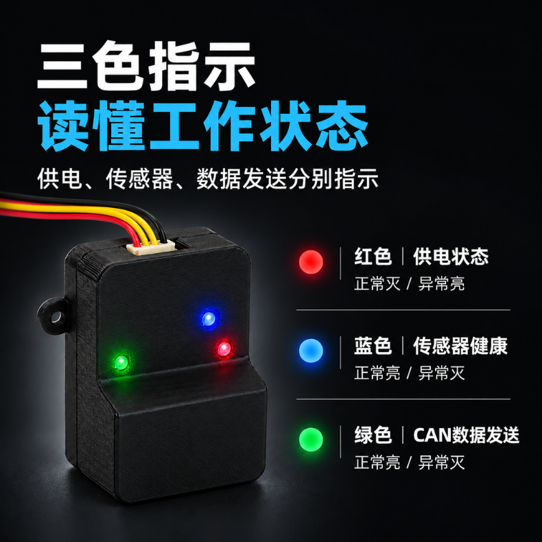
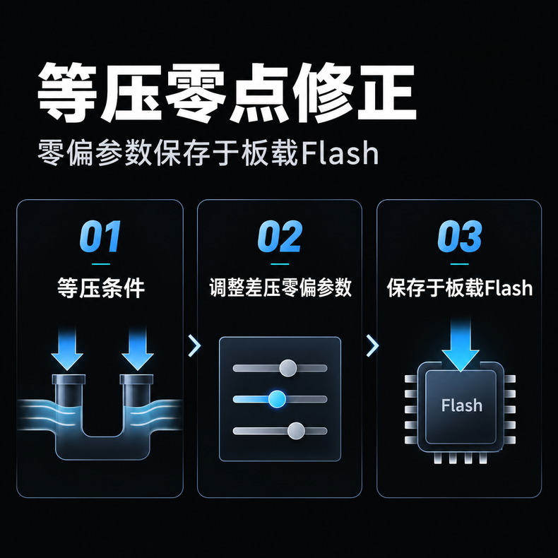
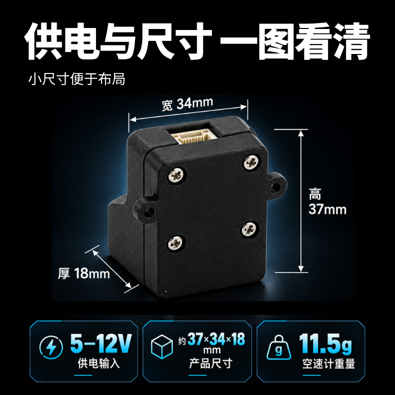
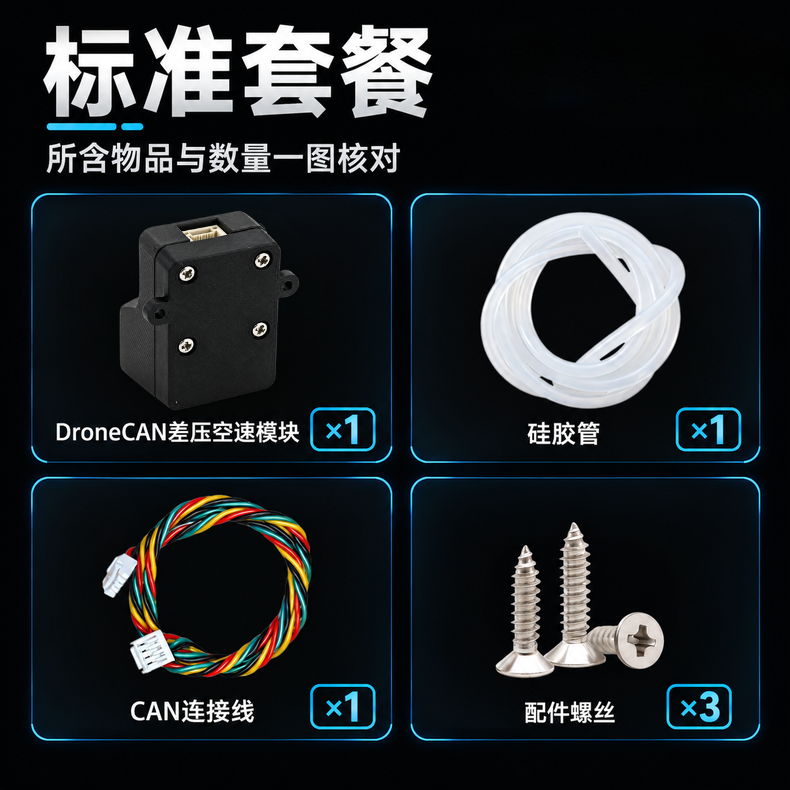
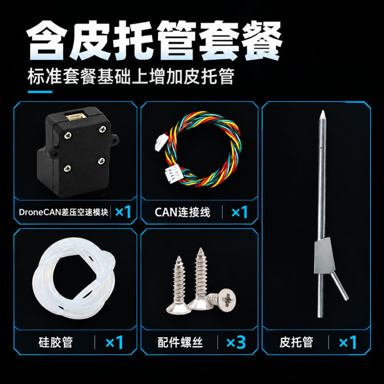

# SwiftWing A2 DroneCAN 高精度DLVR-L10D空速模块 | 适配 PX4 / ArduPilot

## 产品特点

本模块采用双晶圆技术的 DLVR-L10D 数字差压传感器和高性能 GD32F303CCT6 处理器，可通过 DroneCAN GUI Tool 上位机进行参数管理、状态查看和 CAN 固件升级。通过 CAN 总线发布标准 DroneCAN 空速数据，适配主流 PX4、ArduPilot 飞控系统。使用 4Pin 标准 CAN 接口，实现高实时、高可靠、强抗干扰的空速数据传输。拥有红、蓝、绿三色状态指示灯，分别反映供电是否正常工作、传感器健康状态、CAN 空速数据发送状态，一眼即可判断模块工作状态。尺寸小巧，重量约 5g，适合在无人机等小尺寸飞行器上使用。供电范围支持 5-12V 宽电压输入，适配不同电压系统，降低电路适配难度。

### 高精度空速传感器

* 采用双晶圆技术的 DLVR-L10D 数字差压传感器，传感器量程为 ±10 inH2O（约 ±2.49 kPa），14 位数字压力输出。
* 测量范围：0~63.8 m/s（约 0~230 km/h）

### CAN 通信协议

* 使用标准 DroneCAN / UAVCAN v0 消息传输差压，同时适配 PX4 / QGroundControl 和 ArduPilot / Mission Planner。
* CAN 通信拥有高实时性、高可靠性、强抗干扰性等优势。

### 高数据采样率

* 默认 50 Hz 采样及发布，可通过 DroneCAN 参数调整为 1~100 Hz。

### DroneCAN 生态系统

* 支持自动分配 DroneCAN 节点 ID，也可配置固定 ID；
* 支持 DroneCAN GUI Tool 上位机进行参数管理、节点状态查看和 CAN 固件升级流程。

### 多状态指示

* 红色状态指示：反映供电是否正常工作，正常时灭，异常时亮。
* 蓝色状态指示：反映传感器健康状态，正常时亮，异常时灭。
* 绿色状态指示：反映 CAN 空速数据发送状态，正常时亮，异常时灭。

### 自带零点修正

* 可通过差压零偏参数进行等压零点修正，参数保存于板载 Flash。

### 兼容宽电压

* 支持 5-12V 宽电压输入，适配不同电压系统，降低电路适配难度。

## 产品参数

| 项目            | 说明                                                 |
| --------------- | ---------------------------------------------------- |
| 产品            | DroneCAN 差压空速模块                                |
| 主控 / 传感器   | GD32F303CCT6 / DLVR-L10D                             |
| 差压量程        | -10~+10 inH2O，约 -2491~+2491 Pa                    |
| 空速参考范围    | 正差压 0~2491 Pa 对应约 0~63.8 m/s（约 0~230 km/h） |
| 传感器总误差带  | L10x 系列典型 ±0.30% span，最大 ±0.75% span        |
| 传感器温度档    | 0~60 °C                                             |
| 采样 / 数据发布 | 默认 50 Hz，可设 1~100 Hz                            |
| CAN 速率        | 1000 kbit/s                                          |
| 供电            | 5 ~ 12 V                                             |
| 尺寸            | 约 37mm x 34mm x 18mm                                |
| 重量            | 约 11.5g                                             |
| 硬件接口        | GH1.25 4pin                                          |

## 采购

- [SwiftWing 淘宝店铺](https://shop356089311.taobao.com/category.htm?spm=a1z0d.6639537/202410.shop.d2220391460905.15aa7484Rt1BqK)

## 硬件连接

将模块的 CAN 接口通过配套 CAN 连接线接入飞控的 CAN（UAVCAN/DroneCAN）接口，注意 CAN_H、CAN_L 不可接反，VCC、GND 极性须正确。

* 接线完成后，模块接入的 CAN 通道须在飞控中启用 CAN 驱动并将协议设置为 DroneCAN，飞控才能识别到该空速模块。
* 气路连接：使用硅胶管连接皮托管与模块差压接口，皮托管总压口接模块动压（P1）接口，模块静压（P2）接口与环境静压连通或接皮托管静压口。
* 具体接线与飞控配置步骤请参考[使用说明](使用说明.md)。

## 发货清单

### 标准套餐

* DroneCAN 差压空速模块 x 1
* 硅胶管 x 1
* CAN 连接线 x 1
* 配件螺丝 x 3

### 含皮托管套餐

* DroneCAN 差压空速模块 x 1
* 硅胶管 x 1
* CAN 连接线 x 1
* 皮托管 x 1
* 配件螺丝 x 3

