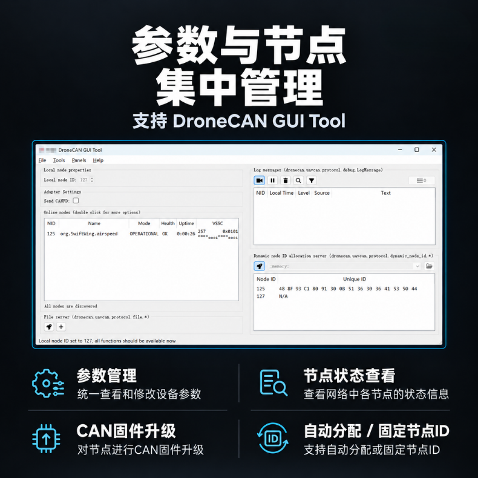

# DroneCAN GUI Tool 使用

DroneCAN GUI Tool 是 DroneCAN 官方提供的上位机工具，可用于节点参数管理、节点状态查看和 CAN 固件升级，下载地址：[dronecan/gui_tool](https://github.com/dronecan/gui_tool)。

硬件接线与飞控配置请参考[使用说明](使用说明.md)及对应平台的配置指南：[配置指南（AP）](配置指南（AP）.md) / [配置指南（PX4）](配置指南（PX4）.md)。

## 参数管理

* 通过 USB-CAN 适配器将电脑接入模块所在 CAN 总线，打开 DroneCAN GUI Tool，在 `Node` 列表中选择对应节点。
* 在 `Parameters` 标签页中可查看和修改节点参数，包括：
  * **采样 / 数据发布率**：默认 50 Hz，可在 1~100 Hz 范围内调整；
  * **差压零偏**：用于等压零点修正，修改后保存至板载 Flash；
  * **节点 ID**：默认自动分配，可配置为固定 ID。
* 修改参数后需点击写入并重启模块使新参数生效。

## 节点状态查看

在 `Node` 列表中可查看模块的节点 ID、固件版本、健康状态等信息，用于判断模块是否正常在线。

## CAN 固件升级

* 在 DroneCAN GUI Tool 中选择对应节点，进入固件升级界面，选择对应的固件文件按提示进行升级。
* 升级过程中请保持供电稳定，切勿断电或断开 CAN 连接。
