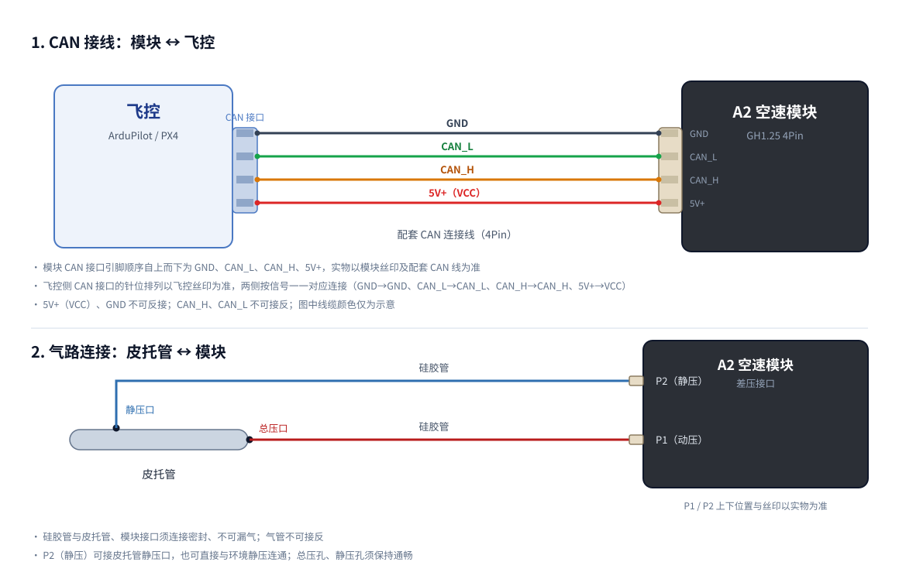

# SwiftWing A2 DroneCAN 空速模块使用说明

## 产品概述

SwiftWing A2 DroneCAN 空速模块是一款基于 DLVR-L10D 数字差压传感器的高精度空速测量模块，采用 GH1.25 4Pin 标准 CAN 接口，通过 CAN 总线以 DroneCAN / UAVCAN v0 协议发布标准空速数据，适配 PX4（QGroundControl）与 ArduPilot（Mission Planner）飞控系统。

模块出厂默认自动分配 DroneCAN 节点 ID、默认 50 Hz 采样及发布，支持通过 DroneCAN GUI Tool 上位机进行参数管理、节点状态查看和 CAN 固件升级。详细产品规格请参考[产品介绍](0_SwiftWing_A2_DroneCAN空速模块.md)。

## 硬件连接

### 引脚定义

| 引脚（自上而下） | 信号 | 说明 |
|---|---|---|
| 1 | GND | 电源负极，接地 |
| 2 | CAN_L | CAN 低电平信号线 |
| 3 | CAN_H | CAN 高电平信号线 |
| 4 | 5V+（VCC） | 电源正极，5~12V 宽电压输入 |

引脚在连接器上的排列顺序以模块外壳丝印及配套 CAN 连接线线序为准。

### 接线说明

1. 使用配套 CAN 连接线，将模块 CAN 接口接入飞控的 CAN（UAVCAN/DroneCAN）接口。
2. 确认 VCC、GND 极性正确，CAN_H、CAN_L 不可接反。
3. 模块供电范围 5~12V，请确认飞控 CAN 接口供电电压在范围内。
4. 接线完成后上电，确认状态指示灯正常（详见下文“状态指示”章节）。

### 气路连接

* 使用硅胶管连接皮托管与模块差压接口：皮托管总压口接模块动压（P1）接口，模块静压（P2）接口与环境静压连通或接皮托管静压口。
* 气管不可接反，接口处须密封、不可漏气。
* 皮托管总压孔与静压孔须保持通畅，不可堵塞。

具体气路标识以模块及皮托管实物丝印为准。

### 安装位置

1. **皮托管安装**
   * 安装在机翼前缘或机头位置，开口正对气流方向
   * 避免螺旋桨滑流干扰
   * 距离机身至少 10cm，减少边界层影响

2. **模块安装**
   * 安装在机身内部，远离热源
   * 保持气路连接管尽量短
   * 避免剧烈震动

## 状态指示

模块配备红、蓝、绿三色状态指示灯：

| 指示灯 | 反映内容 | 正常状态 | 异常状态 |
|---|---|---|---|
| 红色 | 供电是否正常工作 | 灭 | 亮 |
| 蓝色 | 传感器健康状态 | 亮 | 灭 |
| 绿色 | CAN 空速数据发送状态 | 亮 | 灭 |

上电后若红灯亮、或蓝灯/绿灯不亮，说明供电、传感器或 CAN 数据发送存在异常，请参照下文“常见问题”章节排查。

## 飞控配置

飞控参数配置与空速校准请按所用飞控平台选择对应指南：

* ArduPilot（Mission Planner）：[配置指南（AP）](配置指南（AP）.md)
* PX4（QGroundControl）：[配置指南（PX4）](配置指南（PX4）.md)

## DroneCAN GUI Tool 使用

DroneCAN GUI Tool 上位机的节点参数管理、节点状态查看与 CAN 固件升级操作，请参考[DroneCAN GUI Tool 使用](DroneCAN_GUI_Tool使用.md)。

## 常见问题

### Q1: 飞控/地面站识别不到模块

**排查步骤：**

1. 检查 CAN_H、CAN_L 是否接反，VCC、GND 极性是否正确；
2. 检查模块所接 CAN 通道是否已启用 CAN 驱动并将协议设置为 DroneCAN（ArduPilot 需设置 `CAN_Px_DRIVER` 与 `CAN_Dx_PROTOCOL`）；
3. 检查 CAN 总线两端是否已接入 120Ω 终端电阻；
4. 在 DroneCAN GUI Tool 中确认模块节点是否在线。

### Q2: 空速读数始终为 0

**排查步骤：**

1. 检查皮托管总压口、静压口是否堵塞；
2. 检查硅胶管是否接反、是否漏气；
3. 确认状态指示灯绿色常亮，CAN 空速数据正常发送。

### Q3: 无风状态下读数不为 0（大于 3 m/s）

**排查步骤：**

1. 确认当前处于无风环境；
2. 参考对应平台配置指南执行零点校准：[配置指南（AP）](配置指南（AP）.md) / [配置指南（PX4）](配置指南（PX4）.md)；
3. 若仍无法归零，检查气路是否漏气、皮托管是否堵塞。

### Q4: 空速读数偏大或偏小

**排查步骤：**

1. 确认气路无漏气、无弯折；
2. 参考对应平台配置指南执行空速校准（ArduPilot 使用 `ARSPD_AUTOCAL`，PX4 使用 QGroundControl 空速校准）；
3. 检查皮托管安装位置是否受螺旋桨滑流或机身气流干扰。

### Q5: 读出数据波动大

**排查步骤：**

1. 缩短气路长度，避免气路弯折；
2. 检查模块安装是否牢固、避免剧烈震动；
3. 确认供电稳定。

## 安全注意事项

注意事项

<ul>
<li><strong>防反接</strong>：VCC、GND 不可反接，CAN_H、CAN_L 不可接反，否则模块无法正常通信甚至损坏</li>
<li><strong>防过压</strong>：供电电压须在 5~12V 范围内，超出范围可能损坏模块</li>
<li><strong>防带电插拔</strong>：请勿在通电状态下插拔 CAN 连接线</li>
<li><strong>防漏气</strong>：硅胶管与皮托管、模块接口须连接密封，漏气会造成空速测量误差</li>
<li><strong>防堵塞</strong>：皮托管总压孔、静压孔须保持通畅，堵塞会导致空速读数异常</li>
<li><strong>防气管接反</strong>：总压（动压）与静压接口不可接反，否则空速读数异常</li>
<li><strong>防高压冲击</strong>：请勿使用高压气枪直接冲击传感器接口，以免损坏差压传感器</li>
</ul>

## 联系支持

如有问题，请联系：

- 淘宝店铺：[SwiftWing](https://item.taobao.com/item.htm?id=975458285619)
- 技术支持：见产品包装内的联系方式
