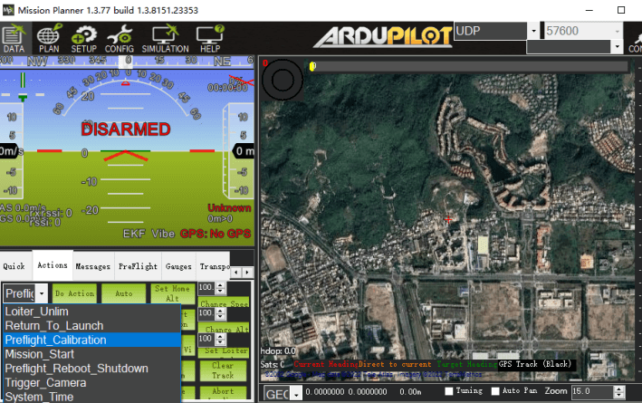
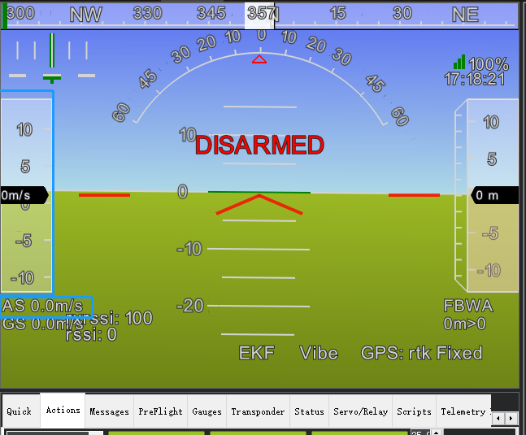

# SwiftWing A2 DroneCAN 空速模块 配置指南（ArduPilot）

本指南面向运行 ArduPilot 固件的飞控，说明 A2 DroneCAN 空速模块的参数配置、零点校准与空速比例校准方法，以及起飞前检查项。模块接线与气路连接请参考[使用说明](使用说明.md)。

## 参数配置

在 Mission Planner 中打开 `配置` > `全部参数表`，按下表完成设置，写入参数后重启飞控：

| 参数 | 设置值 | 说明 |
|---|---|---|
| `CAN_P1_DRIVER` | `1` | 模块接入 CAN1 时，启用 CAN1 驱动 |
| `CAN_D1_PROTOCOL` | `1` | 模块接入 CAN1 时，将 CAN1 协议设为 DroneCAN/UAVCAN |
| `CAN_P2_DRIVER` | `1` | 模块接入 CAN2 时，启用 CAN2 驱动 |
| `CAN_D2_PROTOCOL` | `1` | 模块接入 CAN2 时，将 CAN2 协议设为 DroneCAN/UAVCAN |
| `ARSPD_TYPE` | `8` | 空速传感器类型设为 DroneCAN |
| `ARSPD_USE` | `1` | 启用空速参与飞行控制 |

`CAN_Px_DRIVER` 与 `CAN_Dx_PROTOCOL` 只需配置模块实际接入的那一路 CAN 通道。

## 零点校准

无风状态下空速显示大于 3 m/s 时，需在起飞前完成零点校准。

提示

<ul>
<li>本模块在一般环境中具有良好的一致性，可将 <code>ARSPD_SKIP_CAL</code> 设置为 1，无需执行零点校准。</li>
</ul>

在 Mission Planner 中按以下步骤操作：

1. 连接飞行控制器，并确认皮托管处于无风环境；
2. 打开 `飞行数据` > `动作` 栏；
3. 在第一个复选框中选择 `Preflight Calibration`，点击右侧 `执行动作` 按钮。

说明

<ul>
<li>差压零偏参数保存于模块板载 Flash，掉电不丢失。</li>
</ul>

## 起飞前检查

连接地面站，逐项确认：

1. 无风状态下空速值在 0~3 m/s 范围内跳动；超出范围需重新执行零点校准；
2. 用手托住空速管并向管内吹气，空速数值能随气流速度变化；
3. 皮托管总压孔、静压孔无堵塞，硅胶管连接无漏气。

## 空速比例校准

不同安装方式与模块个体之间存在比例差异，首次飞行需完成空速比例校准。

将 `ARSPD_AUTOCAL` 设置为 `1` 启动自动校准，再按下列方式之一飞行：

1. **方式一（空速参与控制）**：以 QStabilize 或 QLoiter 多轴模式升空，转换为 FBWA（自稳 A 模式）控制无人机盘旋飞行 5 圈左右，地面站消息栏提示校准完成后执行降落；
2. **方式二（空速不参与控制）**：使能空速计但不使用空速计（`ARSPD_USE=1`、`ARSPD_TYPE=8`），飞机将以地速飞行，起飞后使用 Loiter 模式盘旋 5 圈左右，地面站消息栏提示校准完成后执行降落。

注意事项

<ul>
<li>校准请勿在风速较大的环境下进行。</li>
<li>地面站提示校准完成后，须将 <code>ARSPD_AUTOCAL</code> 改回 0。</li>
</ul>

