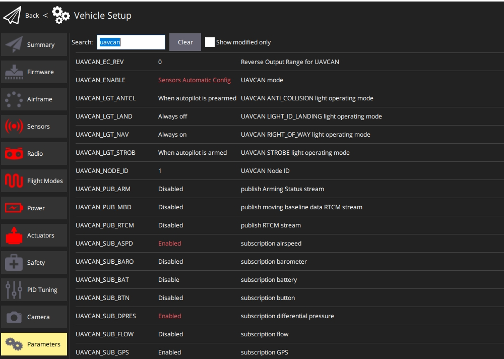
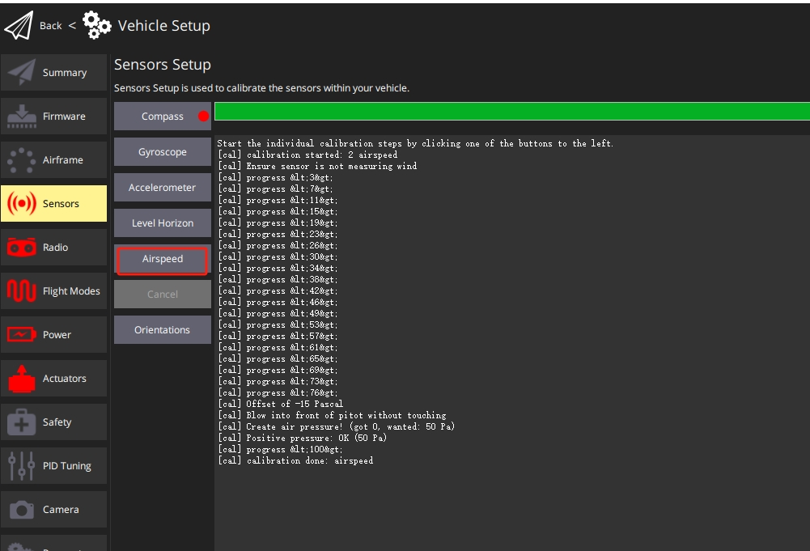

# SwiftWing A2 DroneCAN 空速模块 配置指南（PX4）

本指南面向运行 PX4 固件的飞控，说明 A2 DroneCAN 空速模块的参数配置、空速传感器校准方法及多空速计的冗余选择。模块接线与气路连接请参考[使用说明](使用说明.md)。

## 参数配置

在 QGroundControl 中按下表设置参数，并按顺序重启载具：

| 参数 | 设置值 | 说明 |
|---|---|---|
| `UAVCAN_ENABLE` | `Sensors Automatic Config` | 传感器自动配置 |
| `UAVCAN_SUB_ASPD` | `Enable` | 订阅空速数据（在 `UAVCAN_ENABLE` 设置并重启后才会出现） |
| `UAVCAN_SUB_DPRES` | `Enable` | 订阅差压数据（同上） |

设置顺序：

1. 将 `UAVCAN_ENABLE` 设置为 `Sensors Automatic Config`（传感器自动配置）并保存，重启飞控；
2. 将 `UAVCAN_SUB_ASPD` 设置为 `Enable`（启用空速数据订阅）、`UAVCAN_SUB_DPRES` 设置为 `Enable`（启用差压数据订阅）并保存，再次重启控制器；
3. 重启后在地面站传感器列表中确认已识别到空速计。

## 多空速计冗余

配置了多个空速传感器时，可用 `ASPD_PRIMARY` 选择主用传感器，其余传感器作为冗余：

| 取值 | 含义 |
|---|---|
| 0 | 空速估算（地速减去风速） |
| 1 | 第一个空速传感器（默认） |
| 2 | 第二个空速传感器 |
| 3 | 第三个空速传感器 |

空速选择器首先验证已启用的传感器，并且仅当启用的传感器未通过空速检查时才切换到其他传感器（检查项使用 `ASPD_DO_CHECKS` 配置），然后使用选定的传感器向估计器（EKF2）和控制器提供数据。

## 空速传感器校准

校准步骤如下：

1. 选择 `Q` 图标 > `车辆设置` > `传感器`（侧边栏）以打开传感器设置；
2. 单击空速传感器按钮；
3. 保护传感器不受风吹（即用手捂住），注意不要堵塞任何孔；
4. 单击 `确定` 开始校准；
5. 向皮托管前部吹气，以便检测空速；
6. 等待 QGroundControl 提示校准完成。

说明

<ul>
<li>如果校准失败，可能是动压管和静压管连接错误，传感器读取到较大的负压差，将其互换后再试。</li>
</ul>

