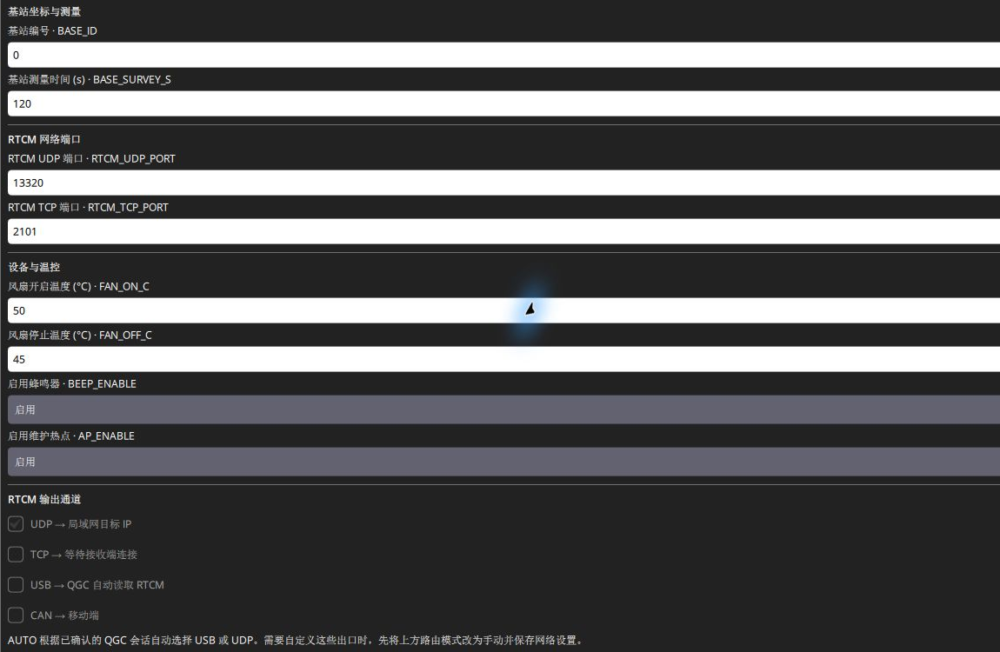

# RTK 设备参数参考

以下 23 项依据本项目 0.1.23 / 0.1.24 系列配置定义。**默认值指无旧配置时的通用固件初始值**；成品角色、旧设备和升级保留值以读回为准，不用默认值覆盖已验证配置。

## 在哪里修改

用 SwiftWing QGC 进入 **应用设置 → NTRIP/RTK → SwiftWing R1 / R1-G RTK**，选对设备后修改参数并点 **应用并保存**。网页中在对应角色、设备设置页面操作。普通 QGC 飞行器参数页修改的是飞控，二者不能混淆。

网络 SSID / 密码、多网络选择、静态 IP、UDP 目标和路由模式单独保存，不计入下列 23 项。网络修改点 **保存局域网设置**。保存失败或超时先读回当前状态，确认应用结果后再决定下一步。

## 角色、定位和航向：7 项

| 参数 | 默认值 | 允许值 / 单位 | 调整后的作用 |
| --- | --- | --- | --- |
| `RTK_ROLE` | 0 | 0 移动端；1 自动测量基站；2 固定坐标基站 | 决定 UM982 角色和页面功能 |
| `GPS1_RATE_MS` | 200 | 50 / 100 / 200 ms | 移动端 20 / 10 / 5 Hz 更新；不改变基站 RTCM 周期 |
| `GPS_YAW_OFFSET` | 0 | 整数 0–360° | 安装角修正；ANT1 在前、ANT2 在后为 0 |
| `CAN_HDG_PROFILE` | 3 | 0 未选择；1 经典 PX4；2 ArduPilot；3 AUTO | 选择 CAN 航向兼容格式，0 不输出对应飞控航向 |
| `HDG_ENABLE` | 1 | 0 / 1 | 是否启用双天线航向 |
| `HDG_LEN_CM` | 50 | 0–10000 cm | 实测两天线相位中心间距；0 为不约束物理长度的自动模式 |
| `HDG_TOL_CM` | 10 | 1–1000 cm | 已知基线的长度容差；越界时航向无效 |

例：两天线相距 60 cm，正常前后安装，设置 `HDG_LEN_CM=60`、`HDG_TOL_CM=10`、`GPS_YAW_OFFSET=0`。这里的 60 cm 不是飞控重心到 ANT1 的位置偏移。新装机优先填写实际长度，不能为了显示航向而把长度改 0 或无限放宽容差。

AUTO 需与飞控实际交互后核对有效模式；PX4 家族识别不代表精确版本兼容。更换飞控后正常重启移动端。只需要单天线定位时可将 `HDG_ENABLE=0`，不将无航向作为故障；需要航向时按[移动端配置](../SwiftWing_R1_RTK_移动端/QGC配置移动端.md)完成安装和验证。

## 基站坐标与测量：6 项

| 参数 | 默认值 | 允许值 / 单位 | 调整后的作用 |
| --- | --- | --- | --- |
| `BASE_ID` | 0 | 0–4095 | RTCM 参考站号，区别不同基站流 |
| `BASE_SURVEY_S` | 120 | 60–3600 秒 | 自动测量时长参数，不是定位精度保证 |
| `BASE_SET` | 0 | 0 / 1 | 固定坐标确认标记；角色 2 必须为 1 |
| `BASE_LAT_E8` | 0 | −9000000000–9000000000 | 纬度° × 100000000，北正南负 |
| `BASE_LON_E8` | 0 | −18000000000–18000000000 | 经度° × 100000000，东正西负 |
| `BASE_H_MM` | 0 | −1000000–20000000 mm | WGS84 椭球高 × 1000，毫米 |

整数参数单位与界面输入框单位可能不同，按字段标签输入。固定坐标必须对应实际 ANT1 参考点；地面点高度需先换算天线高度，正高 / 海拔不能直接当椭球高。具体建站操作和示例见[基站模式与参数](../SwiftWing%20R1-G%20RTK基站/基站模式与参数.md)。

## 差分出口与 CAN：6 项

| 参数 | 默认值 | 允许值 / 单位 | 调整后的作用 |
| --- | --- | --- | --- |
| `RTCM_OUT_MASK` | 1 | 0–15，位掩码 | 手动路由出口：UDP=1、TCP=2、USB=4、CAN=8，组合相加 |
| `RTCM_UDP_PORT` | 13320 | 1024–65535 | 基站 UDP 发送端口，与 QGC 监听端口一致 |
| `RTCM_TCP_PORT` | 2101 | 1024–65535 | 基站原始 TCP 服务端监听端口 |
| `CAN_NODE_ID` | 0 | 0 动态分配；1–127 静态 | 本设备节点号；静态号应唯一 |
| `CAN_BITRATE` | 1000000 | 500000 / 1000000 bit/s | 总线速率，必须与飞控及其他节点一致 |
| `RTCM_SRC_ID` | 0 | 0 自动；1–127 指定 CAN 源 | 移动端选择从哪个 CAN 节点接收差分 |

**AUTO 路由**通过有效 QGC USB 会话选择 USB，否则选择 UDP。此时运行出口可能为 4 或 1，与保存的 `RTCM_OUT_MASK` 不同。要按掩码启用 TCP 或多出口，先在网络区选择手动路由并保存，再应用出口参数。

改节点号或波特率会影响 CAN 链路，优先保留 USB 管理连接后操作。动态节点需要飞控或调试工具提供分配服务；USB 识别正常不等于 CAN 已获得节点。

## 温控、提示音与热点：4 项

**基站温控按本教程设置为 35 °C 开启、30 °C 关闭。** 下表温控两项列的是教程设置，不代表已修改现有固件的出厂值或设备保存值；在 QGC / 网页 **应用并保存 → 重新读取**确认。正常保参升级会保留旧阈值。

| 参数 | 教程设置 / 其余默认值 | 允许值 / 单位 | 调整后的作用 |
| --- | --- | --- | --- |
| `FAN_ON_C` | 35（教程设置） | 20–85 °C | 基站板温达到或超过 35 °C 开启风扇 |
| `FAN_OFF_C` | 30（教程设置） | 10–84 °C，必须低于开启值 | 降至 30 °C 或以下关闭；30～35 °C 之间保持原状态 |
| `BEEP_ENABLE` | 1 | 0 / 1 | 主板蜂鸣器，不控制供电板低压蜂鸣器 |
| `AP_ENABLE` | 1 | 0 / 1 | 兼容保留字段；0.1.23 / 0.1.24 的热点策略不读取它，不能靠它单独开关热点 |

移动端角色不启用基站风扇策略。风扇状态是控制输出，没有转速反馈。基站温度无效时控制输出开启；板温不是电池温度。

先根据角色、飞控交互、差分路线和维护状态决定无线是否开启，再根据实际 LAN IP 与维护窗口决定是否开放热点。保存 SSID 不保证无线保持开启，`AP_ENABLE` 也不能替代这套策略。具体操作分别见[移动端热点规则](../SwiftWing_R1_RTK_移动端/差分与Wi-Fi后台.md#wireless-rules)和[基站热点规则](../SwiftWing%20R1-G%20RTK基站/设备后台参数修改.md#wireless-rules)。

此图展示本机基站参数页中的测量、端口、温控和出口；截图保留旧温控值，本教程使用 **35 / 30 °C**。移动端航向及基线字段按角色另行显示，不能在基站页面寻找双天线配置。

## 常见调整任务

- **换一套天线支架**：测量新的基线，只修改长度 / 必要的安装偏角；飞控中另核对 ANT1 相对重心的位置。
- **更换 PX4 / ArduPilot 飞控**：核对 AUTO 的有效模式，正常重新上电，按对应飞控教程验证 yaw；不清空全部参数。
- **从 USB 改无线差分**：保存局域网和 QGC 主机 IP，确认 UDP 监听，再断基站数据 USB 并保留独立供电。
- **只用 TCP**：网络路由改手动并保存，再设出口掩码 2；QGC 连接基站 IP:2101。
- **降低 CAN 负载**：核对更新周期和其他 CAN 节点负载，优先从默认 200 ms 开始；提高频率不等于提高定位精度。
