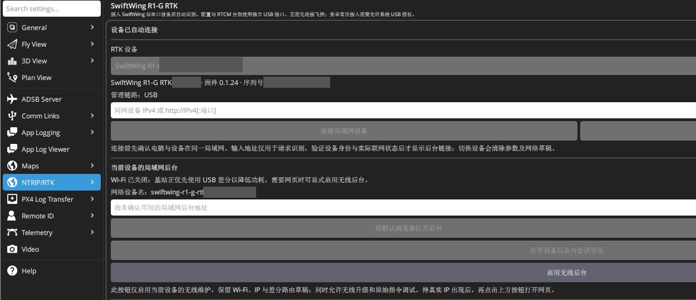
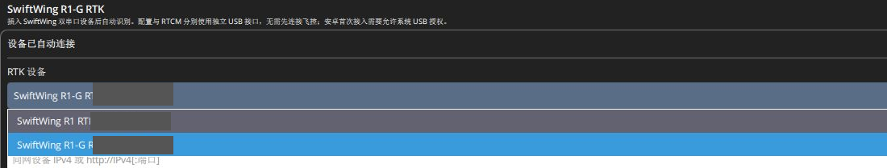

# SwiftWing QGC 下载、安装与 USB 连接

适用于 SwiftWing R1 RTK 移动端、SwiftWing R1-G RTK 基站。本文界面以 **SwiftWing QGC Windows 0.1.0 build8** 为例，设备操作以 0.1.23 / 0.1.24 系列固件为依据。设备与地面站有各自的版本号，升级前分别核对。

## 从百度网盘下载安装

**百度网盘下载链接：** [https://pan.baidu.com/s/1CAqwyC05L5_-I7qV0qO-yg?pwd=m5x6](https://pan.baidu.com/s/1CAqwyC05L5_-I7qV0qO-yg?pwd=m5x6)  
**提取码：** `m5x6`

1. 打开上述百度网盘链接，输入提取码，将 **SwiftWing QGC Windows x64 完整安装包**下载到电脑。
2. 若下载的是压缩包，先完整解压，再运行其中的安装器。本教程对应文件名为 `SwiftWing-QGC-Setup-0.1.0-b8-Windows-x64.exe`；下载区以后更新时，按随包版本说明选择配套版本。
3. 按安装向导完成安装，从快捷方式打开 **SwiftWing QGC**。便携包则须完整解压后运行，不能单独拷贝 `SwiftWingRTK.exe`。
4. 在软件版本信息中核对名称与 build。普通 QGroundControl 和其他厂商修改版不包含本项目的设备配置页。

下载入口尚未补充时，使用随货提供的同版本安装包；不要把本教程的设备固件 `.bin` 当作电脑软件安装包。

## 用 USB 找到 RTK

1. 使用支持数据传输的 USB-C 线，将 **RTK 主板的原生 USB-C** 接电脑。基站选配供电板上的 USB-C 是充电口，接它不会枚举 RTK。
2. 正常启动时松开 BOOT。当前版本改参无需按 BOOT，也无需进入下载模式。
3. 关闭占用该 RTK 串口的串口助手、升级工具或 USB 代理，打开 SwiftWing QGC。
4. 进入 **应用设置 → NTRIP/RTK → SwiftWing R1 / R1-G RTK**，在 **RTK 设备** 列表选择目标设备。
5. 核对产品名称、硬件短码、完整序列号、固件版本和实际角色。名称末六位用于区分设备，不是 CAN 节点号。

一个物理 USB 提供两个虚拟串口：**配置口 CDC0** 和 **原始 RTCM 输出口 CDC1**。QGC 自动区分，不需要按 COM 号大小手动猜测，也不要把 RTK 建成普通 MAVLink 串口连接。USB 虚拟串口设置不是 UM982 内部 COM1 / COM2 波特率。

只接移动端时可以没有基站三脚架图标，仍从应用设置进入。识别出 USB 基站后可点击工具栏三脚架，再点 **SwiftWing RTK配置**。已识别但暂无有效差分时图标可为红色，应继续检查基站建站状态。

上图为 2026-11-13 本电脑实机截图：左侧选择 **NTRIP/RTK**，设备已自动连接，管理链路为 **USB**。图中固件为 0.1.24。灰块遮盖设备身份信息；此时基站按 USB 优先策略关闭 Wi-Fi，因此网页地址和打开按钮尚不可用。需要网页时点下方 **启用无线后台**，等实际地址出现。

本教程新增实机截图均可点击查看原图。计数、温度和联网状态是拍摄时读数，参数值仍须按自己的设备、安装和网络设置。

## 基站与移动端同时接 USB

展开 **RTK 设备**列表，选择 **SwiftWing R1-G RTK** 配置基站，选择 **SwiftWing R1 RTK** 配置移动端。两台各有独立的 USB 数据线与设备身份；名称中的 **R1-G / R1** 及设备实际角色须同时核对。截图灰块隐藏硬件短码。

配置一台后可直接在列表切换另一台，当前参数区会跟随所选设备。切换只改变配置对象，基站差分来源另外查看。移动端的 USB 用于管理；日常定位、航向与差分仍走它和飞控之间的 CAN，不需要把移动端 USB 配成差分输入。

## 保存 RTK 参数与保存网络

设备参数区修改角色、基线、航向、CAN 等字段后，点击 **应用并保存**，等到 **参数已实时生效、保存并读回确认**，再核对实际数值。

保存成功后可点设备区下方的 **重新读取**，再次检查角色、基线、协议等实际值；只有查看参数时不需要点击保存。未保存的草稿在切换设备前先处理，避免把输入框中的数值当作已保存结果。

SSID、网络密码、静态 IP、UDP 目标和 AUTO / 手动路由属于网络设置，使用 **保存局域网设置**。两处保存按钮作用不同，修改网络后只点设备参数保存不会完成网络保存。

同一电脑同时连接基站和移动端时，每次保存前检查所选序列号和角色。读取超时先刷新设备与应用结果，不连续重复提交。切换配置设备不等于切换差分来源，基站的实收状态另行查看。

## 打开网页后台

首次网络未知、网页不可达时，先用 RTK **自己的主板 USB**在 QGC 配置；飞控 USB 遥测不能代替 RTK USB。后台已内置在固件中，不需另外安装。已能访问设备热点或实际 LAN IP 时，可直接从网页配置。

正常 CAN 交互中的移动端、USB 优先中的基站通常关闭无线省电，USB 配置仍可使用。要同时查看网页，在所选设备区域点 **启用无线后台**：它会把“无线高级维护”保存为开启，使无线及热点保持开启，完成维护后需明确关闭并保存。它不会代替 **保存局域网设置**保存 SSID / 密码草稿。

只短时查看也可在应用正常运行时长按 **BOOT 约 2 秒**，开启约 **30 分钟**临时窗口，重启失效；不要同时按 EN/RESET。普通状态、参数和日志不额外要求高级维护权限，无线升级及原始指令另需开启。

访问方式：已连接外部 Wi-Fi 且实际取得 LAN IP 时，同一局域网使用该 IP，或点 **用默认浏览器打开后台**；只有设备热点时，按钮可能仍灰色，连接热点后手动打开 [设备热点后台](http://192.168.4.1/)。移动端热点为 `SwiftWing R1 RTK-XXXXXX`，基站为 `SwiftWing R1-G RTK-XXXXXX`，默认密码 `12345678`；旧固件可能显示旧名称。

没有临时窗口或高级维护时，设备取得 LAN IP 后通常自动关闭自身热点。两种产品何时启用 / 关闭整个无线不同，分别按[移动端规则](../SwiftWing_R1_RTK_移动端/差分与Wi-Fi后台.md#wireless-rules)和[基站规则](../SwiftWing%20R1-G%20RTK基站/设备后台参数修改.md#wireless-rules)操作。

## 下一步

- [基站快速上手](../SwiftWing%20R1-G%20RTK基站/快速上手.md)：建站、保存局域网、USB / UDP 差分。
- [移动端快速上手](../SwiftWing_R1_RTK_移动端/快速上手.md)：双天线基线、CAN、飞控配置。
- [设备参数参考](设备参数参考.md)：默认值、单位、范围和作用。
