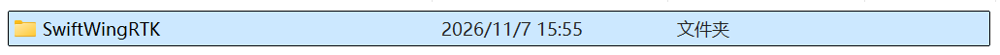
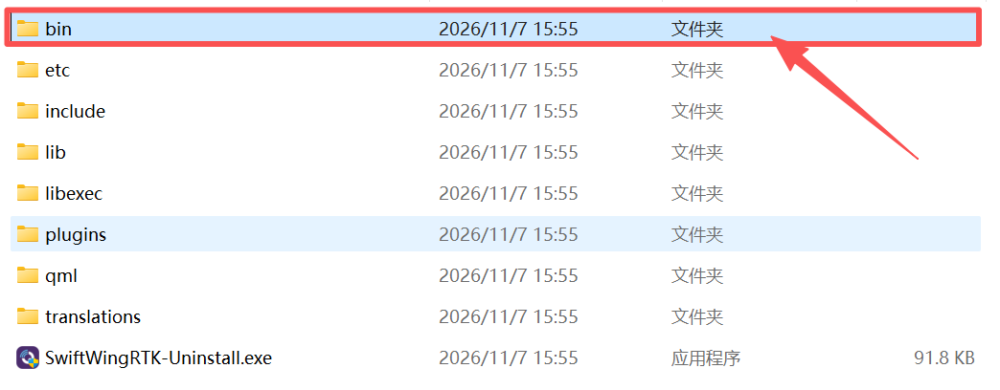
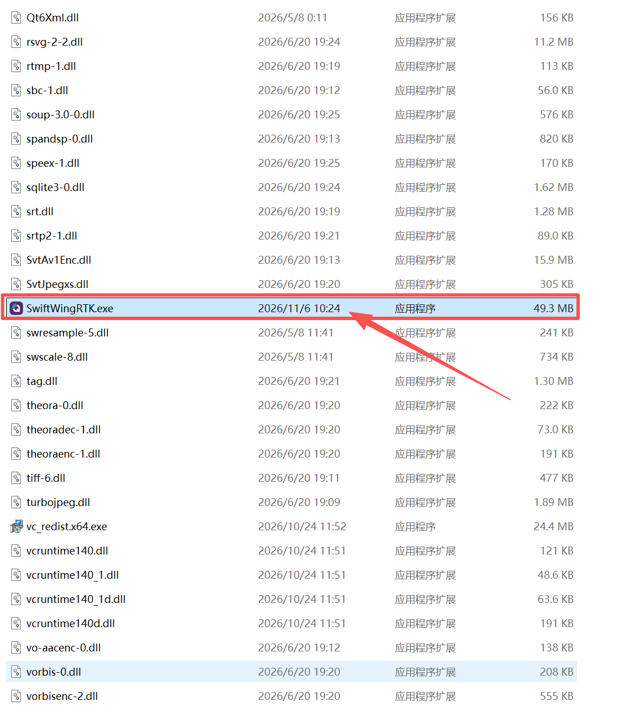
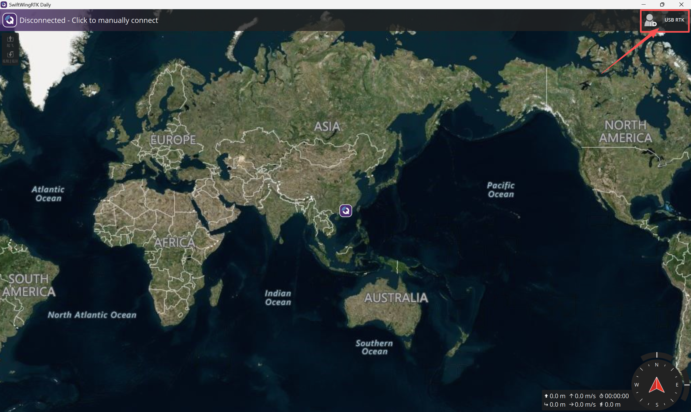
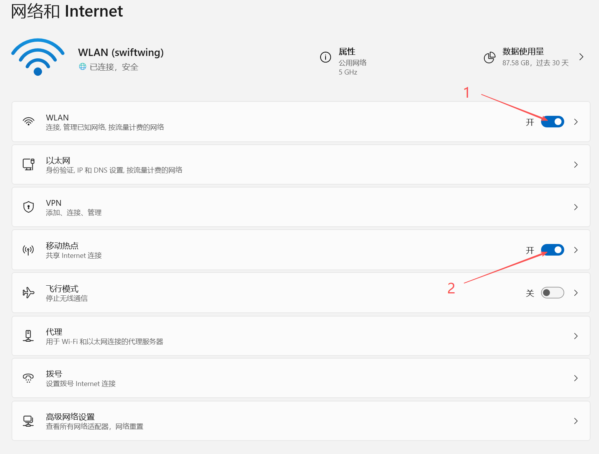
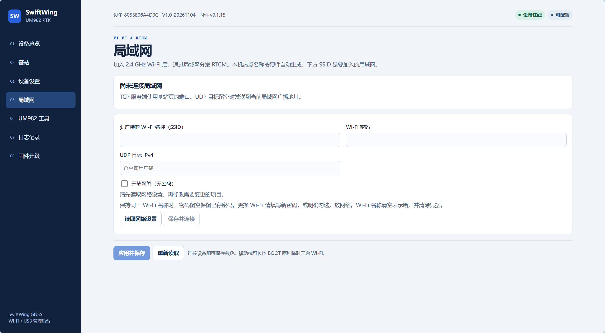

# QGC 地面站参数修改

## 前期准备

### 安装配套 SwiftWing QGC

- 当前安装器：`D:\SwiftWing-QGC-Windows-0.1.0-b8\SwiftWing-QGC-Setup-0.1.0-b8-Windows-x64.exe`；其他电脑复制完整安装器安装，不只复制单个 EXE。

说明

本教程使用 SwiftWing QGC Windows 0.1.0 build8。配套定制地面站提供 SwiftWing 设备识别、参数配置及差分接入能力，具体支持范围以安装包的版本记录为准。自动识别不等于差分已经生效，仍需查看实际接收帧数和接收端差分状态。

- USB 方式：使用交付版本支持的 SwiftWing USB RTK 入口，允许设备访问，并核对正确序列号。
- UDP 方式：使用支持 UDP RTCM 的地面站版本，启用入口，端口与基站保持一致，并将 UDP 目标指向运行地面站的终端。
- TCP 方式：由支持原始 TCP RTCM 的软件连接基站，再按其功能转交给地面站或接收系统。

注意

标准版 QGC 及其他厂商软件的自动识别、UM982 管理命令和网络入口不完全相同，不应直接套用其他接收机的 USB 建站流程。旧配套包也可能显示旧产品名称，以 build8 的实际界面和版本记录为准。

## 首次连接设备

1. 运行安装器完成安装，打开 **SwiftWing QGC**（普通官方 QGC 不包含本项目配置页）。

以下为旧版 build1 的安装示意，build8 使用安装器安装，路径略有不同：

* 将压缩包解压后，双击打开 `SwiftWingRTK` 文件夹

* 双击打开 `bin` 文件夹

* 下滑找到并双击打开 `SwiftWingRTK.exe` 文件

2. 用数据线将 **RTK 主板原生 USB** 接电脑（不是供电板充电 USB）。连接基站模块后，配套 QGC 自动识别到设备。

3. 进入 **应用设置 → NTRIP/RTK → SwiftWing R1 / R1-G RTK**，选择正确的基站并核对序列号。

4. 打开 Wifi 热点。

5. 在局域网页面输入热点名称和密码，连接你的 Wifi 热点。

6. 完成配置后可选用 Wifi 热点连接基站设备完成数据交互。
