

# QGC 地面站参数修改

注意

本页面演示 QGC 地面站参数修改和保存，基站实际使用不需要修改除了局域网的其他所有参数。

## 下载并安装

按[软件下载与 USB 连接](../RTK通用/软件下载与USB连接.md)下载完整 Windows x64 安装包、解压并安装。本文使用 **SwiftWing QGC 0.1.0 build8**。

## USB 连接和选择基站

1. 用 USB 数据线将 **RTK调试口** 接电脑。

注意

供电板充电口只用于电池充电，不用于连接 QGC。

2. 打开 SwiftWing QGC，点击右上角红色图标。

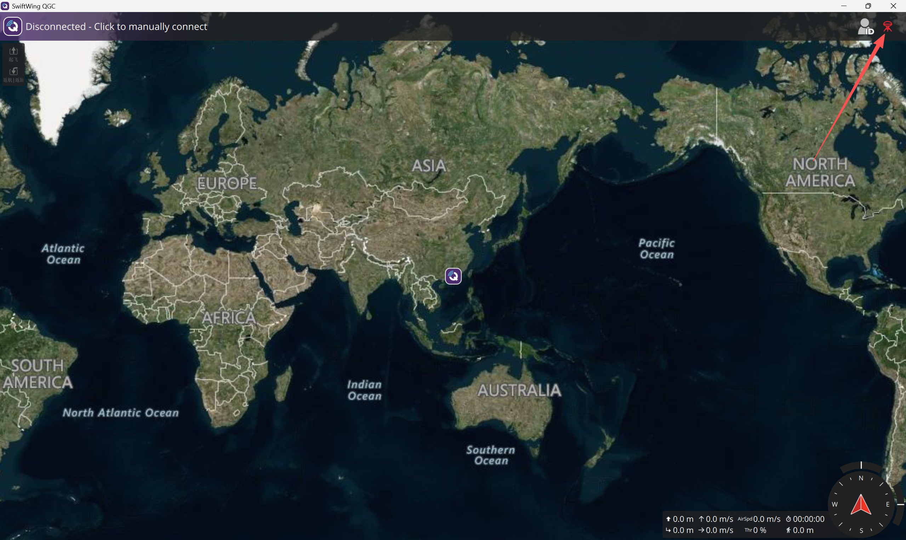

3. 在弹窗底部点击 **SwiftWing RTK配置**。

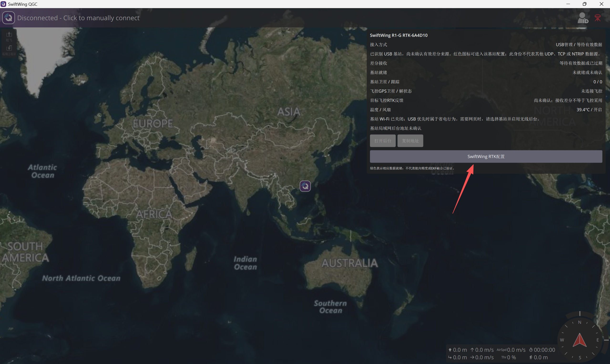

4. 在 **使用方式** 列表选择“基站：自动测量”，核对硬件短码、完整序列号、版本和角色。

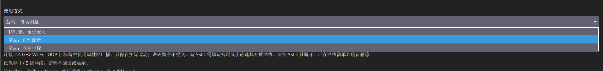

5. 同时连接移动端时，每次提交前检查当前设备；配置设备选择与基站差分会话分开。

[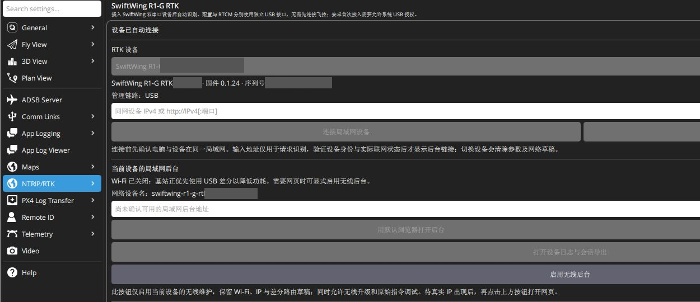](../RTK通用/image/实机操作/qgc-usb-base.png)

``

## 顶部基站图标：状态查看与配置入口

飞行页面顶部的**三脚架形图标**是基站 / RTCM 状态入口，点击可展开下图弹窗。它与旁边的 GPS / 卫星图标不同；QGC 识别到基站，或收到过差分后才会显示。

[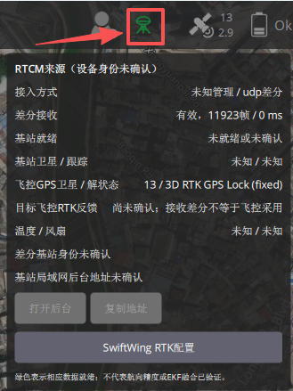](../RTK通用/image/实机操作/qgc-rtk-indicator-unknown.png)

### 图标颜色

- **绿色**：最近 5 秒内收到有效差分；已识别对应基站时，还要求该基站报告就绪。绿色不表示基站身份一定已确认。
- **红色**：等待有效差分、数据已过期，或已识别基站尚未就绪。只识别到 USB 基站但还没收到差分时，也可以点击红色图标进入配置。
- 旁边若显示 **Wi-Fi / dBm**，它表示已确认的基站局域网信号：≥−60 dBm 为绿，−75 至 −60 dBm 为黄，更弱为白；不是移动端卫星信号。

### 基站图标页面说明

| 项目                    | 含义                                                                                             |
| ----------------------- | ------------------------------------------------------------------------------------------------ |
| 顶部设备名称            | 已关联基站时显示名称；只收到原始差分、尚未关联设备时显示"RTCM来源（设备身份未确认）"             |
| 接入方式                | 前半是设备管理方式，后半是差分入口。如"HTTP管理 / udp差分"；"未知管理 / udp差分"仍可正常收到 UDP |
| 差分接收                | QGC 收到的有效帧数及最近一帧距今时间，单位 ms；观察帧数增加、时间持续刷新                        |
| 基站就绪                | 对应基站是否报告参考与观测就绪；"未就绪或未确认"也可能是尚未取得设备状态                         |
| 基站卫星 / 跟踪         | 地面基站参与定位 / 跟踪数量，不是移动端卫星数                                                    |
| 飞控GPS卫星 / 解状态    | 当前活动飞控回传的 GPS 卫星数及定位状态，用于查看移动端结果                                      |
| 目标飞控RTK反馈         | 与该基站关联的目标固定反馈；可在 NTRIP/RTK 页核对反馈绑定对象                                    |
| 温度 / 风扇、联网与地址 | 对应基站板温、风扇和实际后台地址；身份未确认时可能显示未知                                       |

### 三个按钮

- **打开后台**：在浏览器打开该基站网页，需先确认可用地址；未知地址时按钮为灰色。
- **复制地址**：复制该基站后台地址，便于在其他浏览器打开。
- **SwiftWing RTK配置**：进入 **应用设置 → NTRIP/RTK**。已确认身份时定位到对应基站；身份未确认时，进入后自行选择正确设备。

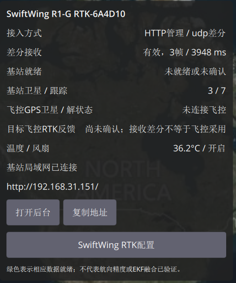

## 配置基站工作方式

在使用方式中选 **“基站：自动测量”** 或 **”基站：固定坐标“**，展开 **”基站坐标与测量”**，填写站号、时间或已知坐标。首次无控制坐标可用 `RTK_ROLE=1`、`BASE_SURVEY_S=120`。

点 **应用并保存**，等待 **参数已实时生效、保存并读回确认**，再核对实际值。自动测量与已知坐标的完整参数、单位和天线高度要求见[基站模式与参数](基站模式与参数.md)。

[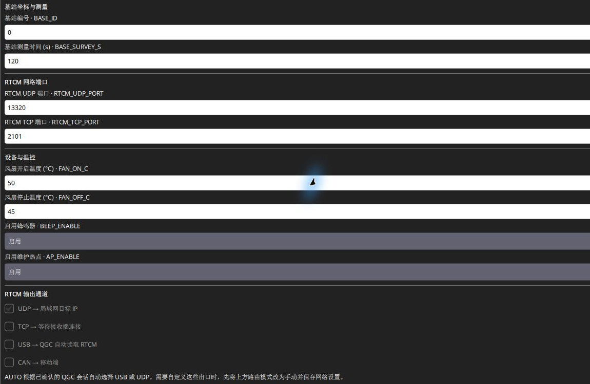](../RTK通用/image/实机操作/qgc-base-parameters.png)

## 配置局域网和差分路由

1. 准备外部 2.4 GHz 路由器 / 手机热点，QGC 电脑也接入同一网络。

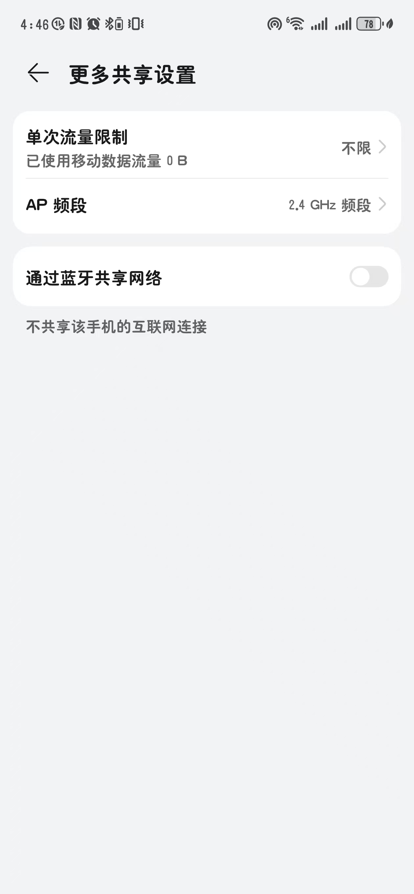

2. 在所选基站的网络区填写 SSID / 密码；新增网络须输入密码或明确选开放网络，同 SSID 只改其他项时密码留空保留原值。

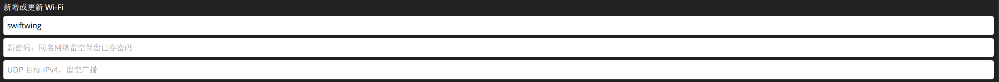

3. UDP 目标填 **QGC 电脑实际 IPv4**，端口默认 13320。基站自己的 LAN IP 用于管理与 TCP 服务，不填到 UDP 目标里。

4. 路由可保留 **AUTO · QGC USB 优先，否则 UDP**，点击 **保存局域网设置**。配置完成后断开主板数据 USB，日常使用 UDP；网络和设备参数使用不同保存按钮。

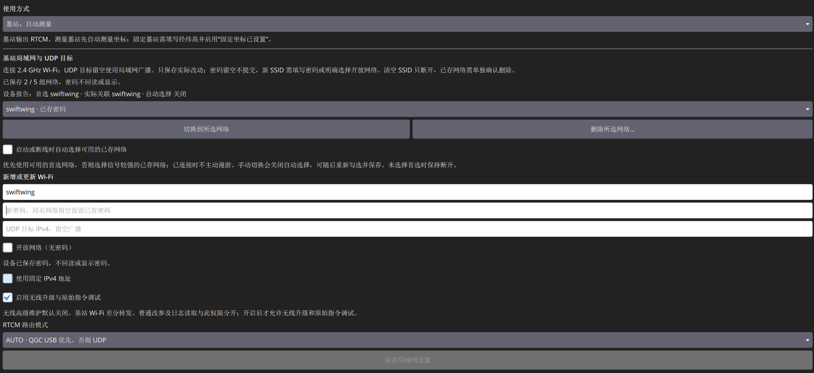

USB 数据会话有效时 AUTO 实际优先 USB，可能关闭 Wi-Fi；这是自动路由规则，日常仍推荐 UDP。配置完成后开启 SW1，确认电池或供电板 USB 输入经 XT30 供电，再拔主板数据 USB；若必须保留 USB 管理同时使用 UDP，则明确选择‘手动路由与 UDP 出口’。TCP 也需手动启用，不属于 AUTO 路线。具体见<a href="../Wifi输出差分/">Wi-Fi 输出差分</a>。

## 参数保存

* 修改参数后，点 **应用并保存**，等待 **参数已实时生效、保存并读回确认**，再核对实际值。

[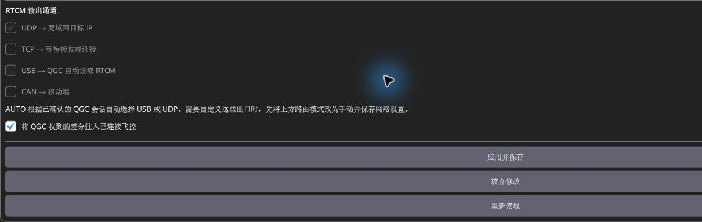](../RTK通用/image/实机操作/qgc-rtcm-output-save.png)
