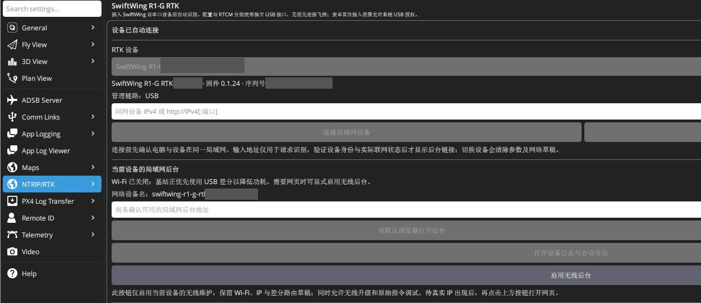
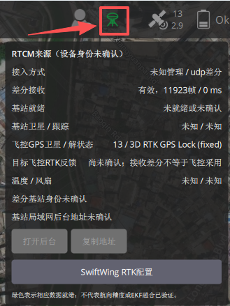
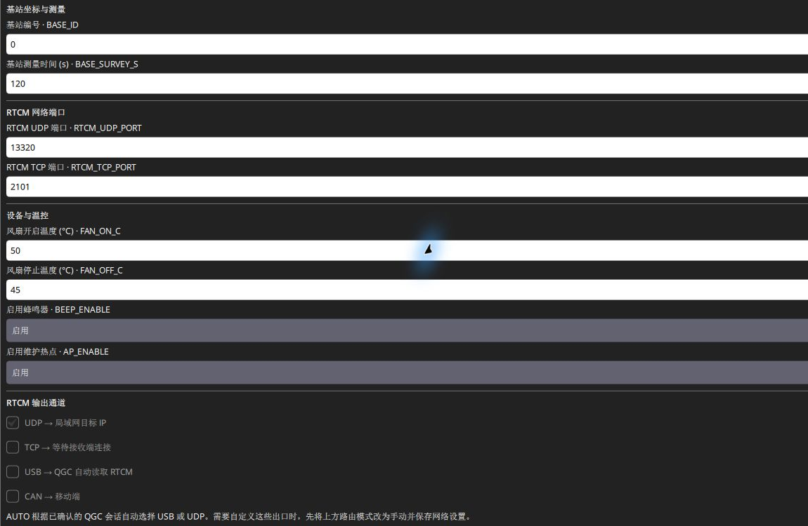
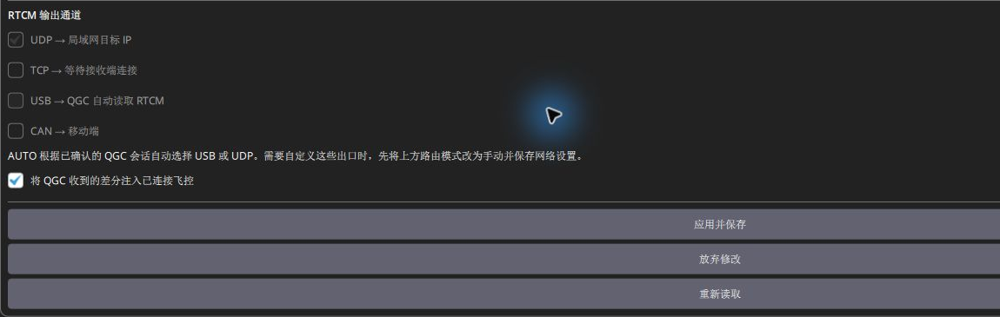

# QGC 地面站参数修改

## 下载并安装

**百度网盘下载链接、提取码待补充。** 按[软件下载与 USB 连接](../RTK通用/软件下载与USB连接.md)下载完整 Windows x64 安装包、解压并安装。本文使用 **SwiftWing QGC 0.1.0 build8**。

## USB 连接和选择基站

1. 用数据线将 **RTK 主板原生 USB-C** 接电脑，松开 BOOT，关闭占用其串口的程序。供电板 USB-C 是充电口。
2. 打开 SwiftWing QGC，进入 **应用设置 → NTRIP/RTK → SwiftWing R1 / R1-G RTK**。
3. 在 **RTK 设备** 列表选择基站，核对硬件短码、完整序列号、版本和角色。单根 USB 提供配置与原始 RTCM 两个接口，软件自动分辨。
4. 同时接着移动端时，每次提交前检查当前设备；配置设备选择与基站差分会话分开。

2026-11-13 实机：配置页显示 **设备已自动连接**、**管理链路：USB**。灰块隐藏现场设备身份；当前 Wi-Fi 关闭，打开网页前需先启用无线后台。

## 顶部基站图标：状态查看与配置入口

飞行页面顶部的**三脚架形图标**是基站 / RTCM 状态入口，点击可展开下图弹窗。它与旁边的 GPS / 卫星图标不同；QGC 识别到基站，或收到过差分后才会显示。

### 图标颜色

- **绿色**：最近 5 秒内收到有效差分；已识别对应基站时，还要求该基站报告就绪。绿色不表示基站身份一定已确认。
- **红色**：等待有效差分、数据已过期，或已识别基站尚未就绪。只识别到 USB 基站但还没收到差分时，也可以点击红色图标进入配置。
- 旁边若显示 **Wi-Fi / dBm**，它表示已确认的基站局域网信号：≥−60 dBm 为绿，−75 至 −60 dBm 为黄，更弱为白；不是移动端卫星信号。

### 弹窗数据怎么看

| 项目 | 含义 |
| --- | --- |
| 顶部设备名称 | 已关联基站时显示名称；只收到原始差分、尚未关联设备时显示“RTCM来源（设备身份未确认）” |
| 接入方式 | 前半是设备管理方式，后半是差分入口。如“HTTP管理 / udp差分”；“未知管理 / udp差分”仍可正常收到 UDP |
| 差分接收 | QGC 收到的有效帧数及最近一帧距今时间，单位 ms；观察帧数增加、时间持续刷新 |
| 基站就绪 | 对应基站是否报告参考与观测就绪；“未就绪或未确认”也可能是尚未取得设备状态 |
| 基站卫星 / 跟踪 | 地面基站参与定位 / 跟踪数量，不是移动端卫星数 |
| 飞控GPS卫星 / 解状态 | 当前活动飞控回传的 GPS 卫星数及定位状态，用于查看移动端结果 |
| 目标飞控RTK反馈 | 与该基站关联的目标固定反馈；可在 NTRIP/RTK 页核对反馈绑定对象 |
| 温度 / 风扇、联网与地址 | 对应基站板温、风扇和实际后台地址；身份未确认时可能显示未知 |

### 三个按钮

- **打开后台**：在浏览器打开该基站网页，需先确认可用地址；未知地址时按钮为灰色。
- **复制地址**：复制该基站后台地址，便于在其他浏览器打开。
- **SwiftWing RTK配置**：进入 **应用设置 → NTRIP/RTK**。已确认身份时定位到对应基站；身份未确认时，进入后自行选择正确设备。

### 图中“收到差分，但身份未确认”怎么处理

图中已有 **11923 个有效帧**，说明 UDP 差分已到 QGC；**13 / 3D RTK GPS Lock (fixed)**是当前飞控的 GPS 报告。基站身份尚未关联，所以基站卫星、温度和后台地址仍未知，“目标飞控RTK反馈”也尚未确认。这些字段分别判断，不把未知直接当作差分中断。

要查看完整基站信息，点击 **SwiftWing RTK配置**，选择匹配的 USB 基站；无线使用时，在 **同网设备 IPv4 或 http://IPv4[:端口]**输入基站实际 LAN 地址，点 **连接局域网设备**并核对身份。确认该设备与当前差分来源关联后，再检查弹窗；不要选另一台设备代替未知来源。

此图标用于查看差分与设备状态。RTK 航向按移动端的[航向确认](../SwiftWing_R1_RTK_移动端/起飞前检查.md#rtk-heading)另看。

## 配置基站工作方式

在使用方式中选 **基站：自动测量** 或 **基站：固定坐标**，展开 **基站坐标与测量**，填写站号、时间或已知坐标。首次无控制坐标可用 `RTK_ROLE=1`、`BASE_SURVEY_S=120`。

点 **应用并保存**，等待 **参数已实时生效、保存并读回确认**，再核对实际值。自动测量与已知坐标的完整参数、单位和天线高度要求见[基站模式与参数](基站模式与参数.md)。

截图拍摄时编号 0、测量时间 120 秒、UDP 13320、TCP 2101；图内温控是旧设置。当前教程请填写 **FAN_ON_C=35、FAN_OFF_C=30**并 **应用并保存 → 重新读取**。此图展示参数所在位置，角色和坐标应按现场建站方式选择。

## 配置局域网和差分路由

1. 准备外部 2.4 GHz 路由器 / 手机热点，QGC 电脑也接入同一网络。
2. 在所选基站的网络区填写 SSID / 密码；新增网络须输入密码或明确选开放网络，同 SSID 只改其他项时密码留空保留原值。
3. UDP 目标填 **QGC 电脑实际 IPv4**，端口默认 13320。基站自己的 LAN IP 用于管理与 TCP 服务，不填到 UDP 目标里。
4. 路由可保留 **AUTO · QGC USB 优先，否则 UDP**，点击 **保存局域网设置**。配置完成后断开主板数据 USB，日常使用 UDP；网络和设备参数使用不同保存按钮。
5. 要在 USB 优先时持续访问网页，点 **启用无线后台**，它会保存开启“无线高级维护”；维护完再关闭并保存。短时查看可长按 BOOT 约 2 秒，开启约 30 分钟临时窗口。取得 LAN IP 后点 **用默认浏览器打开后台**；只有设备热点时连接热点后手动访问 192.168.4.1，完整条件见[基站后台规则](设备后台参数修改.md#wireless-rules)。

USB 数据会话有效时 AUTO 实际优先 USB，可能关闭 Wi-Fi；这是自动路由规则，日常仍推荐 UDP。配置完成后开启 SW1，确认电池或供电板 USB 输入经 XT30 供电，再拔主板数据 USB；若必须保留 USB 管理同时使用 UDP，则明确选择手动路由与 UDP 出口。TCP 也需手动启用，不属于 AUTO 路线。具体见[Wi-Fi 输出差分](Wifi输出差分.md)。

## 验证接收与转发

等 **基站 RTCM 已就绪**，查看 **QGC 实收：…帧 · CRC 错误… · 帧龄…ms**，确认持续更新。设备已识别、已联网或参数保存成功，都不代表已有有效差分。

飞控连接 QGC 后勾选 **将 QGC 收到的差分注入已连接飞控**，按[USB 与地面站输出差分](USB与地面站输出差分.md)核对转发。若需观察固定反馈，可绑定当前飞控，但此绑定不限制差分注入对象。

图中已勾选向已连接飞控注入差分。AUTO 下出口复选框不可编辑：保存的 UDP 勾选不代表运行中正在走 UDP，实际 USB / UDP 路线以接收状态为准。下方 **应用并保存**用于设备参数；仅查看或截图无需提交。

网页操作入口见[设备后台参数修改](设备后台参数修改.md)，全部参数见[设备参数参考](../RTK通用/设备参数参考.md)。

## USB 配置阶段结束后切换 UDP

确认基站角色、站号与测量 / 坐标参数已保存并读回；外部 Wi-Fi、QGC 主机 IPv4、端口 13320 与计划使用的路由也已单独保存。基站继续固定放置，切换数据路线不需要搬站或恢复出厂。

准备独立供电后，可按[Wi-Fi 输出差分](Wifi输出差分.md)切换：AUTO 模式断开主板数据 USB 后回到 UDP；保留 USB 管理时则明确选择手动路由与 UDP 出口。两种方法选一种，并核对 QGC 当前实际差分来源，不能只看 USB 阶段留下的历史计数。

如果同时断开移动端 USB，仍须保留 **飞控 → QGC 的 USB / 遥测连接**以及 **移动端 → 飞控的 CAN 与供电**。移动端的 USB 配置完成项见[移动端 USB 配置教程](../SwiftWing_R1_RTK_移动端/QGC配置移动端.md)。
