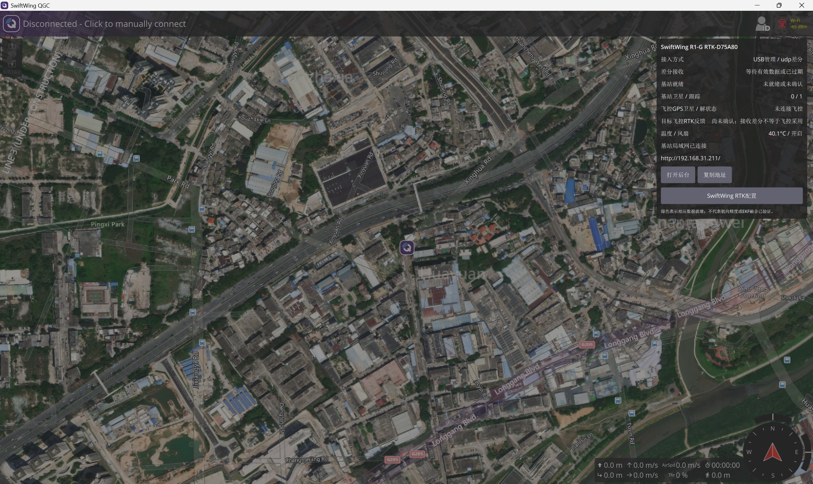
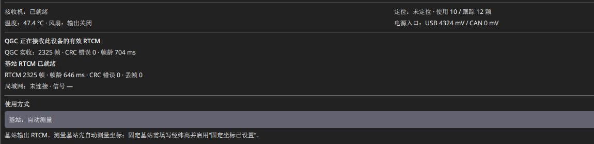
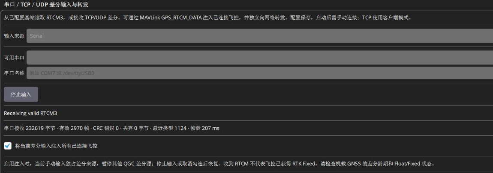

# 有线USB输出差分

使用本项目 **SwiftWing QGC 0.1.0 build8** 的自动识别能力，把基站差分接入地面站。注意这里接的是 **RTK 调试口**，不是供电板的充电 USB。

### 配置 / 调试时，临时用 USB 获取 RTCM

1. 电脑用数据线接 **RTK 调试口**。
2. 打开 QGC，选择对应基站，确认 AUTO 路由及当前 USB 来源。
3. 等有效帧持续增加，再勾选注入已连接飞控并检查移动端。

## 一、基站 USB 自动接入

1. 基站的一个物理 USB 提供两个接口，QGC 按身份区分，不按 COM 号大小猜测。
2. 选择正确的 **SwiftWing R1-G RTK**，核对硬件短码、完整序列号和固件。
3. 路由设 AUTO 并保存，等待 QGC USB 会话生效。观察 **QGC 正在接收此设备的有效 RTCM** 和 **QGC 实收：…帧 · CRC 错误… · 帧龄…ms**。
4. 仅显示 **USB RTCM 已连接，等待有效差分** 时，查基站角色、ANT1、测量和 RTCM 就绪，不把它当接收成功。

AUTO 基于有效 QGC 会话使用 USB；USB 优先时 Wi-Fi 自动关闭省电。

## 二、转发飞控与反馈绑定

QGC连接飞控，勾选 **将 QGC 收到的差分注入已连接飞控**。手动输入区对应选项名为 **将当前差分输入注入所有已连接飞控**。

当前实机处于 **Receiving valid RTCM3**，有效帧和帧龄可见，注入飞控选项已勾选。输入读取中时部分来源字段不可编辑；

## 三、SwiftWing 基站搭配其他厂家移动端

### 1. 移动端正常连接飞控

基站提供 RTCM3 差分，不要求移动端也使用 SwiftWing；

| 机载移动端 | 前置条件 | 差分怎样到达 |
| --- | --- | --- |
| 其他厂家 DroneCAN GPS | 对方支持标准 DroneCAN RTCM 接收，飞控支持该型号；CAN 速率、终端和供电按其手册核对 | SwiftWing 基站 → QGC → MAVLink → 飞控 → DroneCAN → 第三方移动端 |
| 其他厂家串口 GPS | 飞控支持该型号的定位协议，并支持向该 GPS 串口注入 RTCM；线序、电平、波特率正确 | SwiftWing 基站 → QGC → MAVLink → 飞控 → GPS 串口 → 第三方移动端 |
| 只有定位输出、不能接收 RTCM 的普通 GPS | 不满足 RTK 差分接收条件 | 增加地面基站不会让它获得 RTK 功能 |

注意

其他厂家移动端按照其手册配置，确保飞控支持该型号的定位协议。

### 2. 按顺序接入并检查

1. **先配本基站**：按[快速上手](快速上手.md)前四步完成建站和 QGC 接收；日常仍优先 UDP，USB 用于配置和备用。默认参考 / 观测输出为 `1006 / 1033 / 1074 / 1084 / 1094 / 1124`，需核对第三方移动端能使用所需星座和频点；对方要求的额外报文不在默认列表时，不能直接认为已满足。
2. **再配第三方移动端与飞控**：用厂家工具保存其接收机设置，按该厂家的飞控教程选 CAN 或串口 GPS 驱动。SwiftWing 的 `RTK_ROLE`、`CAN_HDG_PROFILE`、`HDG_LEN_CM`和网页菜单不用于配置第三方设备；串口 GPS 不照抄 DroneCAN 的 `GPS1_TYPE=9`。
3. **连接目标飞控**：通过 USB / 遥测接入 QGC，只保留本轮目标；勾选 **将 QGC 收到的差分注入已连接飞控**。CAN 路线还要确认飞控向 CAN 转发 RTCM；例如本手册适用的经典 PX4 使用 `UAVCAN_PUB_RTCM=1`，此参数不用于串口 GPS 的差分出口。

   

4. **确认第三方移动端收到**：在其厂家状态工具或飞控支持的诊断中查看 RTCM 接收 / 差分龄；不要尝试用 SwiftWing 移动端网页读它。飞控通过哪个接口连接 GPS，就检查该接口的注入链路。
5. **确认目标 GPS 解状态**：在 QGC 查看对应的 `GPS_RAW_INT` / `GPS2_RAW`，核对卫星数及 `fix_type`（5=RTK Float，6=RTK Fixed）。多 GPS 时选中第三方移动端对应实例；基站图标绿色只说明相应差分接收状态。
6. **需要航向时另行配置**：第三方移动端必须自身具备双天线或其他航向能力，并与飞控协议兼容。基线、偏角、航向来源及检查方式按该厂家手册处理，不能因为收到本基站差分就套用 SwiftWing 的航向参数。

### 3. 使用其他地面站软件时

* 使用官方QGC地面站软件时，以官方支持功能为准。

* SwiftWing USB 自动配对是定制功能，其他软件不支持；
