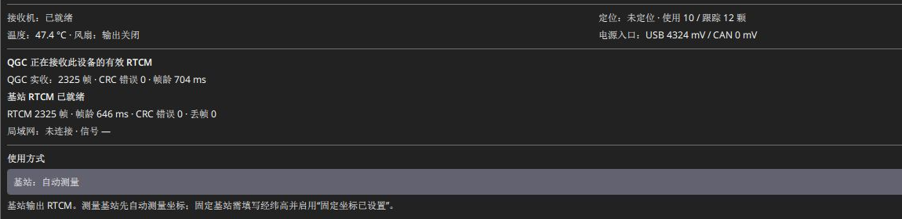
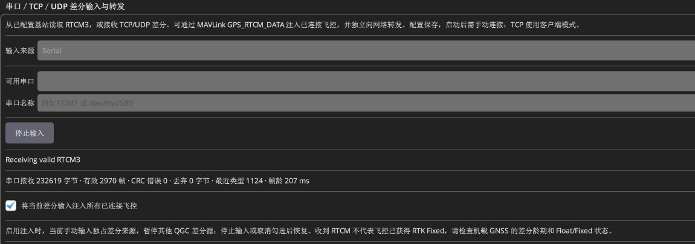

# 通过 USB 与地面站输出差分

使用本项目 **SwiftWing QGC 0.1.0 build8** 的自动识别能力，把基站差分接入地面站。注意这里接的是 **RTK 调试口**，不是供电板的充电 USB。

### 配置 / 调试时，临时用 USB 获取 RTCM

1. 电脑用数据线接 **RTK 调试口**，让主板得到供电。
2. 若同时需要给电池补电，匹配的 **12 V 档 PD 充电器**另接 **供电板 USB-C**；主板仅由电脑 USB 工作时，SW1 可关闭。
3. 打开 QGC，选择对应基站，确认 AUTO 路由及当前 USB 来源。
4. 等有效帧持续增加，再勾选注入已连接飞控并检查移动端。

主板的数据线和供电板的充电线可以同时连接。充电口不枚举数据，调试口 USB 也不会反向替电池充电；两口作用见[供电与充电](供电与充电.md#charging)。

配置完毕，开启 SW1 并确认供电，再断开调试口数据线回到 UDP。**基站低电时也可由供电板 USB 供电、补电并继续使用 UDP，不需要按电量切换 RTCM 传输方式。**

## 一、基站 USB 自动接入

1. RTK 主板原生 USB 接电脑，关闭占用其配置/RTCM 串口的软件。一个物理 USB 提供两个接口，QGC 按身份区分，不按 COM 号大小猜测。
2. 选择正确的 **SwiftWing R1-G RTK**，核对硬件短码、完整序列号和固件。基站与移动端可同时连接，配置选择与基站数据会话分开。
3. 路由设 AUTO 并保存，等待 QGC USB 会话生效。观察 **QGC 正在接收此设备的有效 RTCM** 和 **QGC 实收：…帧 · CRC 错误… · 帧龄…ms**。
4. 仅显示 **USB RTCM 已连接，等待有效差分** 时，查基站角色、ANT1、测量和 RTCM 就绪，不把它当接收成功。虚拟 USB 波特率不等于 UM982 内部串口速率，不因等待提示就改接收机串口波特率。

AUTO 基于有效 QGC 会话使用 USB；USB 优先时 Wi-Fi 自动关闭省电，旧 Wi-Fi 和地址配置仍保留。调试口 USB 断开后，基站恢复 UDP 路径；需要 UDP 同时验证时参见 [Wifi 输出差分](Wifi输出差分.md)。

管理口输出配置协议，不能当原始 RTCM 使用。RTCM 口用于输出，往该口写入的数据不会作为设备的差分输入。主机打开接口时应正确设置 DTR；部分通用串口软件需另行启用该选项。

未知 UDP/TCP 差分在 QGC 中可显示通用有效 RTCM 状态，但不能借另一个 USB 设备的产品名/IP 冒充来源。

建议

日常可直接点击顶部 <strong>三脚架形基站图标</strong> 查看实时状态。尚未收到有效差分时，已识别的 USB 基站也会显示红色图标并提供配置入口；完整颜色、弹窗和按钮说明见<a href="../QGC地面站参数修改/#rtk-indicator">基站图标功能</a>。

## 二、转发飞控与反馈绑定

连接所需飞控，勾选 **将 QGC 收到的差分注入已连接飞控**。手动输入区对应选项名为 **将当前差分输入注入所有已连接飞控**。首次联调只连接本轮目标飞控，避免无意向其他飞控注入。

**绑定当前飞控反馈** 只选择本页及基站状态所用的返回反馈目标，不限制差分只发送给它。切换活动飞控也不会自动改变已绑定反馈；换机时重新核对或 **解除绑定**。反馈固定仅表示该目标的新鲜 GPS 固定报告，不等于精度和航向验收。

当前实机处于 **Receiving valid RTCM3**，有效帧和帧龄可见，注入飞控选项已勾选。输入读取中时部分来源字段不可编辑；不要为了查看选项而停止正在使用的差分。

使用 **SwiftWing 移动端**时，**PX4 1.17 固件**需启用 CAN GPS 并设置 `UAVCAN_PUB_RTCM=1`，ArduPilot 按[移动端教程](../SwiftWing_R1_RTK_移动端/快速上手.md)配置 DroneCAN GPS、航向和杆臂。机载使用 **其他厂家移动端**时改按下节选择 CAN / 串口路线。经 QGC 和飞控转发时，基站本身不需要再接飞控 CAN。

## 三、SwiftWing 基站搭配其他厂家移动端

### 1. 先按移动端接口选路线

基站提供 RTCM3 差分，不要求移动端也使用 SwiftWing；前提是对方接收机、飞控驱动及中间链路都支持所用数据。

| 机载移动端 | 前置条件 | 差分怎样到达 |
| --- | --- | --- |
| 其他厂家 DroneCAN GPS | 对方支持标准 DroneCAN RTCM 接收，飞控支持该型号；CAN 速率、终端和供电按其手册核对 | SwiftWing 基站 → QGC → MAVLink → 飞控 → DroneCAN → 第三方移动端 |
| 其他厂家串口 GPS | 飞控支持该型号的定位协议，并支持向该 GPS 串口注入 RTCM；线序、电平、波特率正确 | SwiftWing 基站 → QGC → MAVLink → 飞控 → GPS 串口 → 第三方移动端 |
| 只有定位输出、不能接收 RTCM 的普通 GPS | 不满足 RTK 差分接收条件 | 增加地面基站不会让它获得 RTK 功能 |

注意

“有 CAN 插头”不等于支持 DroneCAN RTCM；其他 CAN 协议需厂家网关或驱动。“飞控能显示串口 GPS 位置”也不保证该驱动已支持差分回传，接收条件须由具体型号与飞控版本确认。

### 2. 按顺序接入并检查

1. **先配本基站**：按[快速上手](快速上手.md)前四步完成建站和 QGC 接收；日常仍优先 UDP，USB 用于配置和备用。默认参考 / 观测输出为 `1006 / 1033 / 1074 / 1084 / 1094 / 1124`，需核对第三方移动端能使用所需星座和频点；对方要求的额外报文不在默认列表时，不能直接认为已满足。
2. **再配第三方移动端与飞控**：用厂家工具保存其接收机设置，按该厂家的飞控教程选 CAN 或串口 GPS 驱动。SwiftWing 的 `RTK_ROLE`、`CAN_HDG_PROFILE`、`HDG_LEN_CM`和网页菜单不用于配置第三方设备；串口 GPS 不照抄 DroneCAN 的 `GPS1_TYPE=9`。
3. **连接目标飞控**：通过 USB / 遥测接入 QGC，只保留本轮目标；勾选 **将 QGC 收到的差分注入已连接飞控**。CAN 路线还要确认飞控向 CAN 转发 RTCM；例如本手册适用的经典 PX4 使用 `UAVCAN_PUB_RTCM=1`，此参数不用于串口 GPS 的差分出口。

   

4. **确认第三方移动端收到**：在其厂家状态工具或飞控支持的诊断中查看 RTCM 接收 / 差分龄；不要尝试用 SwiftWing 移动端网页读它。飞控通过哪个接口连接 GPS，就检查该接口的注入链路。
5. **确认目标 GPS 解状态**：在 QGC 查看对应的 `GPS_RAW_INT` / `GPS2_RAW`，核对卫星数及 `fix_type`（5=RTK Float，6=RTK Fixed）。多 GPS 时选中第三方移动端对应实例；基站图标绿色只说明相应差分接收状态。
6. **需要航向时另行配置**：第三方移动端必须自身具备双天线或其他航向能力，并与飞控协议兼容。基线、偏角、航向来源及检查方式按该厂家手册处理，不能因为收到本基站差分就套用 SwiftWing 的航向参数。

图中是既有 SwiftWing 实机差分素材，用于说明 QGC 注入入口，不代表图内接收端是某款第三方设备。仅看到有效 RTCM 计数仍不能代替接收机 Fixed 检查。

### 3. 对方设备能直接接收原始 TCP / UDP 时

这类设备可按接口条件跳过 QGC / 飞控的差分转发；先查厂家是否明确支持**原始 RTCM3 网络输入**，不能只看它有 Wi-Fi 或 NTRIP 菜单。

| 对方设备具备什么能力 | 本基站怎样设置 | 对方怎样设置 |
| --- | --- | --- |
| 原始 TCP RTCM 客户端 | 按[TCP 输出](Wifi输出差分.md#tcp-output)保存手动路由并启用 TCP；确认本基站实际 LAN IP，默认端口 2101 | 连接本基站实际 IP:2101，按原始 RTCM3 流读取；当前最多两个 TCP 客户端 |
| 原始 UDP RTCM 监听 | 按[UDP 设置](Wifi输出差分.md)将目标改为**对方接收设备实际 IPv4**与约定端口；仅用 UDP 时为 mask=1，若保留主板 USB 管理则用手动路由 | 在约定接口 / 端口接收原始 RTCM3；需要可互通局域网 |
| 只有 NTRIP 客户端 | 本基站 2101 是原始 TCP 服务，不提供账号或挂载点 | 不能把本基站当 NTRIP Caster；使用 QGC / 飞控路线，或另行部署并配置合适的 NTRIP 中转 |

改用直接 UDP 后，目标不再是 QGC 电脑；不能要求 QGC 仍必然收到同一份数据。只把设备接到同一路由器不会自动接收差分。若对方直接连接其接收机专用差分串口，还需使用厂家支持的网络 / 电台转换设备及正确电平，不能把 RTK 主板调试 UART0 当成外部 RTCM 透传口。

### 4. 使用其他地面站软件时

先确认该软件能接收本基站的**原始 RTCM3**。可选其支持的 UDP / 原始 TCP 输入；支持手动读取 USB RTCM 的软件，还需按本基站[接口定义](../RTK通用/接口数据与差分链路.md)选 CDC1，并确保输出路由实际启用 USB。第三方软件不具备 SwiftWing QGC 的应用会话时，AUTO 不会只因打开 COM 就切到 USB，需用 SwiftWing 工具预先保存 **手动路由 + USB 出口（mask=4）**并释放端口。

SwiftWing USB 自动配对与参数页不能推定其他地面站也支持；不支持原始输入时，使用本手册的 SwiftWing QGC 路线。避免两个软件争用同一串口或同时给同一飞控注入不同来源。

飞控端原理可参考 [PX4 RTCM 转发](https://docs.px4.io/main/en/advanced/rtk_gps)与 [ArduPilot RTK 差分接入](https://ardupilot.org/copter/docs/common-rtk-correction.html)。以上按接口能力说明使用逻辑，具体第三方型号仍需确认，不代表已经逐台实测。
