

# 无线输出差分

基站可通过无线 UDP 主动推送或原始 TCP 服务端输出差分。默认路由为 **AUTO**：有有效 QGC USB 会话时优先 USB，否则走 UDP。

## 一、接入局域网

1. 使用USB连接基站调试口和电脑，打开 QGC 基站配置，填写外部 2.4 GHz 局域网热点 SSID 和密码，点 **保存局域网设置**。

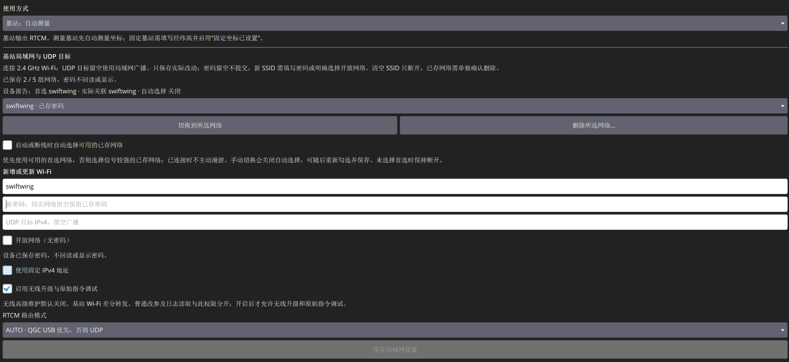

2. 可保存最多 5 组网络，新增网络要输入密码或明确选择开放网络；同 SSID 改 UDP 目标时密码留空会保留，不必重填。容量满会拒绝新增，不覆盖旧账号。

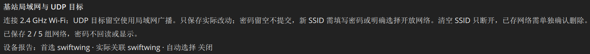

3. 自动选网在启动/断线时优先可用首选，否则选已存网络中信号更强的；已连接时不主动漫游。手动选已存网络不用重输密码，通常会关闭自动选择，需要时再开启保存。
4. 填 **UDP 目标 IPv4** 为运行 QGC 的电脑地址。只改需要变更的字段，保存后等实际关联/IP 状态，不把已存 SSID 当作已联网。（不填目标UDP的IP，基站默认广播RTCM）

[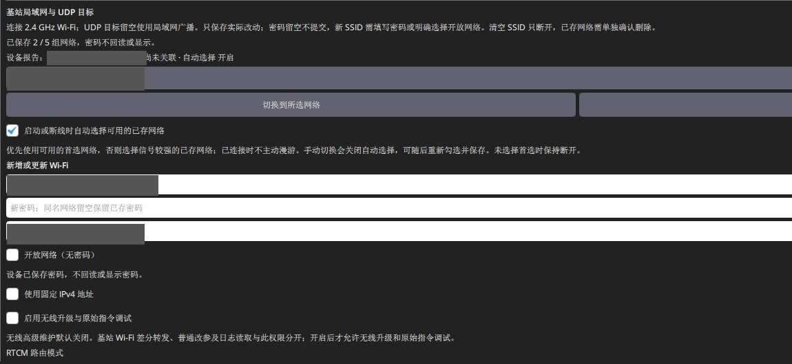](../RTK通用/image/实机操作/qgc-network-settings.png)

| 地址项目 | 示例 | 用途 |
| --- | --- | --- |
| 路由器/热点网关 | 192.168.10.1 | 现场网关 |
| 基站 LAN IP | 192.168.10.60 | QGC 管理、网页、TCP 服务器地址 |
| UDP 目标 IP | 192.168.10.100 | QGC 接收电脑，不是基站自身 |
| UDP 端口 | 13320 | QGC 监听与基站发送使用同一端口 |

连接路由器或热点即可使用其局域网，差分转发本身不要求互联网。设备热点与外部 Wi-Fi 是不同连接：无线开启后，未取得外部网络 IP 时提供恢复热点；成功取得 LAN IP、且没有临时窗口或高级维护时，通常关闭设备热点，改用实际 LAN IP 管理。不能把“保存网络”理解为两种入口始终同时开启，完整条件见[本基站热点与后台规则](设备后台参数修改.md#wireless-rules)。

## 二、打开 QGC 的 UDP 输入

在 **应用设置 → NTRIP/RTK → UDP RTCM Input** 检查 **Enable UDP RTCM input** 已开启，**UDP RTCM input port=13320**。SwiftWing QGC默认开启，但会保留用户以前保存的关闭状态。Windows 防火墙允许所用局域网 UDP 入口；热点若隔离客户端，连接成功也可能收不到包。

[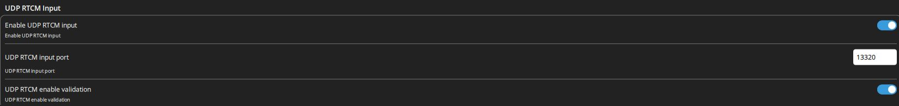](../RTK通用/image/实机操作/qgc-udp-input.png)

## 三、基站UDP

配置好后，**开启供电板 SW1**，再断开 **RTK 主板的数据 USB**。

收到有效 RTCM 后，再核对 QGC 转发、移动端差分龄与位置解。

### 在 QGC 确认 UDP 已收到

1. 返回飞行页面，点击顶部 **RTK / 三脚架图标**。

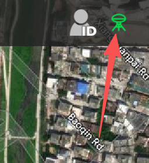

2. 查看 **接入方式**，已关联基站时显示类似 **HTTP 管理 / udp 差分**；前者用于设备管理，后者是实际差分入口。只收到 UDP 尚未关联设备时，也可能显示 **未知管理 / udp 差分**。

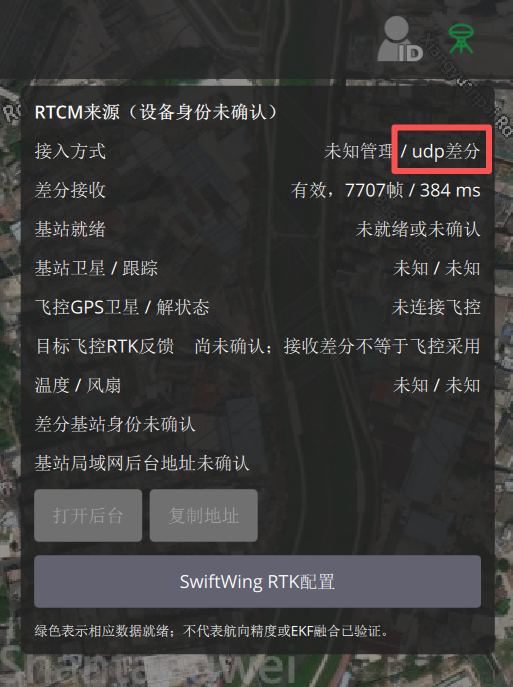

3. 观察 **差分接收**：有效帧持续增加，帧龄持续刷新；已关联对应基站时，再检查参考与观测就绪。身份、颜色、各项数据和按钮用途见[基站图标说明](QGC地面站参数修改.md#rtk-indicator)。

[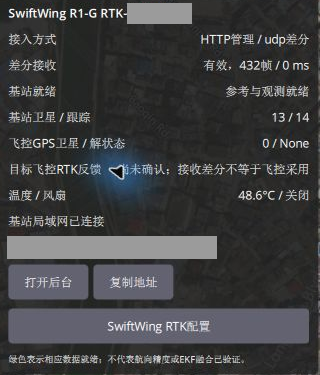](../RTK通用/image/实机操作/qgc-udp-status.png)

上图显示收到 432 个有效帧，基站使用 / 跟踪卫星为 13 / 14。图中飞控刚连接，下方 GPS 0 / None 尚未更新；移动端的卫星和定位应按[移动端教程](../SwiftWing_R1_RTK_移动端/差分与Wi-Fi后台.md#qgc-gps)另看。

4. 在 **NTRIP/RTK**差分转发区域勾选 **将 QGC 收到的差分注入已连接飞控**，再检查移动端的 RTCM 输入和定位解。

[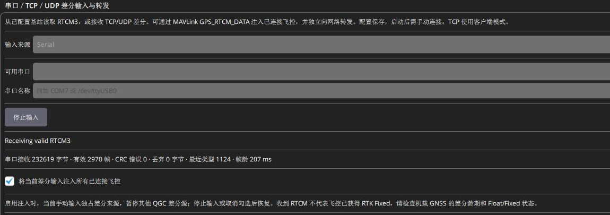](../RTK通用/image/实机操作/qgc-rtcm-relay.png)

若设备区仍提示“USB 差分尚未接入 QGC”，它只说明 USB 路线。使用 UDP 时以实时 UDP 接收状态为准。

[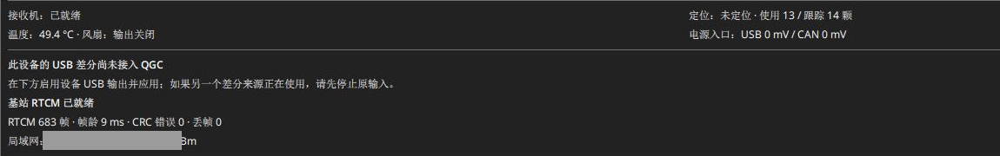](../RTK通用/image/实机操作/qgc-udp-base-panel.png)

## 四、TCP 输出

TCP 用于接收端主动连接基站，基站是服务端。端口默认 2101，但它是 **原始 RTCM 流，不是 NTRIP Caster**，不需要账号、密码或挂载点。

### 1. 基站设置

1. 接入可用局域网，确认基站实际 LAN IP。

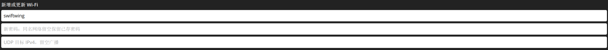

2. 路由选择 **手动 · 使用下方 RTCM 出口配置**，点 **保存局域网设置**。

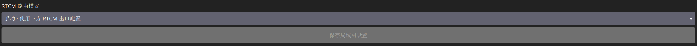

3. 仅用 TCP 时取消 UDP、USB 和 CAN 出口，只勾 **TCP → 等待接收端连接**，端口 2101，点 **应用并保存**，读回 mask=2；若保留 UDP 则为 3。TCP 不在 AUTO 自动选择路径里。

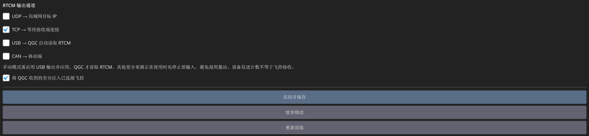

| 手动出口 | mask 位 | 说明 |
| --- | --- | --- |
| UDP → 局域网目标 IP | `1` | 主动发给目标地址；空目标使用对应网络广播 |
| TCP → 等待接收端连接 | `2` | 接收端连接基站 IP:2101，当前最多两个客户端 |
| USB → QGC 自动读取 RTCM | `4` | 原生 USB RTCM 接口 |
| CAN → 移动端 | `8` | 特定直连方案；经飞控转发时不需要 |

组合值相加。保存 mask 只在手动路由生效；AUTO 的有效出口是 USB 4 或 UDP 1，保留的 mask 可能不同。

### 2. QGC 开始读取

在 **NTRIP/RTK → 串口／TCP／UDP 差分输入与转发**，来源选 **TCP client**，**TCP 服务器** 填基站实际 IP，端口 2101，输入格式 **Raw RTCM3**，点击 **开始读取**。需要经飞控送移动端时，勾选注入已连接飞控的选项。

该手动面板会保存字段，但不保证每次启动 QGC 都自动开始 TCP 读取。再次打开 QGC 后检查连接，必要时重新点开始。完成测试用 **停止输入**，再切回计划使用的 AUTO USB/UDP；旧手动输入/NTRIP 可能占据更高优先级，导致你看到的不是新接入的来源。

不要同时混入不同基站。QGC 自动 USB/UDP 有仲裁，显式手动串口、TCP/UDP 或 NTRIP 可优先占用来源。排查时先只保留一个预期输入，核对来源和站号，再扩展连接。

## 五、基站日常管理

风扇按本手册保存为 **35 °C 开启、30 °C 停止**；后台「风扇输出」与实际转动要分别确认。板温不是电芯温度；USB/CAN 5 V 读数不是电池电量。供电板低压报警与主板飞控状态蜂鸣分开。

切换角色、重测坐标、恢复出厂或 UM982 原始命令都可能中断有效差分，不在飞行作业中执行。本项目没有搬移保护，移动基站前应结束相关作业、停稳后重新建站；「移动端继续有定位」不代表错误参考坐标下差分仍正确。
