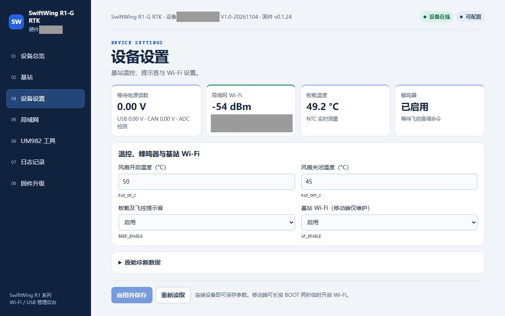

# 基站供电、充电与温控

本页介绍 2S 18650 供电板及 V1.0 RTK 主板。完整操作顺序先看[快速上手流程](快速上手.md)，本页用于查电源、充电时间、续航和风扇设置。

**日常优先 UDP，无需按电量切换差分路线。** 电池可给基站供电；接供电板 USB-C、开启 SW1 后，也可经 XT30 给主板供电并给电池补电。主板 USB 用于配置，也支持备用 RTCM。

两只 18650 串联为 2S；两节 2200 mAh 串联后仍为 2200 mAh，电压相加，不是 4400 mAh。实体连接为 **供电板 SYS_SW_OUT → RTK 主板 XT30**。

## 一、先接对两个 USB

| 接口 | 用途 | 要点 |
| --- | --- | --- |
| 供电板 USB-C | PD 输入、2S 电池充电、经 SW1 向基站供电 | 接匹配充电器；SW1 开启才能向主板 XT30 供电，不传 QGC 数据 |
| RTK 调试 USB-C  | QGC 配置、USB RTCM、5 V 供电 | 接电脑数据线；不会给 2S 电池充电 |
| RTK 主板 XT30 | 接供电板开关后输出 | 走主板降压路径，不是 USB/CAN 的 5 V 脚 |
| RTK 的 CAN_5V | 外部 5 V 输入 | 不能接 2S 电池或快充 12 V |
| FAN+ / FAN- | 受控风扇回路 | FAN- 不能再搭到 GND，否则绕过温控 |

**日常边充边用 UDP：PD 充电器 → 供电板 USB-C → 开启 SW1 → XT30 → RTK 主板**，同时由 Wi-Fi 向 QGC 发送 RTCM。主板 USB 数据线可以拔掉。

注意

仅在需要 USB 配置 / 取数据且同时补电时，才同时接两根线：<strong>电脑 → 主板 USB-C</strong>、<strong>PD 充电器 → 供电板 USB-C</strong>。只接主板 USB 时主板可工作，但电池没有在充电。

## 二、按步骤充电

1. **仅充电收纳**时关闭 SW1；**边充边用基站**时开启 SW1，使充电口输入经 XT30 给主板供电，差分仍优先走 UDP。SW1 关闭不会切断电池充电支路。
2. 选择与设计匹配、明确支持 **12 V 档位**的 PD 快充电源和线材，接供电板 USB-C。只有 PD 字样、但没有所需档位的电源不能保证匹配。
3. 查看供电板充电指示：输入红灯表示输入侧有电，充电红灯表示正在充电，绿灯通常表示充电完成 / 待机；输入灯亮不单独证明已协商到 12 V。
4. 确认供电稳定、需要作业时按[UDP 操作步骤](快速上手.md#choose-link)使用；补电本身不要求改用主板 USB 获取差分。仅收纳时保持 SW1 关闭。

### PD、2S 均衡和过充保护分别做什么

| 功能 | 对使用者的作用 |
| --- | --- |
| PD 快充输入 | CH224A 设计请求 12 V，供后级充电电路使用；不是让快充电压进入电脑或 CAN 的 5 V 口 |
| 2S 充电 | TP5100 按两节串联电池充电，正常目标总压约 8.4 V；普通 5 V 输入不能保证该降压方案充满 2S |
| 两节被动均衡 | HY2213 支路在充电末段对较高电压电芯进行有限电流泄放，减小单节差异；仍需使用匹配电芯 |
| 过充保护 | HY2120 配合保护 MOS 对单节过压等异常条件提供保护；保护阈值不是日常充电目标 |

以上为该供电板的电路功能，分别依据充电及保护器件设计

## 三、SW1 电源开关怎么用

- **开启 SW1**：供电板向主板 XT30 供电，适用于电池工作或接供电板 USB 边充边用。
- **关闭 SW1**：断开该 XT30 负载支路，适用于结束作业或单独充电。
- **关了仍在运行**：检查主板 USB 或带电 CAN 是否还提供外电。完全关机需要结束作业并移除这些外电。

注意

充电、保护、均衡和低压报警电路仍接电池，SW1 关闭不是物理隔离电芯，仍有待机消耗。该电路提供边充边用路径，但没有据此承诺外电插拔完全不重启；切换供电后要重新看差分接收。

## 四、充电、使用与存放时间参考

| 项目 | 已有记录 | 应怎样安排 |
| --- | --- | --- |
| 上电运行 | 历史基站加风扇样机约 4.5 小时至 7.03 V 低压报警 | 可提前约 4 小时检查电量并准备补电，不把 4.5 小时当额定或保底续航 |
| 电池充电 | 白色飞线版两轮约 83 / 91 分钟至绿灯 | 不是从完全没电充到满，不能承诺所有版本的 0%～100% 时间 |
| 无负载存放 | 供电 PCB 单独连接 2S 2200 mAh，约 7 天后仍有电；开关版 8.34 → 8.08 V | 只是无负载参考；该次 SW1 保持开启，并未测出严格关闭开关后的待机上限 |

**关机后能放多久：目前不能可靠标成固定几个月。** 已有数据支持无负载一周以上的观察记录，缺少 SW1 关闭状态的静态电流与完整放电测试。收纳后按周检查电量，长期停用按电池说明隔离电芯；不要只关开关就长期搁置。

说明

电池容量、老化、温度、无线状态和风扇运行时间都会影响续航。不能用电压下降速度直接线性推算待机天数。

## 五、温度检测与风扇散热

1. 打开基站网页 **设备设置**，或在 QGC 基站弹窗查看 **温度 / 风扇**。检测值来自主板 NTC，是 RTK 板温，不是电池温度。
2. 将基站温控设置为 **`FAN_ON_C=35`、`FAN_OFF_C=30`**，保存后按下表工作。已有设备需修改并保存，不能把手册更新当作设备阈值已改变。

| 板温（本手册设置） | 风扇动作 |
| --- | --- |
| 达到或超过 35 °C | 开启散热 |
| 高于 30 °C、低于 35 °C | 保持此前状态，避免反复启停 |
| 降至 30 °C 或以下 | 关闭风扇 |

3. 填写 **`FAN_ON_C=35`、`FAN_OFF_C=30`** 后点 **应用并保存**，再点 **重新读取**；关闭温度必须低于开启温度。例如风扇在 36 °C 时开启，降到 33 °C 时继续转，降到 30 °C 才停止。

此截图为旧阈值，仅作界面位置说明

4. 实物风扇接 **FAN+ / FAN−**，FAN− 不再接 GND；确认转动和通风正常。页面“开启”是控制输出，没有转速反馈。

## 六、低压报警与后台读数

LM393/TL431 分压设计报警点约 7.0 V，实测在 7.03 V 附近开始响。间歇响转长鸣的时间规律不能由RTK 的`BEEP_ENABLE` 控制。

注意

QGC 的 USB/CAN 5 V 检测不是 2S 电池遥测，不能显示电池百分比或证明已充满。低压报警后应结束作业并补电，不把保护器件最终断电当作正常续航终点。

## 附录：实测续航与充电数据

| 项目 | 实测结果 | 测试条件 |
| --- | --- | --- |
| 连续运行 | 约 **4.5 小时** 至 7.03 V 低压报警，由 1.5 小时与 3 小时两段连续相接 | 基站加散热风扇持续运行，2S 2200 mAh |
| 电池充电 | 约 **83 / 91 分钟** 至绿灯，总压 7.18 → 8.41 V、7.74 → 8.42 V | 白色飞线版，非从空电起充 |
| 无负载待机 | 8.34 → 8.08 V / 171 小时，约 **1.52 mV/h**；无开关版约 1.34 mV/h | 仅接供电 PCB，SW1 保持开启 |

说明

以上为单次实测，不是额定或保底值。船型开关版与无开关版起始电压不同，0.03 V 差值不能说明开关版更耗电；电压-SOC 非线性与充后松弛也会改变斜率，不能由电压下降速度线性推算待机天数。两次充电均非 0% 到 100%，不能反推容量、充电电流或承诺充满时间。

严格关闭 SW1 后的静态电流与待机上限尚未测得。负载下充电与温升、外电插拔是否重启、两节均衡与截止、低压报警回差及保护动作仍需单独验证。约 7 V 报警与实测 7.03 V 相近，短响转长鸣的「两分钟」不作为精确定时功能。

## 器件参考

- [P1：WCH CH224 系列官方手册入口](https://www.wch-ic.com/downloads/CH224DS1_PDF.html)
- [P2：TopPower TP5100 官方产品资料](https://www.toppwr.com/eproduct/view.php?id=482)
- [P3：TI TPS54302 官方数据手册](https://www.ti.com/lit/ds/symlink/tps54302.pdf)
- [P4：HYCON HY2120 官方保护芯片手册](https://www.hycontek.com/wp-content/uploads/DS-HY2120_EN.pdf)
- [P5：HYCON HY2213 官方均衡芯片手册](https://www.hycontek.com/hy_battery/DS-HY2213_EN.pdf)
- [PX4 v1.17 DroneCAN 说明](https://docs.px4.io/v1.17/en/dronecan/index)
