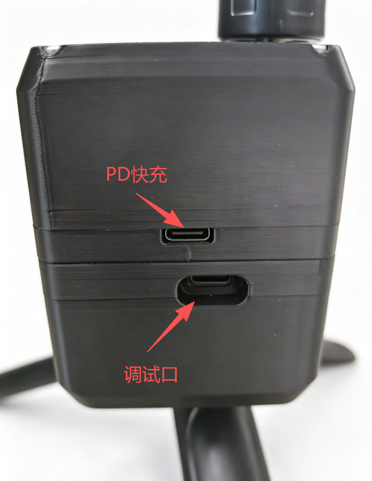
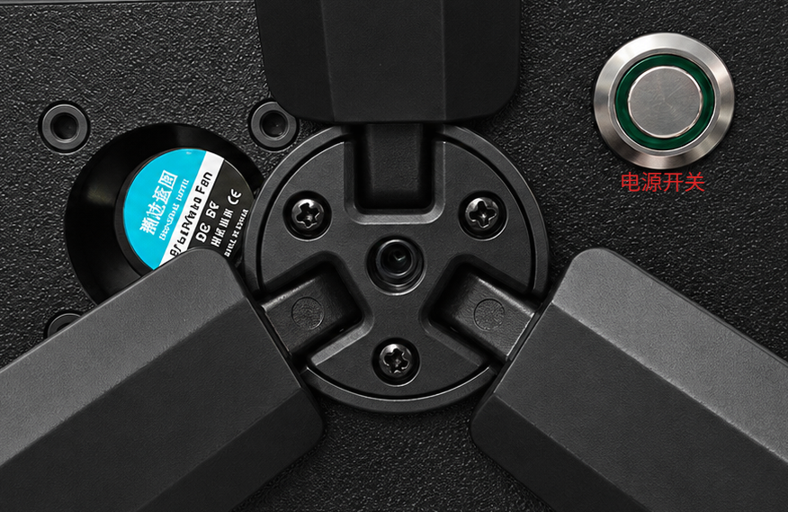

# 基站供电、充电与温控

## 一、供电接口说明

| 接口 | 用途 | 要点 |
| --- | --- | --- |
| 供电板 USB-C | PD 输入、2S 电池充电、经 SW1 向基站供电 | 接匹配充电器；SW1 开启才能向主板 XT30 供电，不传 QGC 数据 |
| RTK 调试 USB-C  | QGC 配置、USB RTCM、5 V 供电 | 接电脑数据线；不会给 2S 电池充电 |
| RTK 主板 XT30 | 接供电板开关后输出 | 走主板降压路径，不是 USB/CAN 的 5 V 脚 |
| RTK 的 CAN_5V | 外部 5 V 输入 | 不能接 2S 电池或快充 12 V |

**日常边充边用 UDP：PD 充电器 → 供电板 USB-C → 开启 SW1 → XT30 → RTK 主板**，同时由 Wi-Fi 向 QGC 发送 RTCM。主板 USB 数据线可以拔掉。

注意

仅在需要 USB 配置 / 取数据且同时补电时，才同时接两根线：<strong>电脑 → 主板 USB-C</strong>、<strong>PD 充电器 → 供电板 USB-C</strong>。只接主板 USB 时主板可工作，但电池没有在充电。

## 二、充电

1. **仅充电**时关闭 SW1；**边充边用基站**时开启 SW1。SW1 关闭不会切断电池充电支路。
2. 选择与设计匹配、明确支持PD快充电源和线材，接供电板 USB-C。只有 PD 字样、但没有所需档位的电源不能保证匹配。

## 三、SW1 电源开关怎么用

- **开启 SW1**：供电板向主板 XT30 供电，适用于电池工作或接供电板 USB 边充边用。
- **关闭 SW1**：断开该 XT30 负载支路，适用于结束作业或单独充电。
- **关了仍在运行**：检查主板 USB 或带电 CAN 是否还提供外电。完全关机需要结束作业并移除这些外电。

## 四、充电、使用与存放时间参考

| 项目 | 已有记录 | 应怎样安排 |
| --- | --- | --- |
| 上电运行 | 历史基站加风扇样机约 4.5 小时至 7.03 V 低压报警 | 可提前约 4 小时检查电量并准备补电，不把 4.5 小时当额定或保底续航 |
| 电池充电 | 白色飞线版两轮约 83 / 91 分钟至绿灯 | 不是从完全没电充到满，不能承诺所有版本的 0%～100% 时间 |
| 无负载存放 | 供电 PCB 单独连接 2S 2200 mAh，约 7 天后仍有电；开关版 8.34 → 8.08 V | 只是无负载参考；该次 SW1 保持开启，并未测出严格关闭开关后的待机上限 |

**关机后能放多久：目前不能可靠标成固定几个月。** 已有数据支持无负载一周以上的观察记录，缺少 SW1 关闭状态的静态电流与完整放电测试。收纳后按周检查电量，长期停用按电池说明隔离电芯；不要只关开关就长期搁置。

## 六、低压报警与后台读数

LM393/TL431 分压设计报警点约 7.0 V，实测在 7.03 V 附近开始响。间歇响转长鸣的时间规律不能由RTK 的`BEEP_ENABLE` 控制。

## 附录：实测续航与充电数据

| 项目 | 实测结果 | 测试条件 |
| --- | --- | --- |
| 连续运行 | 约 **4.5 小时** 至 7.03 V 低压报警，由 1.5 小时与 3 小时两段连续相接 | 基站加散热风扇持续运行，2S 2200 mAh |
| 电池充电 | 约 **83 / 91 分钟** 至绿灯，总压 7.18 → 8.41 V、7.74 → 8.42 V | 白色飞线版，非从空电起充 |
| 无负载待机 | 8.34 → 8.08 V / 171 小时，约 **1.52 mV/h**；无开关版约 1.34 mV/h | 仅接供电 PCB，SW1 保持开启 |

说明

以上为单次实测，不是额定或保底值。船型开关版与无开关版起始电压不同，0.03 V 差值不能说明开关版更耗电；电压-SOC 非线性与充后松弛也会改变斜率，不能由电压下降速度线性推算待机天数。两次充电均非 0% 到 100%，不能反推容量、充电电流或承诺充满时间。

严格关闭 SW1 后的静态电流与待机上限尚未测得。负载下充电与温升、外电插拔是否重启、两节均衡与截止、低压报警回差及保护动作仍需单独验证。约 7 V 报警与实测 7.03 V 相近，短响转长鸣的「两分钟」不作为精确定时功能。

## 器件参考

- [P1：WCH CH224 系列官方手册入口](https://www.wch-ic.com/downloads/CH224DS1_PDF.html)
- [P2：TopPower TP5100 官方产品资料](https://www.toppwr.com/eproduct/view.php?id=482)
- [P3：TI TPS54302 官方数据手册](https://www.ti.com/lit/ds/symlink/tps54302.pdf)
- [P4：HYCON HY2120 官方保护芯片手册](https://www.hycontek.com/wp-content/uploads/DS-HY2120_EN.pdf)
- [P5：HYCON HY2213 官方均衡芯片手册](https://www.hycontek.com/hy_battery/DS-HY2213_EN.pdf)
- [PX4 v1.17 DroneCAN 说明](https://docs.px4.io/v1.17/en/dronecan/index)
