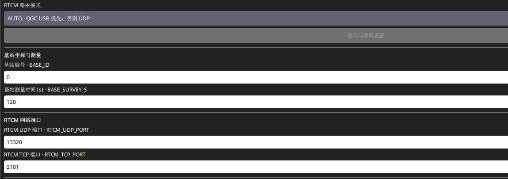

# 基站模式与参数

设备通过[主板 USB 接入 SwiftWing QGC](../RTK通用/软件下载与USB连接.md)，进入 **应用设置 → NTRIP/RTK → SwiftWing R1 / R1-G RTK**，选择基站并核对序列号。在使用方式和 **基站坐标与测量** 区域配置。

## 一、自动测量：新地点没有已知坐标

1. 天线接 ANT1 并固定，在 QGC 选择 **基站：自动测量**，即 `RTK_ROLE=1`。
2. 核对 `BASE_ID` 站号；普通单站可保留 0，避免接收端混入其他站数据。
3. `BASE_SURVEY_S` 初次保留 120 秒，允许 60–3600 秒。
4. 点 **应用并保存**，等保存并读回确认，核对角色和测量时间。
5. 保持天线不动，等待 **基站 RTCM 已就绪**，再确认 QGC 实收帧增长、CRC 和帧龄。

说明

测量时间是接收机建站配置，不是从 USB 插入起的保证倒计时；卫星观测条件差时不能只靠延长时间解决。自动平均也不是已知控制点测量，每次重启会重新测量，绝对参考位置可能变化。

实机界面

## 二、固定坐标：使用核验过的参考点

选择 **基站：固定坐标**，即 `RTK_ROLE=2`，输入实际 ANT1 参考点的纬度、经度和 WGS84 椭球高，确认固定坐标有效标记 `BASE_SET=1`，再应用、保存、读回。

| 设备参数 | 输入含义 | 仅说明单位的示例 |
| --- | --- | --- |
| `BASE_LAT_E8` | 纬度° × 100000000，北正南负 | 31.12345678° → 3112345678 |
| `BASE_LON_E8` | 经度° × 100000000，东正西负 | 121.12345678° → 12112345678 |
| `BASE_H_MM` | WGS84 椭球高 m × 1000 | 100.123 m → 100123 |
| `BASE_SET` | 用户确认坐标有效 | 1，不代表设备已验证坐标准确 |

按当前输入框单位填写，原始参数使用上述整数单位。

注意

示例不能照抄作现场坐标；海拔 / 正高 / MSL 不能直接当作椭球高。

当前固定坐标流程设置 UNDULATION 为 0。地面控制点到天线参考点的天线高需先换算，本板没有独立天线高参数代做此修正。

## 三、路由、出口与局域网

推荐路由选择 **“AUTO · QGC USB 优先，否则 UDP”**，在网络区点 **保存局域网设置**。有效 QGC USB 会话时运行出口为 USB 4，否则为 UDP 1；已保存的出口掩码不会因此自动改写。

建议

日常使用建议是 <strong>UDP 优先</strong>：主板 USB 用于配置，配置后在独立供电保持正常时拔掉数据线，让 AUTO 回到 UDP。电池或供电板 USB 接充电器均可经 SW1 供电，不按电量选择差分路线。

要使用 TCP 或指定多出口，先选 **手动 · 使用下方 RTCM 出口配置** 并保存网络，再配置 `RTCM_OUT_MASK` 并点 **应用并保存**：UDP=1、TCP=2、USB=4、CAN=8，组合相加。TCP 端口默认 2101，UDP 默认 13320。网络 SSID、密码和 UDP 目标不在这份出口掩码里。

- [USB 与地面站输出差分](USB与地面站输出差分.md)：AUTO 会话、接收帧、注入飞控。
- [Wi-Fi 输出差分](Wifi输出差分.md)：2.4 GHz 联网、固定 IP、UDP 目标、原始 TCP。
- [设备参数参考](../RTK通用/设备参数参考.md)：全部 23 项参数及默认范围。

## 四、如何判断已建站

基站应收到新鲜、匹配站号的参考报文 1006 和 MSM4 观测。当前默认 1006 约每 5 秒、1033 约每 10 秒，1074 / 1084 / 1094 / 1124 各约 1 Hz。只看到一个旧报文、PPS 灯或总帧数，不说明当前差分仍可用。

<code>GPS1_RATE_MS</code> 是移动端更新周期，不能用它把基站 RTCM 改成 20 Hz。基站就绪后，还要确认 QGC 实收和移动端使用；基站发送计数不是接收端确认。

## 五、修改与搬站

注意

改变角色、站号、坐标或发送接收机原始命令会重新配置 UM982，可能中断差分。作业前完成这些配置；需要搬站时先结束相关作业，重新固定并建站。本版本没有自动搬移保护，不能靠飞机仍显示 Fixed 判定搬站后参考坐标正确。

