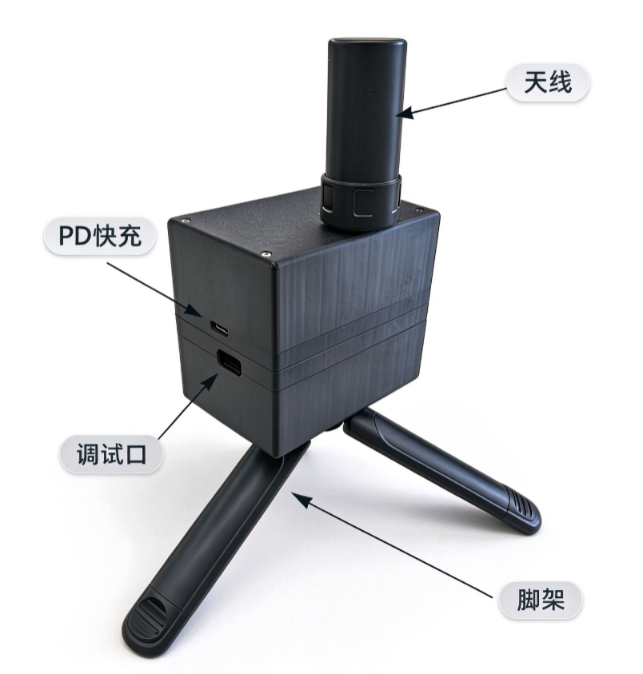
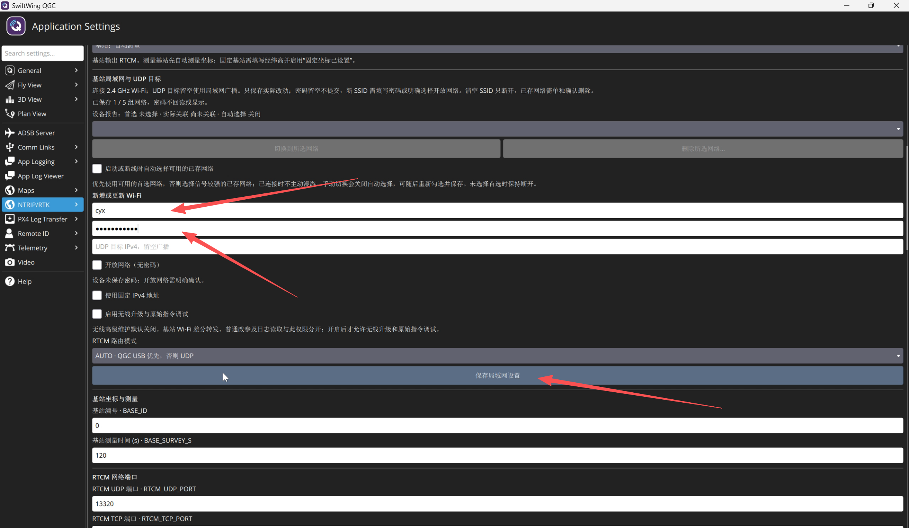
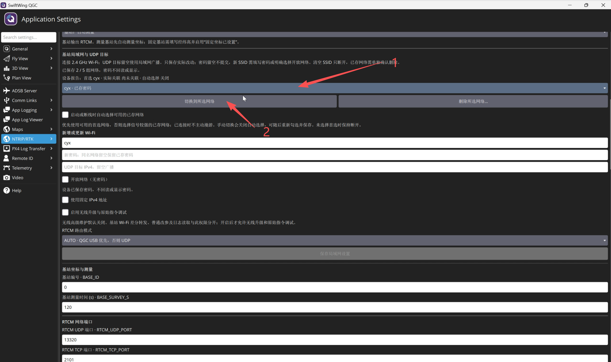
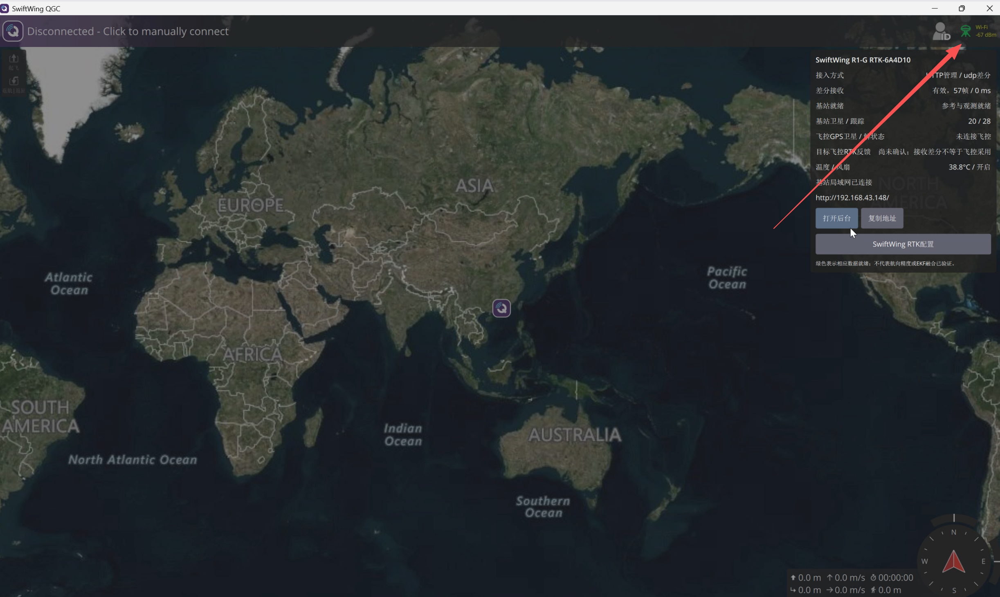
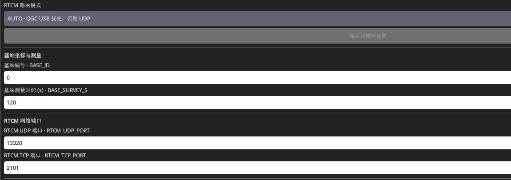
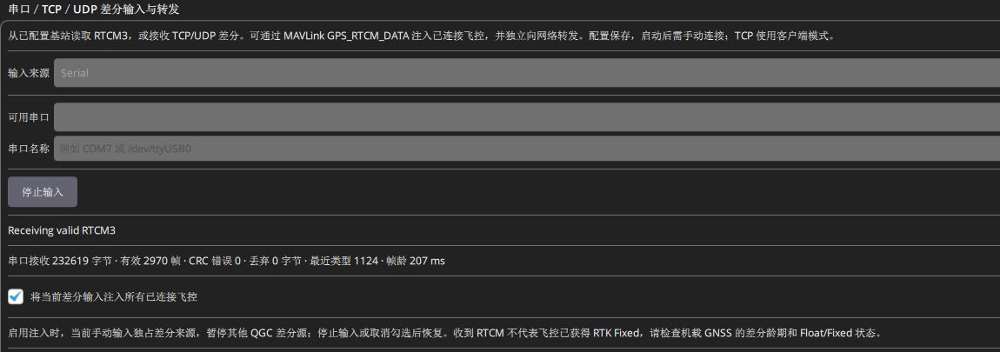
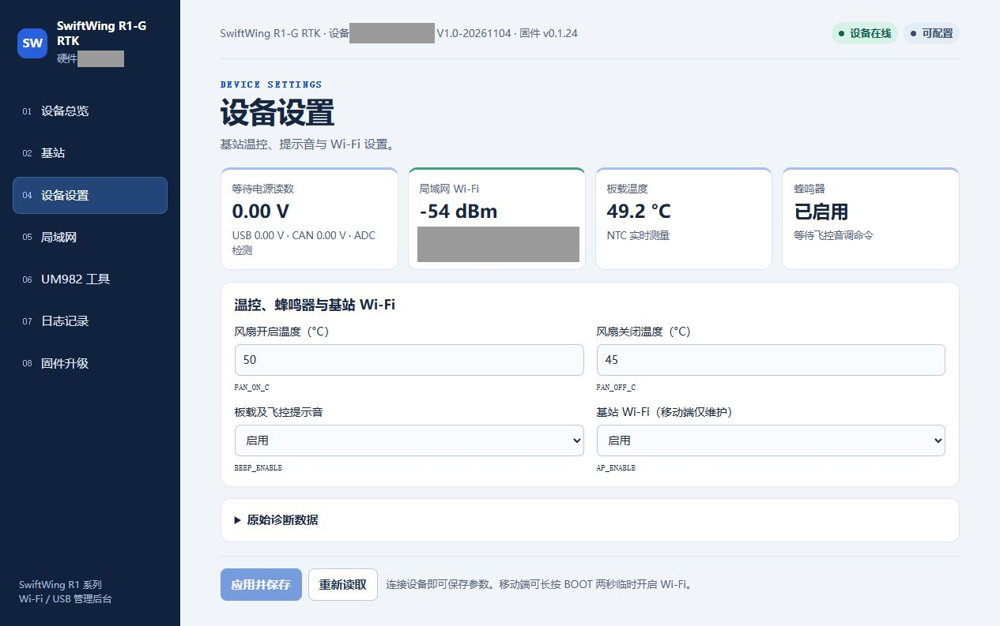

# SwiftWing R1-G RTK 基站快速上手

## 快速使用流程

点击流程图可放大

提示

主板 USB 用于配置，日常优先无线 UDP；电池或供电板 USB 都可给基站供电。下方按相同使用顺序展开操作。

说明

先认清搭配：地面使用本基站时，前四步都适用。机载为 SwiftWing 移动端，第五步按配套教程设置；机载为其他厂家 CAN / 串口 RTK 时，第五步改按<a href="USB与地面站输出差分.md#third-party-rover">第三方移动端路线</a>，不套用 SwiftWing 移动端参数。若地面使用的是其他厂家基站，请转到<a href="../SwiftWing_R1_RTK_移动端/差分与Wi-Fi后台.md#third-party-base">SwiftWing 移动端的第三方基站接入</a>。

更新日期：2026-11-13。首次使用按本页从第一步走到第七步；已完成配置的日常使用，准备天线和电源后，直接从第四步接入 UDP，再完成第五至七步。

**完整顺序：安装软件 → 接天线与电源 → USB 首次配置 → 拔数据线使用 UDP → 检查移动端 → 查看温控 → 结束关机。**

### 开始前先选场景

| 你要做什么 | 是否先接主板 USB | 下一步 |
| --- | --- | --- |
| 首次使用、建站参数或网络未知 | 推荐先接；不依赖热点即可配置 | 从第一至四步完成配置 |
| 已配好的基站日常作业 | 不需要；开启 SW1，确认供电和现场网络 | 从第四步接入 UDP，再检查数据 |
| 查看网页，基站已加入外部网络并取得 IP | 不需要 | 同一局域网访问基站实际 LAN IP；热点关闭也属正常 |

全部支持功能及前置条件见[产品功能清单](SwiftWing%20R1-G%20RTK产品介绍.md#features)。主板数据 USB 和供电板 USB 用途不同；不能按电池有电 / 没电决定差分入口，日常均优先 UDP。

## 一、下载并安装 SwiftWing QGC

说明

百度网盘下载链接：<a href="https://pan.baidu.com/s/1CAqwyC05L5_-I7qV0qO-yg?pwd=m5x6">SwiftWing-QGC-Setup-0.1.0-b8-Windows-x64.exe</a>，提取码：<code>m5x6</code>。

从网盘下载 Windows x64 完整安装包，若为压缩包先完整解压，运行安装器并打开 **SwiftWing QGC**。本文使用 0.1.0 build8。详细安装及 USB 自动识别见[软件下载与 USB 连接](../RTK通用/软件下载与USB连接.md)。

## 二、准备天线和电源

1. 将匹配约 3.3 V 馈电的有源 GNSS 天线接 **ANT1**，固定在室外开阔处，建站与作业期间保持不动；基站不需要 ANT2。
2. 初次接线先将供电板 **SW1 电源开关关闭**。配套两节 18650 串联供电，供电板输出按极性接主板 XT30。
3. 认清两个 USB：**调试口接电脑，负责 RTCM 数据和主板供电；PD快充 USB-C 接充电器，负责给电池充电**。只接电脑数据线不会给电池充电。
4. 可使用电池供电，也可将支持 **12 V 档位**的匹配 PD 快充电源接供电板 USB-C，给基站供电并补电。使用供电板向主板供电时均需开启 SW1，日常 RTCM 都优先用 UDP。

接口、线序和风扇见<a href="../硬件功能与接口/">基站硬件</a>，充电、开关和低压报警见<a href="../供电与充电/">供电与充电</a>。

## 三、用调试口 USB 完成首次配置（无线连接）

以配套 SwiftWing QGC 为例，完成首次配置。

1. 用 USB 数据线将 **RTK调试口** 连接接电脑；供电板充电口不用于连接 QGC。
2. 打开 配套 SwiftWing QGC，进入 **应用设置 → NTRIP/RTK → SwiftWing R1 / R1-G RTK**
3. 仅无线连接基站需要配置，其余参数保持默认即可
4. 打开手机热点，在配套 QGC 中"新增或更新Wifi"填写热点名称、密码，并保存局域网设置

5. 选择所添加的热点名称，并点击“切换到所选网络”

6. 确认打开配套 QGC的设备，连接到热点网络;即基站与电脑或其他设备在同一个局域网下，即可通过UDP无线连接基站。

建议

如需其他方式无线连接基站请看<a href="../设备后台参数修改/">设备后台参数修改</a>，修改其他参数详情请看<a href="../QGC地面站参数修改/">QGC地面站参数修改</a>。

有可靠已知坐标时用 `RTK_ROLE=2`，按[基站模式与参数](基站模式与参数.md)填写坐标与椭球高，不直接复制地图海拔。

## 四、将差分送到移动端并确认定位

1. 飞控通过 USB / 遥测连接 QGC；移动端按自身型号使用 CAN 或飞控 GPS 串口连接，先完成厂家要求的定位驱动配置。
2. 勾选 **将 QGC 收到的差分注入已连接飞控**。首次只连接本轮目标飞控；“绑定当前飞控反馈”只选择状态观察对象。
3. **SwiftWing 移动端**按[移动端教程](../SwiftWing_R1_RTK_移动端/快速上手.md)启用 CAN GPS 与差分转发；**第三方移动端**按[对应 CAN / 串口路线](USB与地面站输出差分.md#third-party-rover)核对其驱动和 RTCM 接收条件。
4. 确认 **QGC 有效 RTCM → 目标移动端 RTCM 增长 / 龄更新 → 接收机位置解**。SwiftWing 在本机网页查看接收，第三方使用其厂家工具 / 飞控报告。基站绿图标不表示飞机已固定，也不表示航向已融合。

日常查看时，点击 QGC 顶部**三脚架形基站图标**，可看差分帧数、基站卫星、飞控 GPS 和后台入口。颜色、各字段及“身份未确认”的含义见[基站图标说明](QGC地面站参数修改.md#rtk-indicator)。

飞控报告的卫星数及 RTK Float / Fixed，可参考[QGC 检查方法](../SwiftWing_R1_RTK_移动端/差分与Wi-Fi后台.md#qgc-gps)；该章节的移动端网页、基线和航向参数仅适用于 SwiftWing。第三方的双天线协议与航向设置按其厂家说明核对。

## 五、查看温度与风扇

1. 在基站弹窗或网页 **设备设置**查看板温及风扇状态。
2. 按本手册设为 **达到 35 °C 开启风扇，降到 30 °C 或以下关闭**。高于 30 °C、低于 35 °C 时保持原开关状态，避免风扇来回启停。
3. 核对 **`FAN_ON_C=35`、`FAN_OFF_C=30`**，点击 **应用并保存**，再 **重新读取**。已有设备需保存新值才生效，正常保参升级不会自动覆盖旧阈值。同时确认实际风扇能转、通风口未被遮挡。

检测温度为 RTK 板温，不是电池温度。

注意

风扇接 FAN+ / FAN−，FAN− 不再搭接 GND，否则会绕过温控。

## 六、结束使用、关机和补电

1. 结束差分作业；需要的日志先导出。
2. 将供电板 **SW1 关闭**只关 SW1 不会切断主板 USB 或带电 CAN 提供的外电。要让基站完全停止，还应断开这些其他供电。
3. 电量不足时将SW1关闭接供电板充电口也可给电池充电；按充电指示确认状态。
4. 运行时间先参考历史样机 **约 4.5 小时至低压报警**，外场安排可提前约 4 小时检查电量并准备补电；这不是所有电池的保底续航。
5. 关机存放仍有电池管理电路消耗。现有无负载记录超过 **7 天**，但尚未测得严格 SW1 关闭时的待机上限；长期存放按电池说明隔离并定期检查，不据此承诺数月免充电。

充电步骤、时长条件及原始实测记录见[供电、充电与使用时间](供电与充电.md#operating-time)。
