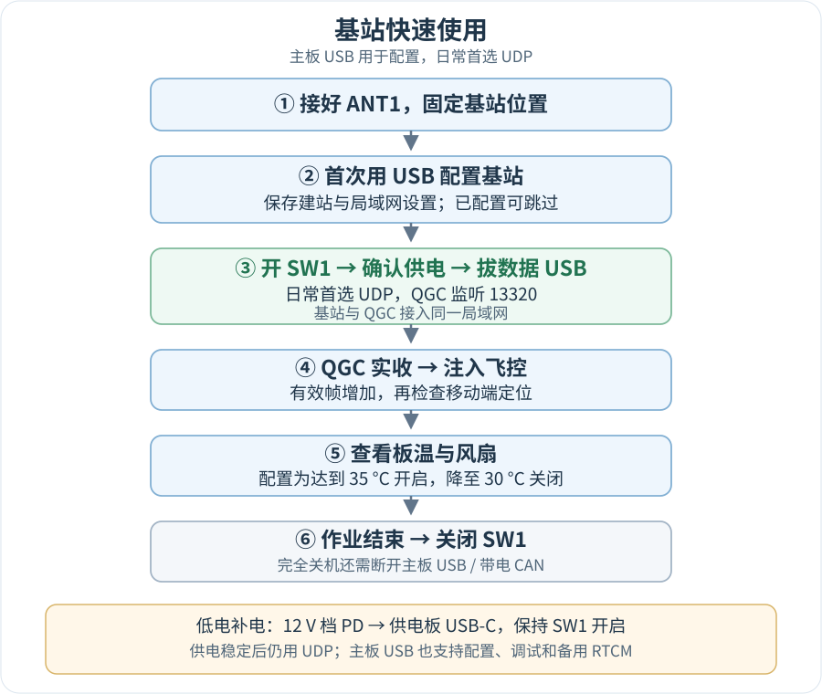
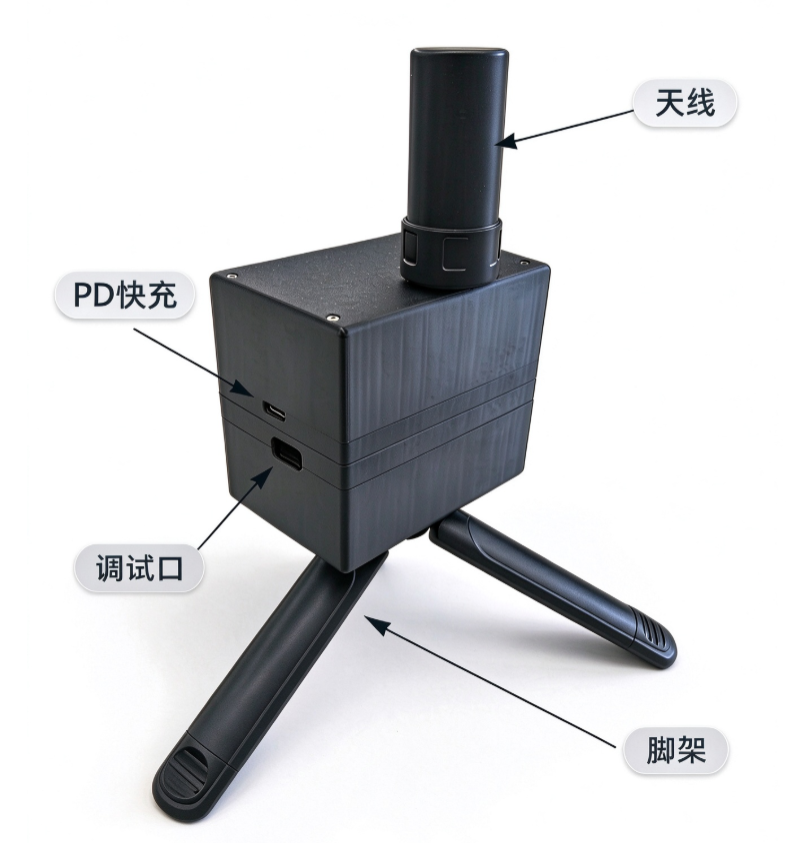
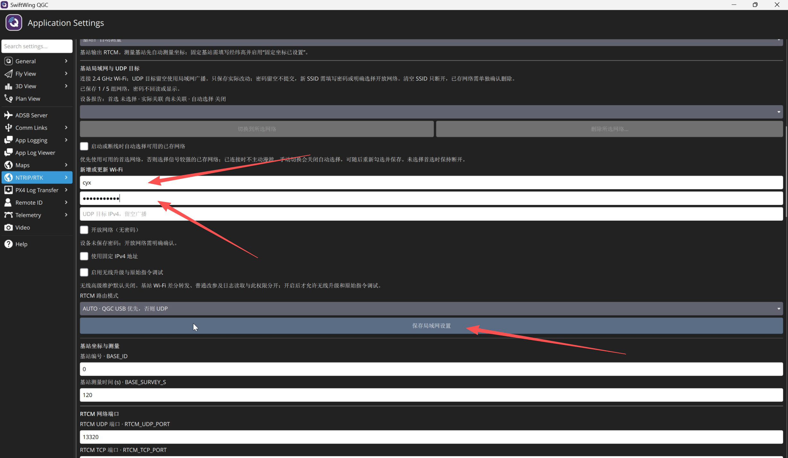
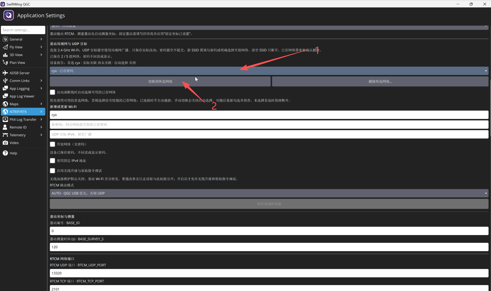
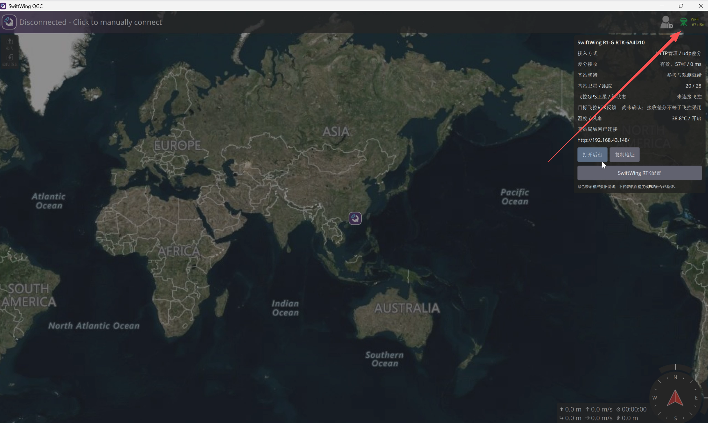
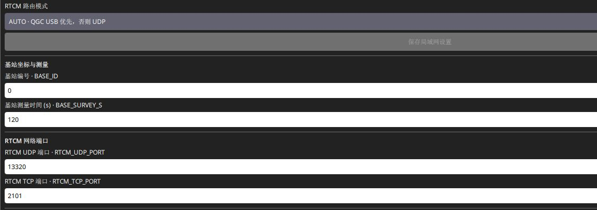
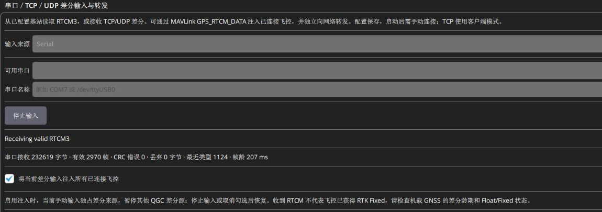
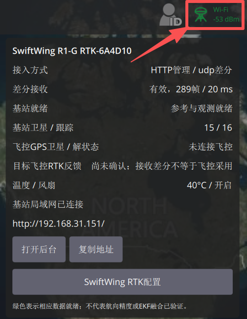
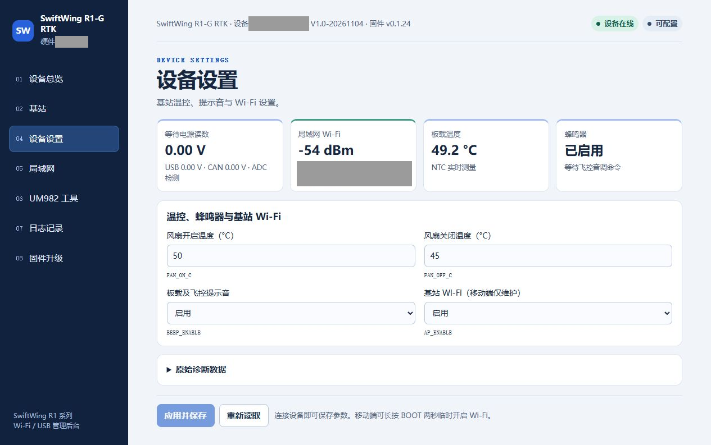

# SwiftWing R1-G RTK 基站快速上手

* 参考本页快速上手即可实现基于默认参数的快速使用
* 需要调整基站功能和参数则需要参考后续的详细使用教程

## 快速使用流程

主板 USB 用于配置，日常优先无线 UDP；电池或供电板 USB 都可给基站供电。下方按相同使用顺序展开操作。

**完整顺序：安装软件 → 接天线与电源 → USB 首次配置 → 拔数据线使用 UDP → 检查移动端 → 查看温控 → 结束关机。**

## 一、下载并安装 SwiftWing QGC

百度网盘下载链接：<a href="https://pan.baidu.com/s/1CAqwyC05L5_-I7qV0qO-yg?pwd=m5x6">SwiftWing-QGC-Setup-0.1.0-b8-Windows-x64.exe</a>，提取码：<code>m5x6</code>。

从网盘下载 Windows x64 完整安装包，若为压缩包先完整解压，运行安装器并打开 **SwiftWing QGC**。本文使用 0.1.0 build8。详细安装及 USB 自动识别见[软件下载与 USB 连接](../RTK通用/软件下载与USB连接.md)。

## 二、基站上电前准备

先接好天线，才能接电源。

1. 将匹配约 3.3 V 馈电的有源 GNSS 天线接 **ANT1**，固定在室外开阔处，基站使用期间保持不动。
2. 初次接线先将供电板 **SW1 电源开关关闭**。
3. 认清两个 USB：**调试口接电脑，可以搭配SwiftWing QGC配置基站功能和获取 RTCM 数据、主板供电等；PD快充 USB-C 接口，负责给基站电源充电**。

接口、线序和风扇见<a href="../硬件功能与接口/">基站硬件</a>，充电、开关和低压报警见<a href="../供电与充电/">供电与充电</a>。

## 三、用USB调试口配置基站

首次使用需要通过SwiftWing QGC配置好常用的局域网连接，其余参数保持默认即可。后续使用没有切换局域网则无需再次配置，基站上电自动通过 UDP 转发RTCM 基站数据。

1. 用 USB 数据线连接 **调试口** 和电脑。
2. 打开 配套 SwiftWing QGC，进入 **应用设置 → NTRIP/RTK → SwiftWing R1 / R1-G RTK**
3. 打开局域网热点，在配套 QGC 中"新增或更新Wifi"填写热点名称、密码，并保存局域网设置

4. 选择所添加的热点名称，并点击“切换到所选网络”

5. 回到QGC主页，出现绿色基站图标，则说明基站和电脑已经在同一个局域网下，同时基站RTCM数据已经通过UDP无线转发到电脑。

QGC配置好常用的局域网连接，其余参数保持默认即可。如需其他方式无线连接基站请看<a href="../设备后台参数修改/">设备后台参数修改</a>，修改其他参数详情请看<a href="../QGC地面站参数修改/">QGC地面站参数修改</a>。

## 四、使用无线UDP将差分送到移动端

点按基站底部位置的SW1金属开关，开启基站电源

1. 飞控通过 USB / 遥测连接 QGC；移动端和飞控正常连接。
2. 默认已经勾选 **将 QGC 收到的差分注入已连接飞控**。
3. **SwiftWing 移动端**按[移动端教程](../SwiftWing_R1_RTK_移动端/快速上手.md)启用 CAN GPS 与差分转发；
4. 确认 **QGC 有效 RTCM → 目标移动端 RTCM 增长 / 龄更新 → 接收机位置解**。

日常查看时，点击 QGC 顶部**三脚架形基站图标**，可看差分帧数、基站卫星、飞控 GPS 和后台入口。颜色、各字段及“身份未确认”的含义见[基站图标说明](QGC地面站参数修改.md#rtk-indicator)。

飞控报告的卫星数及 RTK Float / Fixed，可参考[QGC 检查方法](../SwiftWing_R1_RTK_移动端/差分与Wi-Fi后台.md#qgc-gps)；该章节的移动端网页、基线和航向参数仅适用于 SwiftWing。

## 五、后台数据查看

基站日常使用无需进入网页后台，如果需要<a href="../日志下载与分析/">下载日志</a>或者查看详细数据，则需进入网页后台。

1. 在前面步骤配置好局域网后，基站rtk配置会显示网页后台地址打开后台即可

## 六、结束使用、关机和充电

1. 结束差分作业；需要的日志先导出。
2.  **点按基站底部位置的SW1金属开关，关闭基站电源**。
3. 电量低于7v时，基站有蜂鸣器提示，建议及时充电。
4. 基站满电续航时间约5小时左右
5. 基站满电待机时间约一个月；长期存放按电池说明隔离并定期检查。

充电步骤、时长条件及原始实测记录见[供电、充电与使用时间](供电与充电.md#operating-time)。
