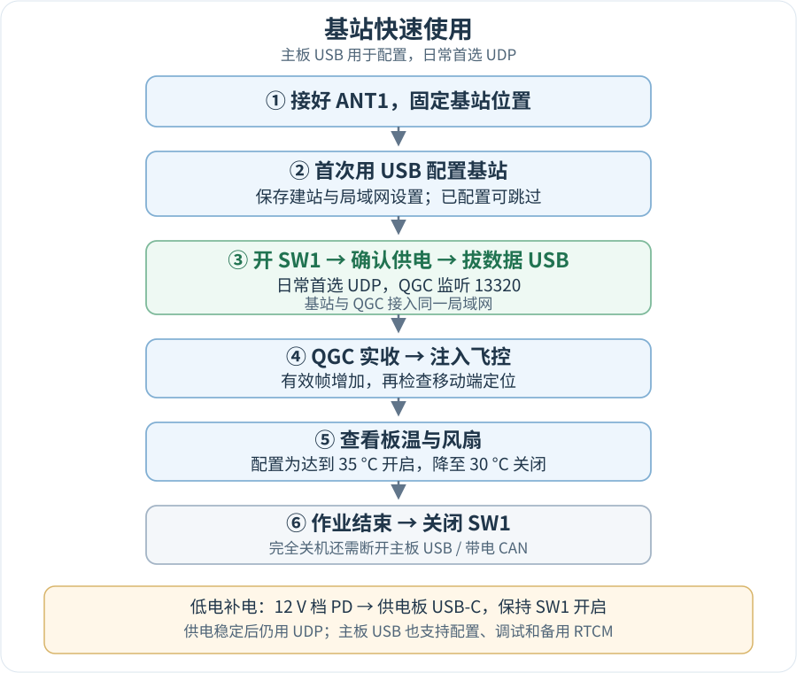
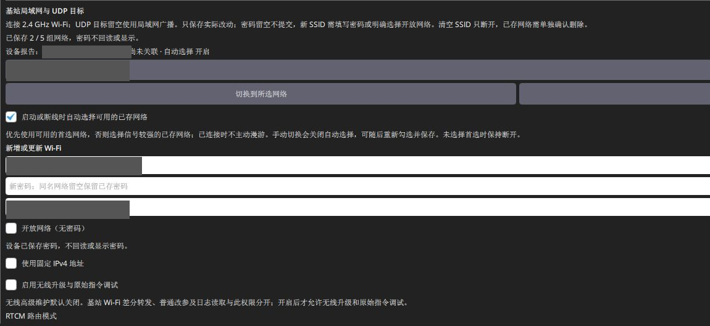
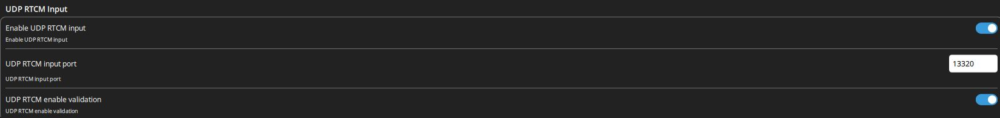

# SwiftWing R1-G RTK 基站快速上手

## 快速使用流程

点击流程图可放大

提示

主板 USB 用于配置，日常优先无线 UDP；电池或供电板 USB 都可给基站供电。下方按相同使用顺序展开操作。

说明

先认清搭配：地面使用本基站时，前四步都适用。机载为 SwiftWing 移动端，第五步按配套教程设置；机载为其他厂家 CAN / 串口 RTK 时，第五步改按<a href="USB与地面站输出差分.md#third-party-rover">第三方移动端路线</a>，不套用 SwiftWing 移动端参数。若地面使用的是其他厂家基站，请转到<a href="../SwiftWing_R1_RTK_移动端/差分与Wi-Fi后台.md#third-party-base">SwiftWing 移动端的第三方基站接入</a>。

更新日期：2026-11-13。首次使用按本页从第一步走到第七步；已完成配置的日常使用，准备天线和电源后，直接从第四步接入 UDP，再完成第五至七步。

**完整顺序：安装软件 → 接天线与电源 → USB 首次配置 → 拔数据线使用 UDP → 检查移动端 → 查看温控 → 结束关机。**

### 开始前先选场景

| 你要做什么 | 是否先接主板 USB | 下一步 |
| --- | --- | --- |
| 首次使用、建站参数或网络未知 | 推荐先接；不依赖热点即可配置 | 从第一至四步完成配置 |
| 已配好的基站日常作业 | 不需要；开启 SW1，确认供电和现场网络 | 从第四步接入 UDP，再检查数据 |
| 查看网页，基站已加入外部网络并取得 IP | 不需要 | 同一局域网访问基站实际 LAN IP；热点关闭也属正常 |
| USB 配置时还要看网页，或热点 / LAN 都不可达 | 先用 USB 点“启用无线后台”，或长按 BOOT 约 2 秒 | 按[后台入口与热点规则](设备后台参数修改.md#wireless-rules)选择访问地址 |

全部支持功能及前置条件见[产品功能清单](SwiftWing%20R1-G%20RTK产品介绍.md#features)。主板数据 USB 和供电板 USB 用途不同；不能按电池有电 / 没电决定差分入口，日常均优先 UDP。

## 一、下载并安装 SwiftWing QGC

说明

百度网盘下载链接：<a href="https://pan.baidu.com/s/1CAqwyC05L5_-I7qV0qO-yg?pwd=m5x6">SwiftWing-QGC-Setup-0.1.0-b8-Windows-x64.exe</a>，提取码：<code>m5x6</code>。

从网盘下载 Windows x64 完整安装包，若为压缩包先完整解压，运行安装器并打开 **SwiftWing QGC**。本文使用 0.1.0 build8。详细安装及 USB 自动识别见[软件下载与 USB 连接](../RTK通用/软件下载与USB连接.md)。

## 二、准备天线和电源

1. 将匹配约 3.3 V 馈电的有源 GNSS 天线接 **ANT1**，固定在室外开阔处，建站与作业期间保持不动；基站不需要 ANT2。
2. 初次接线先将供电板 **SW1 电源开关关闭**。配套两节 18650 串联供电，供电板输出按极性接主板 XT30。
3. 认清两个 USB：**主板 USB-C 接电脑，负责 RTCM 数据和主板供电；供电板 USB-C 接充电器，负责给电池充电**。只接电脑数据线不会给电池充电。
4. 可使用电池供电，也可将支持 **12 V 档位**的匹配 PD 快充电源接供电板 USB-C，给基站供电并补电。使用供电板向主板供电时均需开启 SW1，日常 RTCM 都优先用 UDP。

接口、线序和风扇见[基站硬件](硬件功能与接口.md)，充电、开关和低压报警见[供电与充电](供电与充电.md)。

## 三、用主板 USB 完成首次配置

1. 用 USB 数据线将 **RTK调试口** 连接接电脑；供电板充电口不用于连接 QGC。
2. 打开 SwiftWing QGC，进入 **应用设置 → NTRIP/RTK → SwiftWing R1 / R1-G RTK**，选择基站并核对序列号。
3. 没有可靠已知坐标时选 **基站：自动测量**（`RTK_ROLE=1`），`BASE_SURVEY_S=120` 秒，站号 `BASE_ID` 可先保留 0；温控设置 **`FAN_ON_C=35`、`FAN_OFF_C=30`**。(保持默认即可)
4.网络区路由选 **“AUTO · QGC USB 优先，否则 UDP”**，点 **保存局域网设置**。 点 **应用并保存**，等待保存并读回确认。
5. 保持天线不动，等 **基站 RTCM 已就绪**，再看 **QGC 实收**有效帧增长、CRC 和帧龄。120 秒不是保证建站完成的倒计时。

读图重点：路由为 **AUTO**，基站编号 0、测量时间 120 秒，UDP / TCP 端口分别为 13320 / 2101。网络区与设备参数区使用各自的保存按钮；图中灰色的网络保存按钮表示当前没有待保存的网络修改。

有可靠已知坐标时用 `RTK_ROLE=2`，按[基站模式与参数](基站模式与参数.md)填写坐标与椭球高，不直接复制地图海拔。

建议

AUTO 正在使用有效 QGC USB 会话时，基站通常关闭无线；此时要同时看网页，先点 <strong>启用无线后台</strong>（保存持续高级维护），或长按 BOOT 约 2 秒开约 30 分钟临时窗口。已取得 LAN IP 用实际地址，只有热点时连接热点后用 192.168.4.1。日常拔数据线转 UDP 后会自动启用所需无线，不要求一直开启高级维护。

## 四、配置完成后，日常使用无线 UDP

1. 准备外部 **2.4 GHz** 路由器或手机热点，让 QGC 电脑也接入同一网络。
2. 首次在所选基站网络区填写外部 Wi-Fi 名称、密码，点 **保存局域网设置**；已保存并能联网时不必重复填写。同名网络密码留空保留，新网络填写密码或明确选择开放网络。
3. **UDP 目标 IPv4 填 QGC 电脑的实际局域网地址**，例如电脑为 `192.168.10.100` 就填该地址；不要填基站自己的 IP。端口保留 `13320` 并保存。
4. 将供电板 **SW1 开启**，确认电池或供电板 USB 输入已经由 XT30 给主板供电，再拔掉**主板数据 USB**，AUTO 回到 UDP。低电时可接供电板 USB 供电并补电，仍用 UDP。
5. QGC 进入 **NTRIP/RTK → UDP RTCM Input**，开启 **Enable UDP RTCM input**，端口填 `13320`。
6. 点击顶部三脚架基站图标，检查实际差分入口为 UDP，有效帧持续增加、帧龄刷新，再继续第五步。

无线时基站与电脑之间无需数据线，便于固定天线。电脑地址变化后重新核对 UDP 目标；使用中不要搬动已建站的基站。供电板 USB 接着充电器不会被 QGC 当成 USB 数据会话。

说明

<strong>USB 也能获取 RTCM</strong>，用于配置、调试或无线暂不可用时备用；日常仍优先 UDP。主板 USB 保持有效 QGC 会话时，AUTO 会优先 USB，所以配置完成后拔掉这根数据线。方式对比见<a href="USB与地面站输出差分.md#link-comparison">USB / UDP 说明</a>。

## 五、将差分送到移动端并确认定位

1. 飞控通过 USB / 遥测连接 QGC；移动端按自身型号使用 CAN 或飞控 GPS 串口连接，先完成厂家要求的定位驱动配置。
2. 勾选 **将 QGC 收到的差分注入已连接飞控**。首次只连接本轮目标飞控；“绑定当前飞控反馈”只选择状态观察对象。
3. **SwiftWing 移动端**按[移动端教程](../SwiftWing_R1_RTK_移动端/快速上手.md)启用 CAN GPS 与差分转发；**第三方移动端**按[对应 CAN / 串口路线](USB与地面站输出差分.md#third-party-rover)核对其驱动和 RTCM 接收条件。
4. 确认 **QGC 有效 RTCM → 目标移动端 RTCM 增长 / 龄更新 → 接收机位置解**。SwiftWing 在本机网页查看接收，第三方使用其厂家工具 / 飞控报告。基站绿图标不表示飞机已固定，也不表示航向已融合。

日常查看时，点击 QGC 顶部**三脚架形基站图标**，可看差分帧数、基站卫星、飞控 GPS 和后台入口。颜色、各字段及“身份未确认”的含义见[基站图标说明](QGC地面站参数修改.md#rtk-indicator)。

飞控报告的卫星数及 RTK Float / Fixed，可参考[QGC 检查方法](../SwiftWing_R1_RTK_移动端/差分与Wi-Fi后台.md#qgc-gps)；该章节的移动端网页、基线和航向参数仅适用于 SwiftWing。第三方的双天线协议与航向设置按其厂家说明核对。

## 六、查看温度与风扇

1. 在基站弹窗或网页 **设备设置**查看板温及风扇状态。
2. 按本手册设为 **达到 35 °C 开启风扇，降到 30 °C 或以下关闭**。高于 30 °C、低于 35 °C 时保持原开关状态，避免风扇来回启停。
3. 核对 **`FAN_ON_C=35`、`FAN_OFF_C=30`**，点击 **应用并保存**，再 **重新读取**。已有设备需保存新值才生效，正常保参升级不会自动覆盖旧阈值。同时确认实际风扇能转、通风口未被遮挡。

截图保留拍摄时的旧设置，用于辨认操作位置；温控数值按本页 **35 / 30 °C**填写并保存。

这里检测的是 RTK 板温，不是电池温度。

注意

风扇接 FAN+ / FAN−，FAN− 不再搭接 GND，否则会绕过温控。

## 七、结束使用、关机和补电

1. 结束差分作业；需要的日志先导出。
2. 将供电板 **SW1 关闭**只关 SW1 不会切断主板 USB 或带电 CAN 提供的外电。要让基站完全停止，还应断开这些其他供电。
3. 电量不足时将SW1关闭接供电板充电口也可给电池充电；按充电指示确认状态。
4. 运行时间先参考历史样机 **约 4.5 小时至低压报警**，外场安排可提前约 4 小时检查电量并准备补电；这不是所有电池的保底续航。
5. 关机存放仍有电池管理电路消耗。现有无负载记录超过 **7 天**，但尚未测得严格 SW1 关闭时的待机上限；长期存放按电池说明隔离并定期检查，不据此承诺数月免充电。

充电步骤、时长条件及原始实测记录见[供电、充电与使用时间](供电与充电.md#operating-time)。
