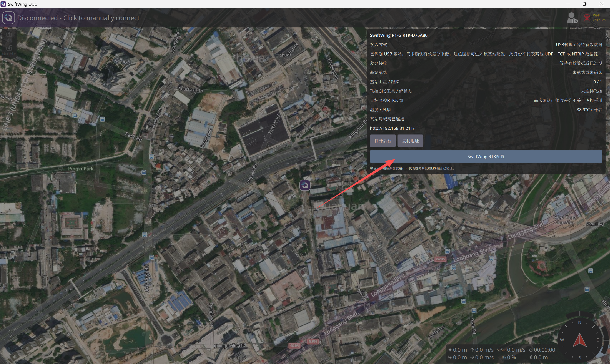
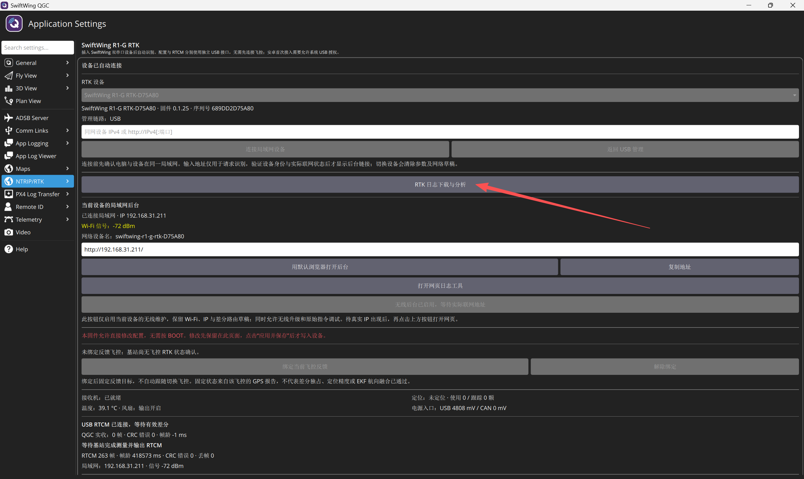
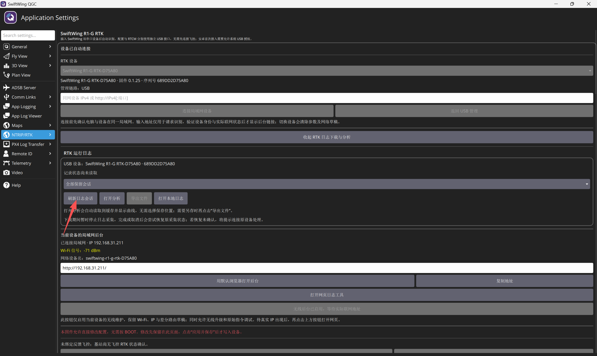
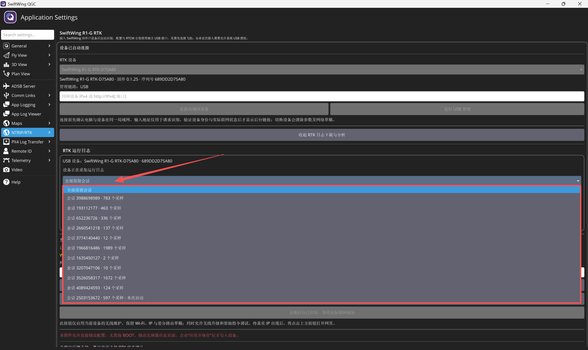
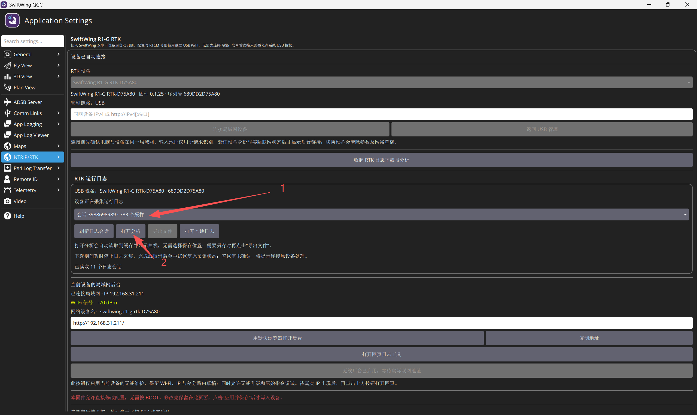
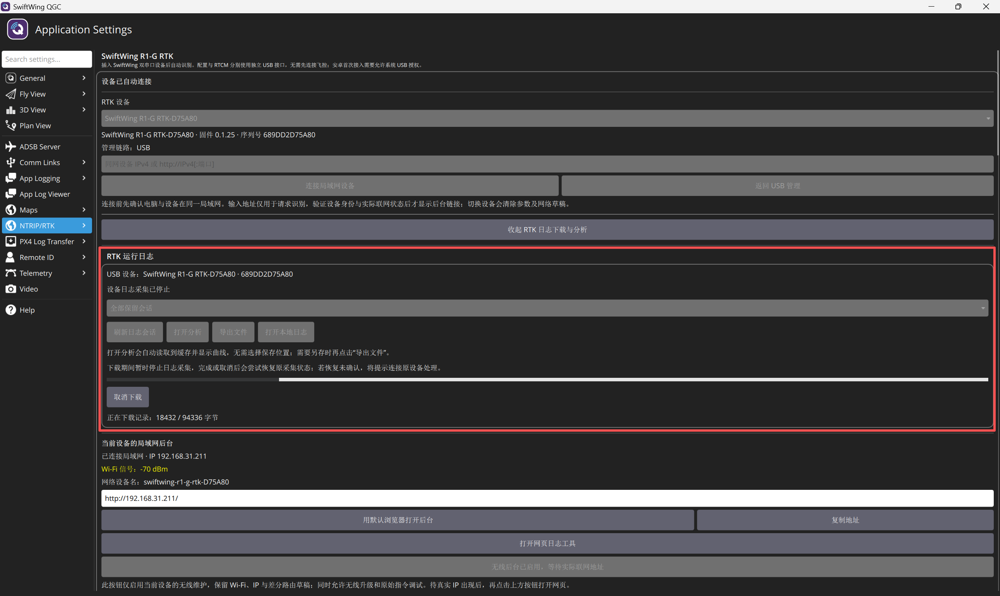
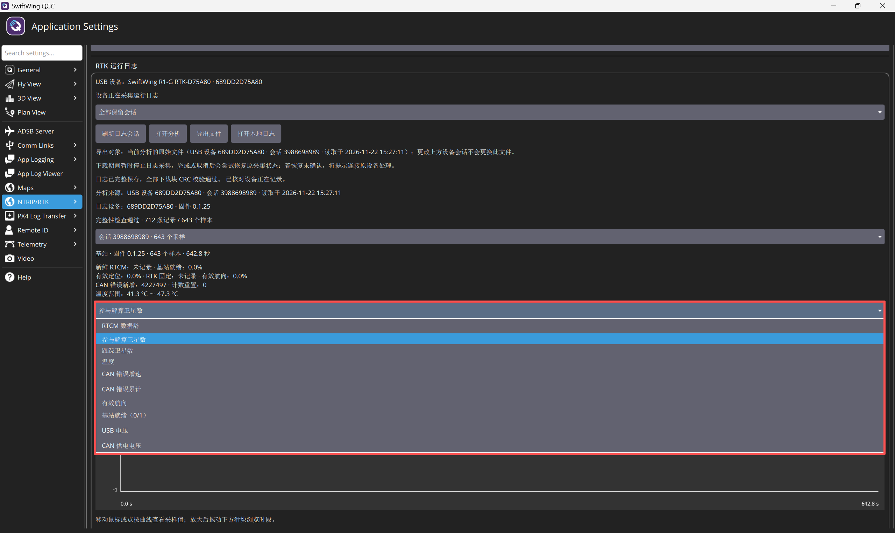

# 日志下载与分析

RTK 基站运行过程中会持续记录运行日志，用于排查基站状态、定位质量、数据链路等问题。日志保存在基站本地，需要通过地面站（SwiftWing QGC）下载到电脑后再进行分析。

## 一、准备条件

* 基站已通过 USB 连接电脑（地面站识别到 USB 设备，例如 `SwiftWing R1-G RTK-D75A80`）。

## 二、操作步骤

### 1. 确认基站已连接

在地面站主界面右上角点击“基站图标”，展开 `SwiftWing RTK 配置` 面板，确认已识别到 USB 设备，并能看到后台地址（如 `http://192.168.31.211/`）。

### 2. 进入 RTK 日志下载与分析

跳转至 `SwiftWing R1-G RTK` 界面，在页面中点击 `RTK 日志下载与分析`。

### 3. 展开日志面板

点击后展开 `RTK 运行日志` 区域，可以看到设备信息以及以下操作按钮：

* `刷新日志会话`：重新读取基站上的日志会话列表；
* `打开分析`：下载并解析所选会话，随后显示数据曲线；
* `导出文件`：将所选会话的日志导出为文件保存到本地；
* `打开本地日志`：打开本地已缓存的日志目录。

### 4. 选择需要分析的会话

点击 `刷新日志会话` 按钮，地面站会自动读取基站上的日志会话列表；再点击 `全部保留会话` 下拉框，列表会显示基站上保留的所有日志会话，每一项的格式为“会话号 + 采样数”。

提示

列表中最后一条通常标注为“本次启动”，即当前正在写入的日志会话。

根据需要选择对应会话（采样数越多，记录时间越长）。

### 5. 打开分析或导出文件

选中会话后：

1. 点击 `打开分析`，地面站会自动读取（必要时下载）该会话日志并显示曲线；
2. 下载后若只需留存原始日志，点击 `导出文件`，选择保存位置即可导出。

### 6. 查看分析结果

点击曲线区域上方的指标下拉框，可切换查看不同数据项，例如：

* 参与解算卫星数、跳变卫星数；
* RTCM 数据流；
* 温度、USB 电压、CAN 供电电压；
* CAN 错误速率、CAN 错误计数；
* 有效航向、基站就绪（0/1）等。

## 三、注意事项

* 分析前请保持基站连接正常，否则无法读取日志。
* 下载日志期间基站会暂停记录。
* 若提示日志损坏或不完整，请重新下载或重新连接设备后再试。
