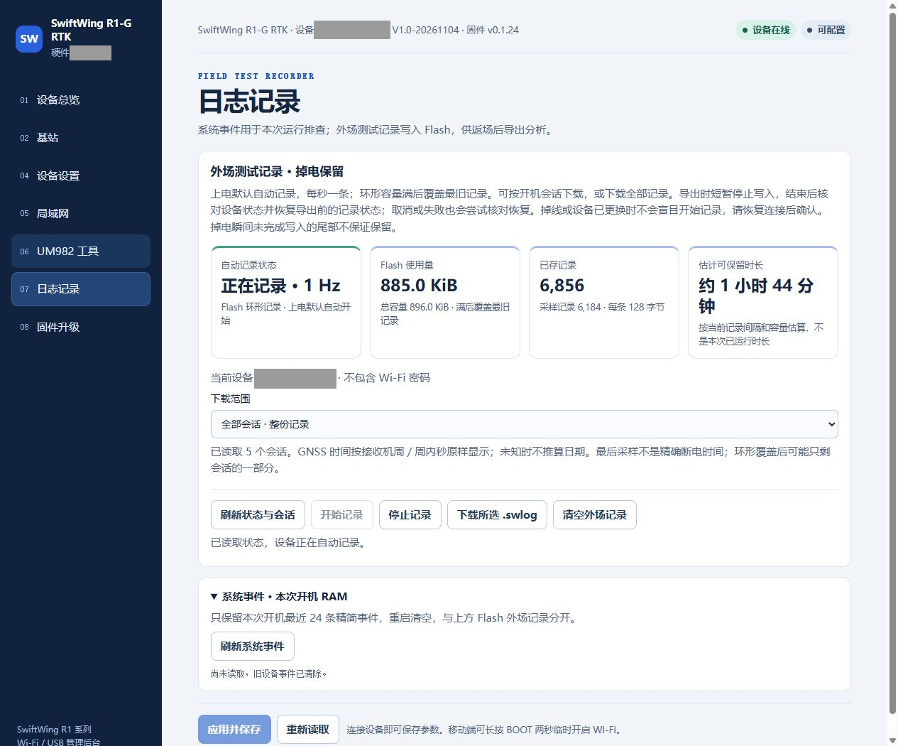
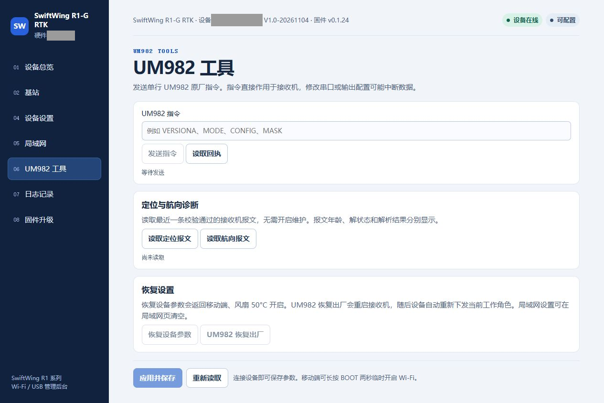
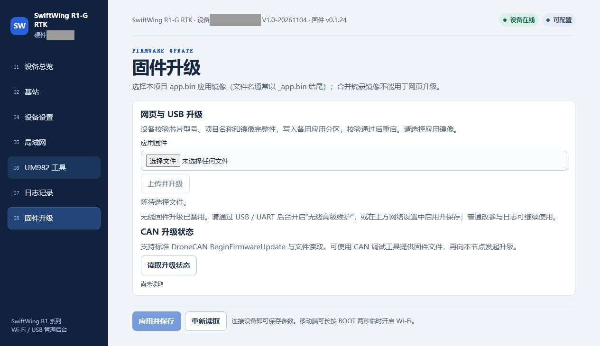

# 基站日志、升级与恢复

用 [QGC](QGC地面站参数修改.md) 选中设备后打开网页后台，或按[网页后台教程](设备后台参数修改.md)直接连接。先核对设备身份和当前角色。

## 日志记录与导出

1. 在 QGC 点击 **打开设备日志与会话导出**，或在网页点击 **日志记录**。
2. 点击 **刷新状态与会话**，核对是否正在记录。
3. **下载范围**选择单个会话或全部，点击 **下载所选 .swlog**。
4. 等待下载完成，再次刷新确认记录状态。

本图为正在记录的界面，仅用于辨认按钮位置。Flash 外场记录每次启动默认约 1 Hz、容量名义约 104 分钟，写满覆盖最早记录，回来及时导出。

网页导出临时停止并尝试恢复原记录状态，下载后核对是否仍在记录；断连、失败或原来已停止时不能假定自动继续。独立调试工具可能保持冻结。清空前先备份，等待擦除完成，之后点开始记录或重新上电。

「日志记录」中的系统事件用于排查启动、USB、网络、接收机及升级等事件，保留本次开机最近 24 条精简记录，重启清空；与 Flash 会话日志不同。本电源板没有电池遥测，以上日志不能补出单节电压、充电电流或电量曲线。

`.swlog` 是专用记录文件，不是连续原始 RTCM、RINEX 或完整接收机原始观测文件。配套离线解码工具可转换为 CSV 和摘要 JSON；普通用户可以直接将原始文件交给技术支持。

## UM982 工具与恢复设置

只需查看接收机数据时，先点击 **读取定位报文**，查看报文年龄、解析结果和解状态。这里读取最近缓存，不要求开启无线高级维护。

「UM982 工具」可发送一条原厂命令并读取回执，用于诊断或有明确依据的配置。查询示例为 `VERSIONA`、`MODE`、`CONFIG`。普通建站优先使用基站页面，ESP32 会按保存参数自动配置接收机。手工修改串口、输出列表或工作模式可能打断当前差分，且不一定同步回 ESP32 参数。

两个恢复入口含义不同：

- **恢复设备参数**：恢复 ESP32 的通用参数，角色会回到移动端，温控恢复所用固件的初始值；之后需重新选择基站，并按本手册设置 **FAN_ON_C=35、FAN_OFF_C=30**，保存并读回。外部 Wi-Fi 凭据另存，不随此操作自动清除。
- **UM982 恢复出厂**：向接收机发送 `FRESET`，随后 ESP32 重新下发当前工作角色，期间数据会中断。它不是清空全部设备网络设置。

断开当前外部 Wi-Fi 可清空当前名称并保存，但这不会删除已存网络。需要移除凭据时，在已存网络列表选择目标并明确删除；按 BOOT 或 EN 不等于恢复出厂。

## 固件升级

常规升级优先使用网页或配套 USB 后台：

通过无线网页上传前，在 **局域网**页开启 **无线高级维护**并保存；普通状态查看、改参和日志下载不要求开启。有线 USB 管理按界面许可操作。

1. 保存设备序列号、当前版本和关键参数；有需要的日志先导出。
2. 获取适配本硬件的应用镜像，文件名通常以 `_app.bin` 结尾。
3. 打开「固件升级」，核对目标设备身份，选择镜像，点击「上传并升级」。
4. 保持电源和连接稳定，等待上传、校验和重启。
5. 重新连接，核对显示的新版本、工作角色、网络及参数，并重新确认 RTCM 就绪与接收端数据。

截图时无线高级维护关闭、未选择文件，上传按钮不可用；此图只说明操作入口，没有为取素材执行升级。

升级使用备用应用分区，并校验芯片、项目及镜像完整性。常规应用升级保留已有参数；仍应在升级后回读确认。完整烧录镜像不能代替应用镜像上传，也不要上传其他产品或飞控的固件。

只有应用无法恢复、安装启动程序或明确要求串口烧录时才使用下载模式：按住 BOOT，点按并松开 EN/RESET，再松开 BOOT。普通参数修改和网页升级不需要此步骤。

基站日常检查和故障排查见[详细使用说明](详细使用说明.md)。
