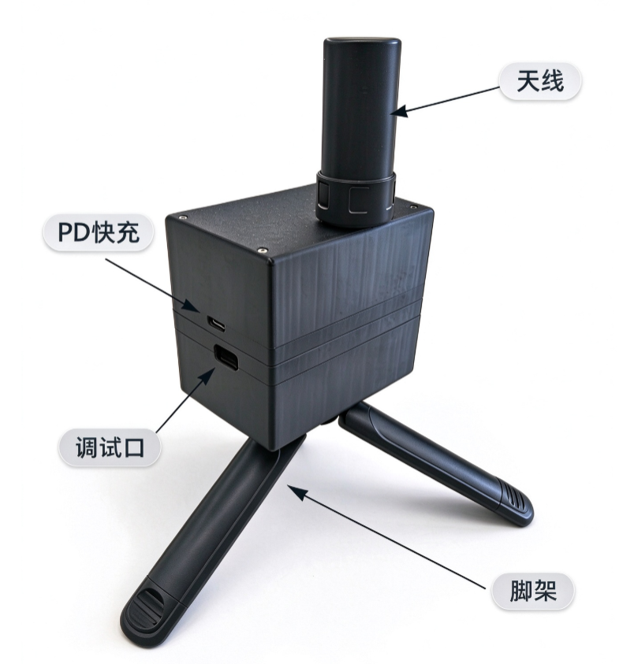

# 基站硬件功能与接口

SwiftWing R1-G RTK 用 ANT1 接收卫星观测，固定参考位置后产生差分，由主板 USB、Wi-Fi UDP / TCP 或指定 CAN 出口分发。

## 一、天线与摆放

1. 有源 GNSS 天线接 。
2. 天线与支架固定在室外开阔、稳定的位置，朝天，避开墙面、窗沿、树木和金属遮挡。
3. 建站及作业期间保持参考点不动；搬到新位置后重新建站，固定坐标模式也要重新核对坐标。

## 二、USB 接口

- **RTK 调试口**：电脑数据线接这里，配套 SwiftWing QGC 自动识别、参数管理、USB RTCM获取 和 5 V 供电。
- **PD 快充 USB-C**：用于配套电池充电和设备供电。

建议

<strong>RTK 调试口</strong> 用于首次配置和调试，也能临时获取 RTCM。日常推荐开启 SW1、确认供电后拔掉主板数据 USB，使用无线 UDP。电池低电时，可接供电板 USB-C 给主板供电并补电，差分仍用 UDP。接线对比见<a href="../USB与地面站输出差分/#link-comparison">USB / UDP 说明</a>。

