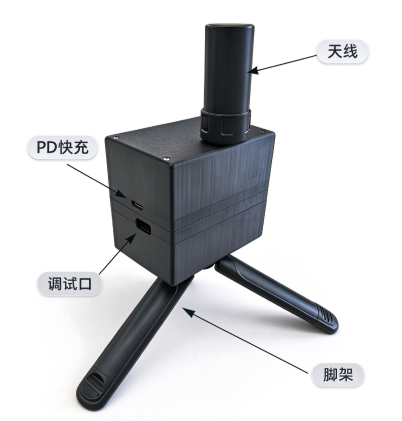

# 基站硬件功能与接口

SwiftWing R1-G RTK 用 ANT1 接收卫星观测，固定参考位置后产生差分，由主板 USB、Wi-Fi UDP / TCP 或指定 CAN 出口分发。基站不是飞控，不需要配置飞控的航向融合与重心偏移。

## 一、天线与摆放

1. 有源 GNSS 天线接 **ANT1**，基站生成差分无需连接 ANT2。
2. 天线与支架固定在室外开阔、稳定的位置，朝天，避开墙面、窗沿、树木和金属遮挡。
3. 建站及作业期间保持参考点不动；搬到新位置后重新建站，固定坐标模式也要重新核对坐标。
4. 天线馈电约 3.3 V，选型时核对供电范围、接头与 GNSS 频段。

## 二、USB 要分清

- **RTK 调试口**：电脑数据线接这里，用于 SwiftWing QGC 自动识别、参数管理、USB RTCM 和 5 V 供电。
- **PD 快充 USB-C**：用于配套电池充电，不连接 RTK USB 数据。

建议

<strong>RTK 调试口</strong> 用于首次配置和调试，也能临时获取 RTCM。日常推荐开启 SW1、确认供电后拔掉主板数据 USB，使用无线 UDP。电池低电时，可接供电板 USB-C 给主板供电并补电，差分仍用 UDP。接线对比见<a href="../USB与地面站输出差分/#link-comparison">USB / UDP 说明</a>。

## 三、CAN、调试口与风扇

CAN、UART0 的逐针定义、终端电阻和逻辑电平见[主板硬件接口与线序](../RTK通用/硬件接口与线序.md)。常规 **基站 → QGC → 飞控 → 移动端** 链路无需给基站连接飞控 CAN。

说明

UART0 是主控调试口，不能直接当作原始 GNSS / RTCM 数传口。需要无线数传时先确认设备确有对应数据输出接口，不套用零一 OneRTK 的 UART 接线。

风扇接 FAN+ / FAN−，FAN− 不额外接地。主板 NTC 检测板温，按本手册保存 **`FAN_ON_C=35`、`FAN_OFF_C=30`** 后，达到 35 °C 开风扇、降至 30 °C 或以下关闭，中间保持原状态。可在设备设置调整，停止值须低于开启值；后台显示控制命令，无转速检测。[温控操作及配图](供电与充电.md#cooling)。

## 四、2S 供电板

两只 18650 串联，经 SW1 开关给主板 XT30 供电。供电板具备匹配 12 V 档的 PD 快充输入、2S 充电、两节被动均衡和过充等保护电路。关闭 SW1 切断 XT30 负载，充电和电池管理仍可能工作。

历史基站加风扇样机约 4.5 小时至低压报警；严格关闭电源开关后的待机上限未测，已有超过 7 天的无负载参考。低压报警与 RTK 主板蜂鸣器相互独立，后台 USB / CAN 电压不提供电池百分比。<a href="../供电与充电/#operating-time">充电步骤与时间条件</a>

接好后继续[基站模式与参数](基站模式与参数.md)，接口传输的具体报文见[接口数据与差分链路](../RTK通用/接口数据与差分链路.md)。
