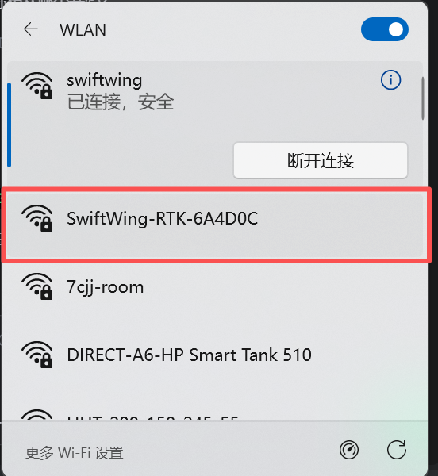
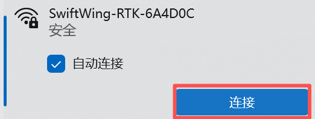
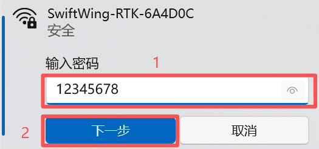
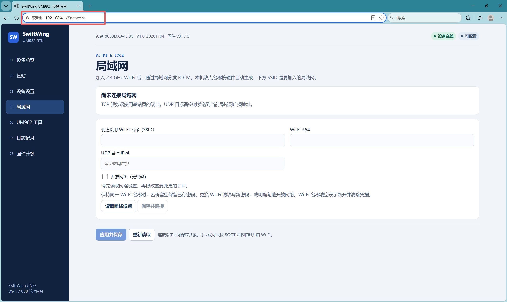
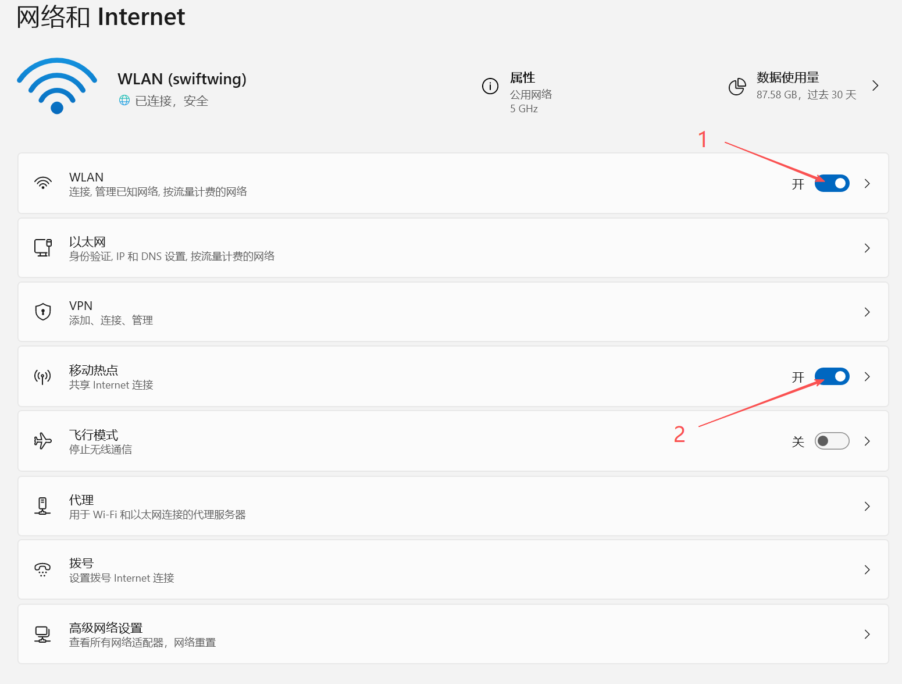
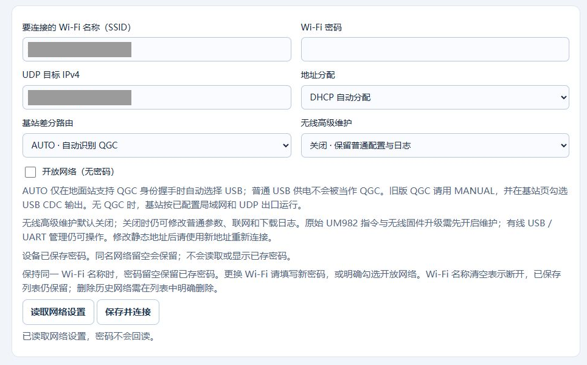
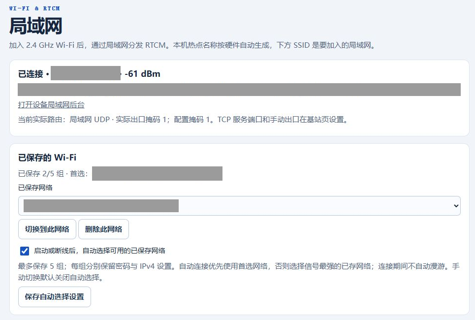
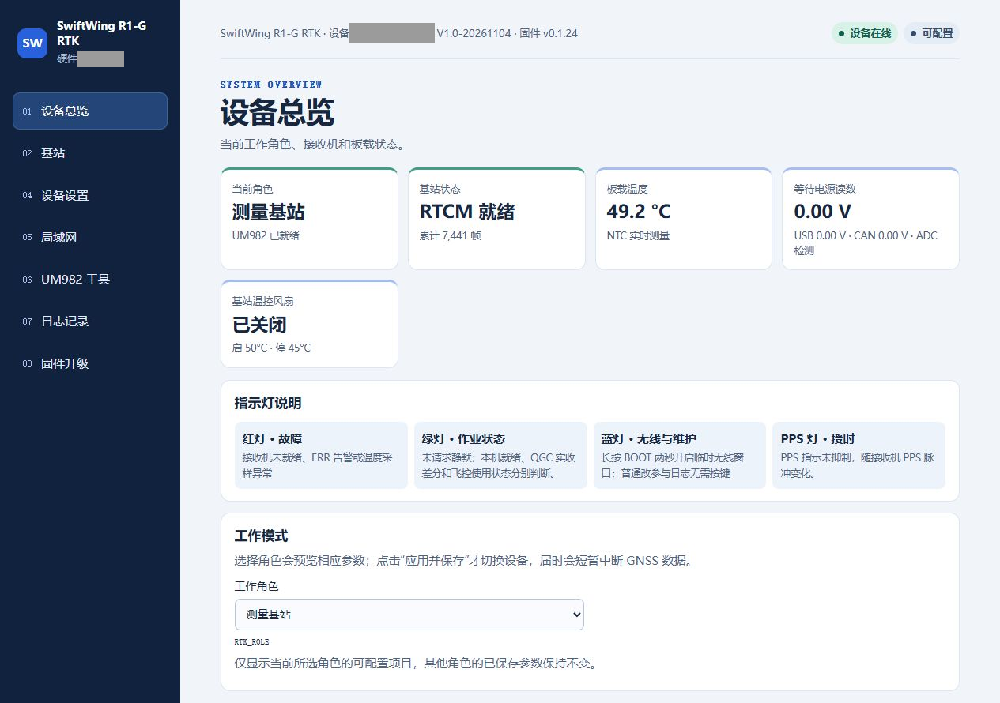
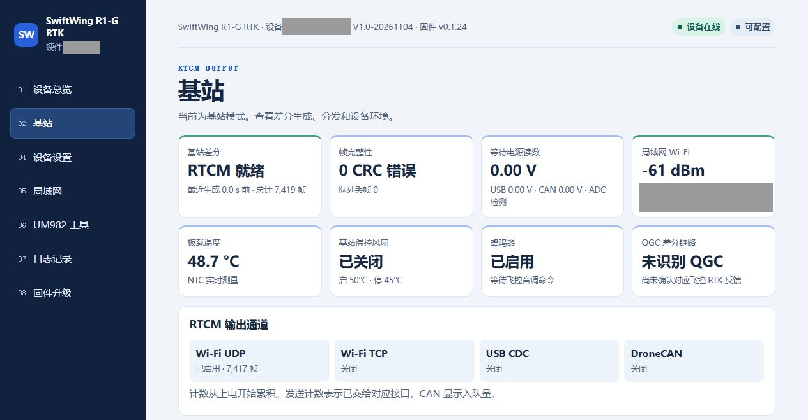
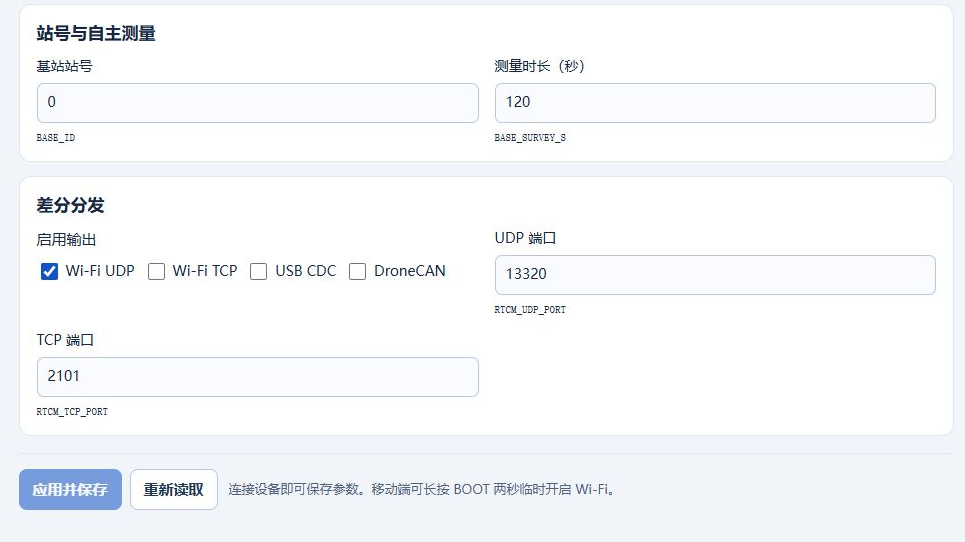

# 设备后台参数修改

本文按"打开网页 → 查看基站状态 → 修改并保存参数"的顺序操作。设备可通过自身热点或外部局域网管理；本页基站网页截图为实机 0.1.24，现场身份和网络信息已遮盖，点击图片可放大。

## 先选连接方式：什么时候先接 USB

**首次使用、外部网络没配好，或热点 / LAN 网页都找不到时，推荐先接主板 USB，用 QGC 保存设备与网络配置。** 网页后台已内置在固件中，USB 用来改配置，不是安装后台。已能连接热点或实际 LAN 地址时，也可以直接在网页配置。

| 当前情况（0.1.23 / 0.1.24） | 无线与热点的行为 | 你的操作 |
| --- | --- | --- |
| 首次配置、网络未知 | USB 管理不依赖无线；AUTO 下有效 QGC USB 会话通常会关闭无线 | 主板数据 USB → QGC 选基站 → 保存角色、建站参数、Wi-Fi 和 UDP 目标 |
| 日常 AUTO、没有有效 QGC USB 会话 | 使用 UDP 并开启无线；连上外部网络且实际取得 IP 后，通常关闭设备热点 | 基站与 QGC 主机同网，使用 UDP；网页用实际 LAN IP |
| 无线已开启，但未设置外部 SSID 或还没取得 LAN IP | 自动开放恢复热点 | 连接基站热点，访问 192.168.4.1，保存外部网络后切到实际 LAN 地址 |
| AUTO 下正在通过主板 USB 与 QGC 有效交互 | 没有其他无线需求时关闭无线，热点和 LAN 网页都会断开 | 直接用 USB 配置；此时要看网页，再启用无线后台或 BOOT 临时窗口 |
| 正常运行时长按 BOOT 约 2 秒 | 开启约 30 分钟临时无线窗口，保留热点，也可连接外部网络；重启失效 | 短时网页维护；到期后恢复自动策略 |
| QGC 点击"启用无线后台"，或保存"无线高级维护"为开启 | 保存持续维护模式，无线和热点保持开启 | 完成维护后关闭该项并保存，恢复自动策略 |

手动路由启用 UDP / TCP 时也需要无线；热点是否出现，仍按"有无实际 LAN IP、是否处于临时 / 持续维护"判断。**设备热点和外部路由器不是始终同时在线；保存过 Wi-Fi 也不保证当前已经联网。** 进行中的网页升级会保持无线，避免中途因策略切换断开。

普通查看状态、修改常规参数、下载日志和只读诊断，不要求"无线高级维护"；前提是无线已经开启、网页可达。无线升级和发送原始 UM982 指令才另外需要高级维护权限。BOOT 临时窗口与保存的高级维护是两种独立状态。

## 一、首次连接设备

### 1. 基站模块供电

**RTK 主板 USB-C**：提供 5 V 供电及 USB 数据连接。使用电脑连接时，线缆需支持数据传输，充电线可能只能供电。

**供电板（选配）**：2S 18650 经 SW1 船型开关接 RTK 主板 XT30（SYS_SW_OUT）。供电板 USB-C 用于供电 / 充电，开启 SW1 时可同时给主板供电，不是 QGC 数据口。

注意

RTK 的 CAN_5V 不能接 2S 电池或快充 12 V。供电板低压报警点约 7.0 V，与主板 <code>BEEP_ENABLE</code> 控制的蜂鸣器分开。

### 2. 连接设备 Wi-Fi 热点

**仅在上表所述热点已开启时执行本节。** 若基站已加入路由器且有 IP，直接使用该 LAN IP；若正在 USB 配置而无线关闭，先看第五节。

基站热点名称为 `SwiftWing R1-G RTK-XXXXXX`，其中 `XXXXXX` 为设备序列号末六位大写短码；默认密码为 `12345678`。

1. 在手机或电脑的 Wi-Fi 列表中找到该热点。

2. 点击「连接」。

3. 输入密码 `12345678`，点击「下一步」。

说明

<ul>
<li>旧版本热点可能仍显示 <code>SwiftWing-RTK-XXXXXX</code>。热点无互联网不影响打开本机后台；手机若自动切换网络，应保持连接设备热点后再访问。</li>
<li>设备名称由固件中的产品角色和硬件序列号生成。局域网页的「Wi-Fi 名称」用于填写外部路由器或热点的名称，不用于修改本机产品名或热点名。运行中切换角色后，USB 显示名称需重启后刷新。</li>
</ul>

### 3. 访问后台地址

打开浏览器，输入后台地址 [http://192.168.4.1/](http://192.168.4.1/)。

这张原有截图只说明浏览器输入地址的位置，页面样式来自旧版；下文使用当前版本实机页面。

### 4. 连接外部局域网（可选）

1. 打开外部 2.4 GHz 手机热点或路由器，并让接收差分的电脑也接入该网络。

2. 在后台点击 **局域网 → 读取网络设置**，填写外部热点名称、密码，以及运行 QGC 的电脑 IPv4。点击 **保存并连接**。QGC 对应按钮叫"保存局域网设置"。

3. 等顶部显示 **已连接**与实际 LAN 地址后，将电脑 / 手机接回同一外部局域网，使用该地址打开后台。

建议

正常模式取得 LAN IP 后设备热点可能关闭，这是预期切换；处于 BOOT 临时窗口或高级维护时可保留热点。UDP 目标是 QGC 电脑地址，不是基站自身地址；端口在基站页配置为 13320。<code>192.168.4.1</code> 只用于设备自身热点。

可保存最多 5 组网络；同名网络密码留空保留，新网络需密码或明确选择开放网络。清空当前 SSID 只断开当前连接，不删除已存历史；移除凭据须在列表中明确删除。完整网络设置见[Wi-Fi 输出差分](Wifi输出差分.md)。

## 二、后台菜单

进入后台后，左侧菜单如下：

- **设备总览**：身份、固件版本、工作模式与指示灯说明。
- **基站**：站号、建站方式、RTCM 就绪状态、输出通道和端口。
- **设备设置**：供电读数、板温、风扇阈值、蜂鸣器及诊断数据。
- **局域网**：连接外部 Wi-Fi、设置 UDP 目标地址。
- **UM982 工具**：发送接收机命令、读取诊断和恢复设置。
- **日志记录**：本次开机事件与 Flash 测试记录。
- **固件升级**：应用镜像上传和升级状态。

先核对顶部产品名、设备身份和"设备在线"。总览中的角色是实际工作状态；工作模式下拉框选择其他角色只是预览，点击"应用并保存"才会切换。

## 三、查看基站差分与输出状态

点击左侧 **基站**，重点看上方状态卡片与 **RTCM 输出通道**。

| 区域 | 查看内容 |
| --- | --- |
| 基站差分 | 显示 RTCM 就绪，最近生成时间持续刷新、累计帧增加 |
| 帧完整性 | CRC 错误与队列丢帧；观察本次窗口内增量 |
| RTCM 输出通道 | UDP 等所用出口已启用，发送计数增加；TCP 还显示连接数 |
| QGC 差分链路 | 设备收到的 QGC 识别及反馈，和本机生成状态分别显示 |
| 温度 / 风扇 | 板温与风扇控制状态；实际风扇转动另行查看 |

本图为 UDP 出口工作状态，QGC 反馈卡片仍显示"未识别 QGC"，因此只用于说明基站生成和发送。是否到达地面站，继续按[Wi-Fi 输出差分](Wifi输出差分.md#qgc-udp-check)在 QGC 查看有效帧。USB/CAN 电压卡片不测量 XT30 电池电压。

## 四、修改参数并确认生效

### 1. 基站测量与差分出口

在 **基站**页填写站号、自动测量时长或固定坐标，按[基站模式与参数](基站模式与参数.md)选择适合的方式；差分分发区域选择出口与端口。

图中为站号 0、测量 120 秒、UDP 13320。

注意

固定坐标应填写自己的参考点，不能复制示例坐标。

### 2. 温控与蜂鸣器

点击 **设备设置**，将风扇开启温度设为 **35 °C（FAN_ON_C=35）**，关闭温度设为 **30 °C（FAN_OFF_C=30）**；关闭温度应低于开启温度。点击 **应用并保存**后再 **重新读取**，确认新值已生效。

达到 35 °C 后启动散热，降至 30 °C 或以下停止；中间保持原状态。例如 36 °C 开启后，33 °C 仍转，降至 30 °C 才停。此值是主板温度，不是电池温度，完整接线与逻辑见[温控风扇说明](供电与充电.md#cooling)。

截图为旧设置的操作素材；本页按 <strong>35 / 30 °C</strong> 配置。修改手册或正常保参升级不会替已有设备改参，须保存并核对读回。

### 3. 保存并重新读取

设备参数改完后，点击底部 **应用并保存**，等显示 **参数已生效并保存**，再点 **重新读取**核对。修改角色或接收机配置后，等待 RTCM 重新就绪。

网络、UDP 目标、AUTO / MANUAL 路由使用网络区的 <strong>保存并连接</strong>，与设备参数分开保存。超时先读回实际值，不连续提交。

全部参数见[设备参数参考](../RTK通用/设备参数参考.md)。**日志记录、UM982 工具和固件升级**的操作与配图，继续看本产品的[日志升级与恢复](日志升级与恢复.md)。

## 五、从 QGC 打开后台

1. 用**基站主板数据 USB**连接 QGC，在 **NTRIP/RTK**选中基站并核对身份。需要外部 LAN 时先填写 Wi-Fi 名称与密码，点 **保存局域网设置**。
2. 点击 **启用无线后台**。这个按钮会把"无线高级维护"保存为开启，使 USB 优先时也保留无线及热点；不会代替上一步保存 Wi-Fi 草稿，也不是只打开浏览器。
3. 等实际 LAN 地址出现，再点 **用默认浏览器打开后台**（或 **打开后台**）。只有设备热点时按钮可能仍为灰色；电脑 / 手机连接基站热点后，手动打开 192.168.4.1。
4. 若只短时查看，也可不用持续维护模式：正常运行时长按 **BOOT 约 2 秒**，开启约 30 分钟临时窗口，再连接热点。不要同时按 EN/RESET 进入下载模式。
5. 完成后在网页 **局域网**关闭"无线高级维护"并点 **保存并连接**；若仍有 BOOT 临时窗口，热点会保留到窗口结束。

注意

不要沿用另一台设备的旧 IP。

QGC 中 Wi-Fi 信号约 ≥−60 dBm 显示绿色，−75 至 −60 dBm 显示黄色，更弱显示白色；该颜色表示信号强度，不是数据到达和厘米定位的保证。

