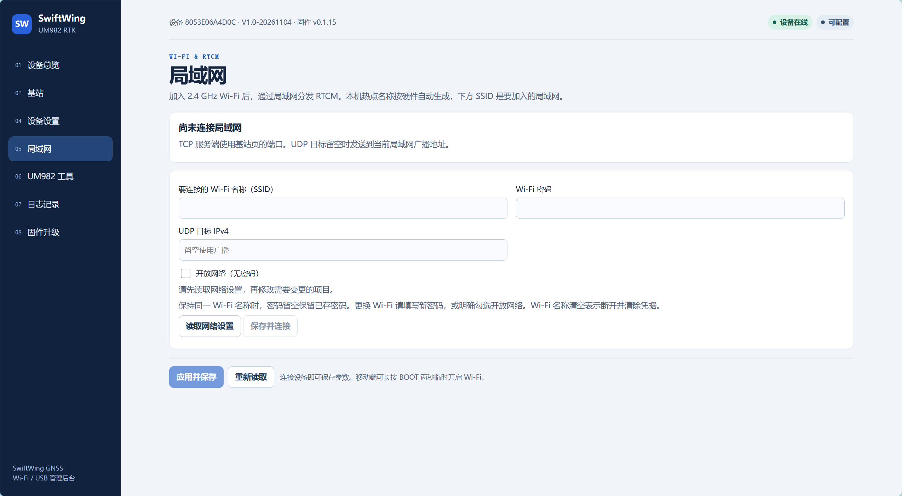
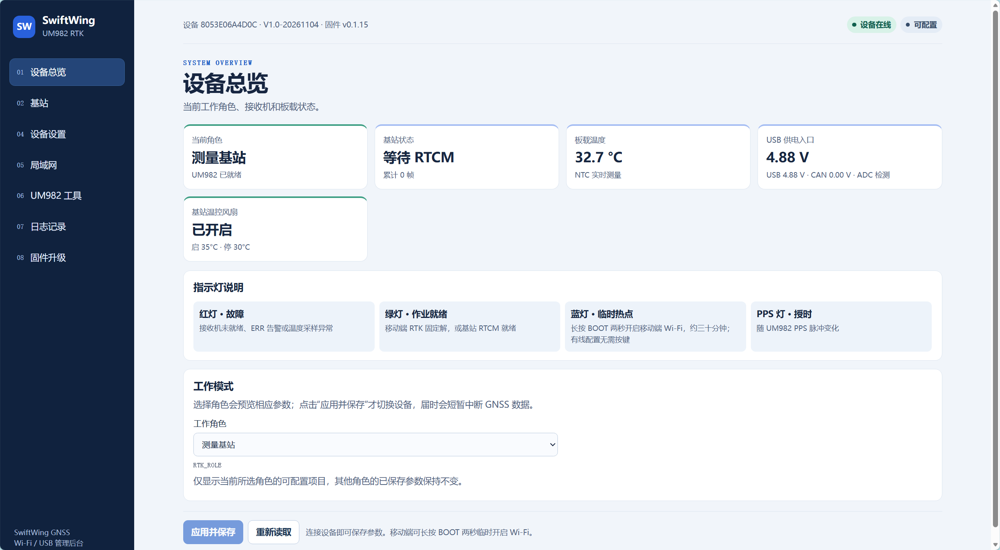
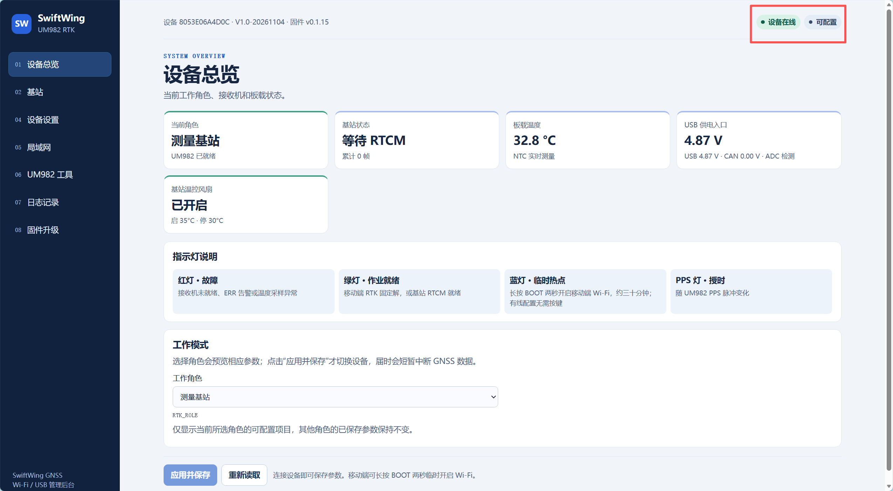
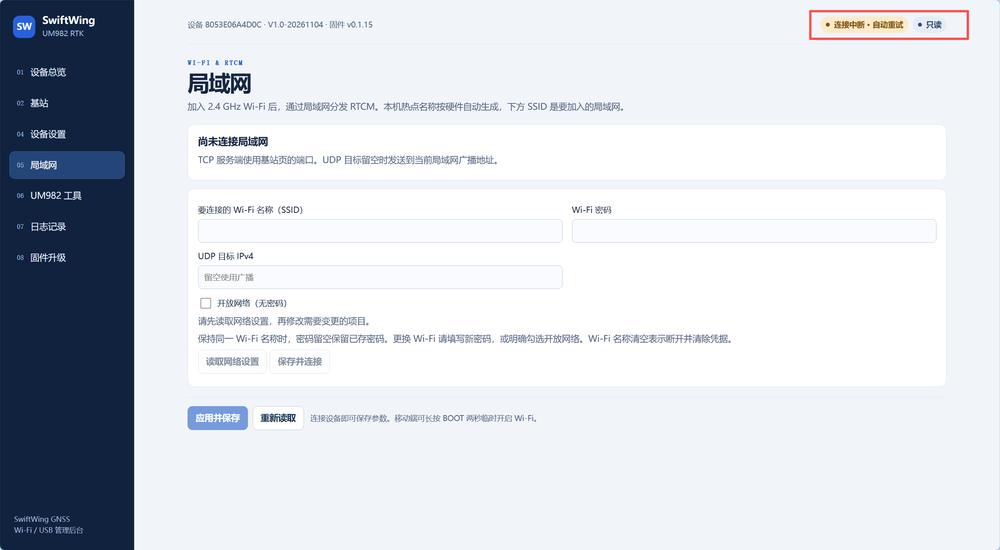

# 设备后台参数修改

本文介绍修改参数的操作步骤。

## 一、首次连接设备

### 1. 基站模块供电

**RTK 主板 USB-C**：提供 5 V 供电及 USB 数据连接。使用电脑连接时，线缆需支持数据传输，充电线可能只能供电。

**供电板（选配）**：2S 18650 经 SW1 船型开关接 RTK 主板 XT30（SYS_SW_OUT）。供电板 USB-C 仅用于充电，不是 QGC 数据口；RTK 的 CAN_5V 不能接 2S 电池或快充 12 V。供电板低压报警点约 7.0 V，与主板 `BEEP_ENABLE` 控制的蜂鸣器分开。

### 2. 连接设备 Wi-Fi 热点

基站默认热点名称为 `SwiftWing R1-G RTK-XXXXXX`，其中 `XXXXXX` 为设备序列号末六位大写短码；默认密码为 `12345678`。

1. 在手机或电脑的 Wi-Fi 列表中找到该热点。

2. 点击「连接」。

3. 输入密码 `12345678`，点击「下一步」。

说明

<ul>
<li>旧版本热点可能仍显示 <code>SwiftWing-RTK-XXXXXX</code>。热点无互联网不影响打开本机后台；手机若自动切换网络，应保持连接设备热点后再访问。</li>
<li>设备名称由固件中的产品角色和硬件序列号生成。局域网页的「Wi-Fi 名称」用于填写外部路由器或热点的名称，不用于修改本机产品名或热点名。运行中切换角色后，USB 显示名称需重启后刷新。</li>
</ul>

### 3. 访问后台地址

打开浏览器，输入后台地址 [http://192.168.4.1/](http://192.168.4.1/)。

### 4. 设置Wifi连接（选）

1. 打开Wifi热点

2. 在后台局域网页面输入热点名称和密码，连接你的Wifi热点。

3. 完成配置后可选用Wifi热点连接基站设备完成数据交互

## 二、后台菜单

进入后台后，左侧菜单如下：

- **设备总览**：身份、固件版本、工作模式与指示灯说明。
- **基站**：站号、建站方式、RTCM 就绪状态、输出通道和端口。
- **设备设置**：供电读数、板温、风扇阈值、蜂鸣器及诊断数据。
- **局域网**：连接外部 Wi-Fi、设置 UDP 目标地址。
- **UM982 工具**：发送接收机命令、读取诊断和恢复设置。
- **日志记录**：本次开机事件与 Flash 测试记录。
- **固件升级**：应用镜像上传和升级状态。

## 三、查看设备连接状态

修改参数前，先在页面右上角确认设备处于「在线」且「可配置」状态。

注意

注意设备连接状态，以免进行无效修改。

## 四、从 QGC 打开后台与信号颜色

在 QGC 所选基站区域点击 **启用无线后台**，等待真实联网状态和地址出现，再点击 **用默认浏览器打开后台**（或 **打开后台**）。没有实际 IP 时不猜测或沿用另一台设备的旧地址；先核对无线是否关闭。调试后可关闭高级维护，恢复省电。

QGC 中 Wi-Fi 信号约 ≥−60 dBm 显示绿色，−75 至 −60 dBm 显示黄色，更弱显示白色；该颜色表示信号强度，不是数据到达和厘米定位的保证。

