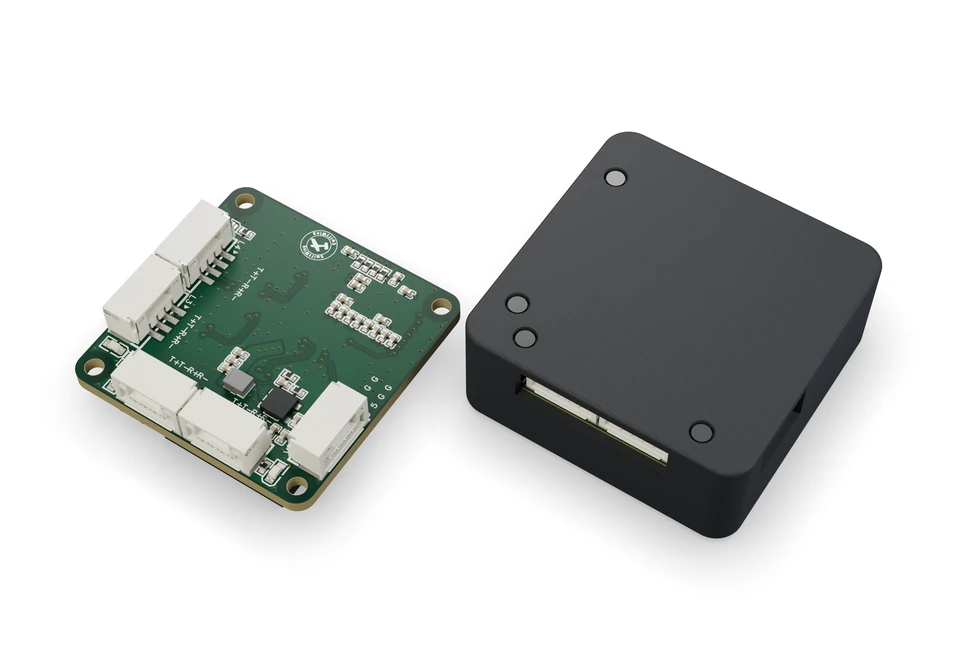
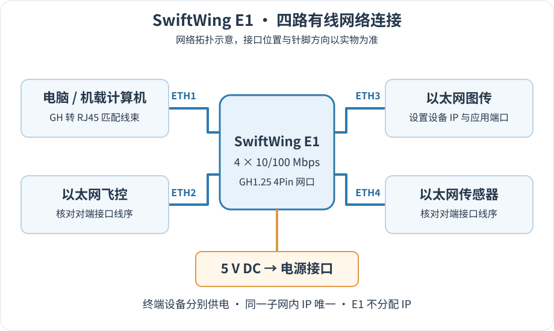

# SwiftWing E1 四口百兆以太网交换机模块

SwiftWing E1 是面向无人机、机器人及嵌入式设备内部网络的四口百兆以太网交换机模块。采用 Realtek RTL8306MB-CG 交换芯片，通过 4 路 GH1.25 4Pin 以太网接口连接机载计算机、具备以太网接口的飞控、图传或传感器，实现设备之间的有线网络通信。

裸板 PCB 模块尺寸 **30 × 30 × 8.3 mm**，重量 **5.6 g**；带外壳整机尺寸 **33 × 33 × 13.3 mm**，重量 **11.4 g**。使用 **5 V 直流供电**，四个网口接入时静态功耗 **0.32 W**，四口全负载运行时本轮实测最大功耗 **0.58 W**。

左侧为裸板版，右侧为带壳版，两者按同一比例展示。

## 产品特点

- **四路百兆网口**：4 个 10/100 Mbps 以太网端口，适合多设备集中接入。
- **四口并发实测**：每个数据方向目标 90 Mbps 的 UDP 测试中，四方向实收合计约 **360 Mbps**；三种配对的 12 个方向均记录为零丢包。
- **小体积、轻重量**：裸板模块 **5.6 g**，带外壳整机 **11.4 g**；带壳尺寸 **33 × 33 × 13.3 mm**，适合机载设备和小型机箱集成。
- **GH1.25 线束连接**：网络和电源均采用 GH1.25 4Pin 连接器，便于设备内部布线；两者线序与用途不同。
- **5 V 低功耗供电**：四口接入静态 **0.32 W / 64 mA**，四口全负载实测最大 **0.58 W / 116 mA**。通过电源接口给模块供电，连接的终端分别按自身要求供电。
- **端口状态指示**：每个网口对应一颗黄色链路与活动指示灯，带壳版从顶面的导光柱观察。灯态说明见[使用说明](使用说明.md#e1-link-act)。
- **接口保护设计**：各以太网端口配置 TVS 防护器件。

## 产品参数

| 项目 | 规格 |
| --- | --- |
| 产品型号 | SwiftWing E1 |
| 产品类型 | 四口百兆以太网交换机模块 |
| 交换芯片 | Realtek RTL8306MB-CG |
| 以太网端口 | 4 × 10/100 Mbps |
| 网络接口 | 4 × GH1.25 4Pin |
| 电源接口 | GH1.25 4Pin |
| 供电电压 | 5 V DC |
| 四口接入静态功耗 / 电流 | 0.32 W / 0.064 A（64 mA），5 V 输入 |
| 四口全负载实测最大功耗 / 电流 | 0.58 W / 0.116 A（116 mA），5 V 输入 |
| PCB 模块尺寸 | 30 × 30 × 8.3 mm（长 × 宽 × 高） |
| PCB 模块重量 | 5.6 g |
| 带外壳整机尺寸 | 33 × 33 × 13.3 mm（长 × 宽 × 高） |
| 带外壳整机重量 | 11.4 g |
| 端口指示灯 | 黄色 LED × 4 |
| 以太网磁性器件 | G2426S × 2 |
| 接口防护器件 | PESDALC10N5VU × 4 |

尺寸和重量分别按裸板 PCB 模块与带外壳整机列出，安装时按对应形态预留空间，并另行预留线束插头、弯线和固定结构的空间。功耗和电流为用户提供的本轮 5 V 输入实测数据，分别对应四口接入静态和四口全负载工况；电源选型需另行为启动及线缆压降留出余量。

四口并发数据来自 2026-11-26 的端到端测试：四台设备直接接入，UDP 负载 1400 字节，四条独立数据流，三种配对各统计约 20 秒。约 360 Mbps 为四方向接收吞吐之和，各端口链路为 100 Mbps。实际应用性能按终端、驱动、线束、协议和负载确定。

## 产品各视角

点击对应版本可放大查看高清原图。

| 视角 | 带壳版 | 裸板版 |
| --- | --- | --- |
| 双网口斜前视 | [带壳图](image/产品图/带壳_01.png) | [裸板图](image/产品图/裸板_01.png) |
| 供电侧斜视 | [带壳图](image/产品图/带壳_02.png) | [裸板图](image/产品图/裸板_02.png) |
| 顶面与接口分布 | [带壳图](image/产品图/带壳_03.png) | [裸板图](image/产品图/裸板_03.png) |
| 底面结构 | [带壳图](image/产品图/带壳_04.png) | [裸板图](image/产品图/裸板_04.png) |
| 网口近景 | [带壳图](image/产品图/带壳_05.png) | [裸板图](image/产品图/裸板_05.png) |
| 五根线套装 | [带壳图](image/产品图/带壳_06.png) | [裸板图](image/产品图/裸板_06.png) |

## 典型连接

图中四个端口分别连接四台以太网设备；连接路由器、电脑或其他交换机时，同样占用一个端口。ETH1～ETH4 为本手册的端口编号，实际位置见[带壳接口与导光柱图](硬件接口与接线.md#e1-port-map)。

E1 负责设备之间的以太网数据交换。设备的 IP 地址、通信协议、服务端口和应用程序仍需分别配置；E1 不提供 Wi-Fi、路由、NAT 或 DHCP 地址分配。

## 从哪里开始

1. 首次接线先看[硬件接口与接线](硬件接口与接线.md)，确认电源和网口针脚。
2. 按[使用说明](使用说明.md)完成上电、组网、IP 配置与通信检查。

