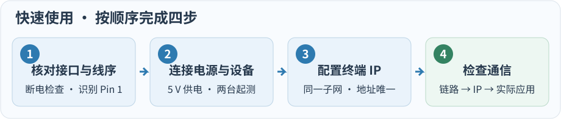

# SwiftWing E1 使用说明

首次使用按下面顺序完成：**核对线序 → 连接 5 V 电源和网络设备 → 配置 IP → 检查链路与应用通信**。

[](image/E1快速使用流程.svg)

## 一、准备设备

- SwiftWing E1 模块与稳定的 5 V 直流电源。
- 与板卡线序匹配的电源线束、GH1.25 网络线束；连接 RJ45 设备时准备匹配的转接线束 / 转接板。
- 至少两台以太网设备，例如电脑和以太网传感器。各设备按自身要求供电。
- 记录设备原有 IP、子网掩码和通信端口，确认需要使用的应用程序。

## 二、接线并上电

1. **全部断电**，按[硬件接口与接线](硬件接口与接线.md)核对电源口、网络口和 Pin 1 方向。
2. 将 5 V 电源线束接到 E1 **电源口**，确认正负极正确。
3. 用两个网络端口分别连接电脑和目标设备。需要更多设备时，继续连接剩余端口。
4. 检查无短路和误插后，给 E1 及各网络设备上电。
5. 在电脑或对端设备的网络状态中确认有线链路已连接；同时观察相应端口指示灯。

端口指示灯用于辅助检查，不单凭亮灯认定设备已经互通。灯的具体亮灭、闪烁和速率含义以该版硬件实际状态为准。

## 三、配置设备 IP

E1 不分配 IP 地址。首次联调可先只接电脑与目标设备，确认互通后再加入其他设备。

### 方式 A：已有路由器或 DHCP 服务器

1. 用 E1 的一个网络端口连接路由器的 **LAN 口**，其余端口连接终端设备。
2. 将需要自动获取地址的终端设为 DHCP。
3. 在路由器或终端的网络状态中查看实际分配的地址，确认设备处于预期网段。

地址由路由器或其他 DHCP 服务器分配。若目标设备固定使用静态 IP，仍需按它的手册设置电脑或调整设备地址，不能只把电脑设为 DHCP 后就默认能访问。

### 方式 B：独立组网，手动设置静态 IP

没有 DHCP 服务器时，为需要互通的设备设置同一子网内的不同地址。下面仅作接线测试示例；目标设备已有固定地址时，先让电脑适配它的网段。

| 设备 | 示例 IPv4 | 子网掩码 |
| --- | --- | --- |
| 电脑 | 192.168.10.10 | 255.255.255.0 |
| 目标设备 A | 192.168.10.20 | 255.255.255.0 |
| 目标设备 B（可选） | 192.168.10.30 | 255.255.255.0 |

每台设备地址必须唯一。只在本地子网内通信时，测试网卡的默认网关和 DNS 可以留空；需要访问其他网段或互联网时，按实际网络配置网关与 DNS。

**Windows 电脑设置示例：**

1. 按 `Win + R`，输入 `ncpa.cpl`并回车，打开网络连接。
2. 找到连接 E1 的以太网网卡，右键选择 **属性**。
3. 选择 **Internet 协议版本 4（TCP/IPv4）→ 属性**，记录原设置后填写 IP 和子网掩码。
4. 保存后，用 `ipconfig`核对该网卡的实际 IPv4。不要误改用于其他业务的网卡；测试结束后按需恢复原设置。

E1 本身无需填写上述 IP；这些地址配置在电脑、传感器、图传等终端上。

## 四、检查连接是否正常

### 1. 看有线链路

在 Windows **网络连接**中双击对应以太网网卡，查看链路状态和协商速率。连接 E1 时按实际结果确认 10 Mbps 或 100 Mbps；协商速率不等于应用实际吞吐量。

### 2. 测试目标设备

打开终端，使用目标设备的实际 IP 测试。以上述静态 IP 示例为例：

```powershell
ipconfig
ping 192.168.10.20
```

`ping`得到回复说明基本 IP 通信可达。若设备不响应 ICMP，继续用其厂家工具或已启用的服务端口检查，不仅凭 `ping`超时判断交换机故障。

### 3. 测试实际应用

按目标设备手册打开网页、连接控制软件或读取数据流，填写正确的目标 IP 和服务端口。确认数据持续更新后，再逐台加入其他设备测试。

使用 UDP 时，还需核对发送端填写的**接收设备 IP 和端口**；以太网交换机不会替应用修改目标地址。连接飞控或图传时，也需在对应软件中配置通信协议与端口。

## 五、增加设备与安装使用

1. 每增加一台设备，先确认它的地址不与现有设备重复，再接入剩余网络口。
2. 四个端口共用来连接终端和上级网络，连接路由器或另一台交换机也会占用一个端口。
3. 首次组网使用树形连接，不将 E1 的两个端口互相接回，也不与另一台交换机形成重复回路。
4. 完成实际应用通信测试后，再固定模块与线束；结束调试按需恢复电脑网卡原有设置。

## 六、常见问题

### 上电后所有设备都没有链路

先检查 E1 电源口实测电压是否为 5 V、正负极是否正确，各终端是否已供电。确认电源线没有误插进网络口，再使用一条已核对的线束和两台设备进行最小连接测试。

### 只有一个端口不通

将同一台设备、同一条已验证的线束换到其他端口，分别排查线束、对端设备和模块端口。GH1.25 插头插到位不代表线序正确，需检查差分对与极性。

### 电脑显示网线已连接，但找不到设备

先看电脑有线网卡和目标设备的 IP、子网掩码是否匹配，是否有重复地址。有多个网卡时，确认访问走的是连接 E1 的网卡。再检查目标服务是否开启、端口是否正确；按应用需要配置对应防火墙规则。

### 自动获取不到地址

检查网络中是否有可用 DHCP 服务器。独立连接 E1 与终端设备时，按第三节手动设置静态 IP。

### 链路只有 10 Mbps，或者传输速度偏低

先检查两端设备是否支持百兆、差分对接线是否正确、线束是否损伤，再查看协商结果。实际传输速度还受终端性能、协议和多设备同时传输影响；待机 0.18 W 也不代表通信时的功耗。

### 是否需要给 E1 配置飞控参数或安装软件

本教程的使用方式是以太网交换连接，无需在 E1 上配置 IP 或飞控参数。具备以太网接口的飞控、图传或传感器，仍按各自教程设置网络地址与应用协议；普通 CAN / UART 接口不能接到 E1 网口。

