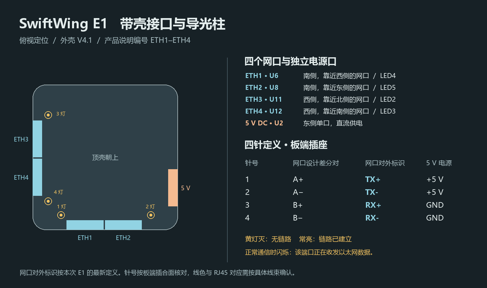
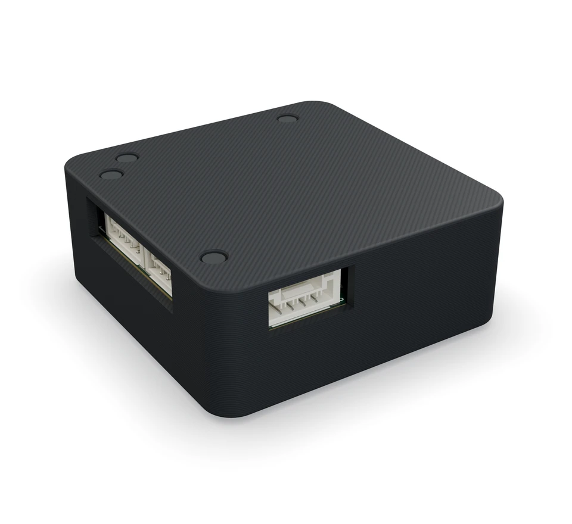
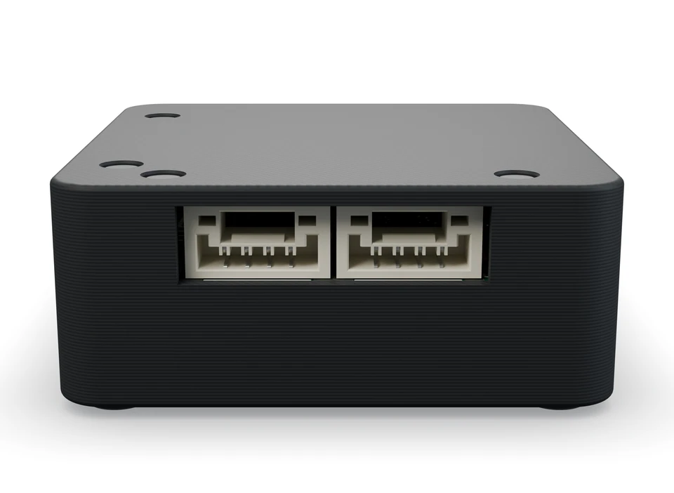
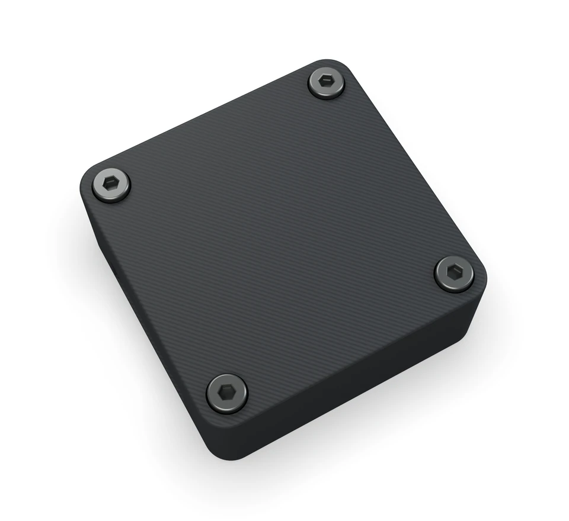

# SwiftWing E1 硬件接口与接线

E1 提供 **1 个电源接口和 4 个以太网接口**，连接器均为 GH1.25 4Pin。准备好与当前板卡匹配的插头和线束，断电后接线。

接线前确认

电源口与网络口外形相似，用途和线序不同。请先按实物丝印识别接口，再核对 Pin 1；不要仅凭插头外形或线色连接。模块使用 <strong>5 V</strong>，不能直接接入 12 V 或动力电池。

## 识别带壳版的接口与指示灯

将顶壳朝上，转到**单口电源窗在右、一个双网口窗朝向自己**的位置，对照下图。靠近自己的两个网口从左到右为 **ETH1、ETH2**。左侧两个网口从远到近为 **ETH3、ETH4**。右侧单口为 **U2，5 V 直流输入**。

| 网口 | 板上插座 | 对应的黄色指示灯 |
| --- | --- | --- |
| ETH1 | U6 | 图中 1 灯（LED4） |
| ETH2 | U8 | 图中 2 灯（LED5） |
| ETH3 | U11 | 图中 3 灯（LED2） |
| ETH4 | U12 | 图中 4 灯（LED3） |

这四处导光柱分别显示对应网口的状态。使用裸板版时，可放大查看[裸板接口面](image/产品图/裸板_03.png)，用同侧插座的数量区分网口和电源口。

## 一、电源接口

在带壳版的单口壳窗内找到 **U2**，使用稳定的 **5 V 直流电源**。下表按 U2 的板端针号列出。

| 针脚 | 信号 | 接线 |
| --- | --- | --- |
| Pin 1 | VCC | +5 V |
| Pin 2 | VCC | +5 V |
| Pin 3 | GND | 电源负极 |
| Pin 4 | GND | 电源负极 |

供电侧图片用于识别单口壳窗。板端针号和线端插头的观察方向可能相反。接电前按 U2 的 Pin 1 和线束两端定义核对正负极，无法辨认时先确认线束导通关系。

1. 电源断开时，核对电源口和线束正负极。
2. 用万用表确认供电端为 5 V，再连接模块。
3. 四口接入静态实测为 **0.32 W / 64 mA**，四口全负载本轮实测最大为 **0.58 W / 116 mA**，两者均为 5 V 输入；电源选型还需为启动和线缆压降预留余量。

## 二、以太网接口

4 个网络接口各包含两组差分信号对，用于 10/100 Mbps 以太网通信。设计资料中的端口连接器位号为 **U6、U8、U11、U12**，本教程用 ETH1～ETH4 表示四路端口。

上图正对板端插座的插入口，顶壳朝上。左座为 **ETH1**，右座为 **ETH2**。按此图的观察方向，这两个插座各自从左到右均为 **Pin 1、2、3、4**。下表的信号定义适用于全部四个 E1 网口。

| 板端针号 | E1 网口标识 | 设计资料中的差分对 |
| --- | --- | --- |
| Pin 1 | **TX+** | A+ |
| Pin 2 | **TX-** | A− |
| Pin 3 | **RX+** | B+ |
| Pin 4 | **RX-** | B− |

TX/RX 为本版 E1 板端标识。配套反向线按两端各自的针号对应 **1↔4、2↔3、3↔2、4↔1**。查看线端时先辨认锁扣与观察面。制作 GH 转 RJ45 或其他设备转接线时，另查对端针号并逐芯测通，勿以线色代替针号。

### 连接 GH1.25 网口设备

1. 确认对端是真正的以太网接口，并查阅其针脚定义。
2. 逐一核对两组差分对及极性，使用匹配线束连接。
3. 保持每组差分对成对布线，避免把 A/B 两对拆开混接。

### 连接 RJ45 网口设备

1. 准备与 E1 线序匹配的 **GH1.25 转 RJ45 以太网线束 / 转接板**。
2. GH1.25 端接 E1 网络口，RJ45 端接电脑、路由器或其他以太网设备。
3. 普通 RJ45 网线无法直接插入板卡 GH1.25 接口；转接线也不能按其他产品的同外形接口线序直接套用。

网口传输以太网数据，各设备分别供电。CAN、UART 等接口即使使用相同外形的插头，也不能直接接入 E1 网络口。

## 三、安装与布线

带壳版的四颗黑色 **M2×8 内六角螺丝**从下壳底部向上紧固上下壳。翻回顶面后看到的四处圆点为网口导光柱。

- 按对应形态预留安装空间：裸板模块 **30 × 30 × 8.3 mm**，带外壳整机 **33 × 33 × 13.3 mm**；另行预留插头、线束弯曲及插拔空间。
- 使用合适支架或绝缘固定结构，避免金属件接触焊点；固定孔尺寸和孔距以实物机械图为准。
- 线束固定在结构件上，给插头留出应力释放，避免连接器直接承受拉力。
- 设备内部布线尽量远离大电流线、电机和强干扰源，避免挤压和反复折弯。

接线完成后，继续按[使用说明](使用说明.md)上电并检查通信。

