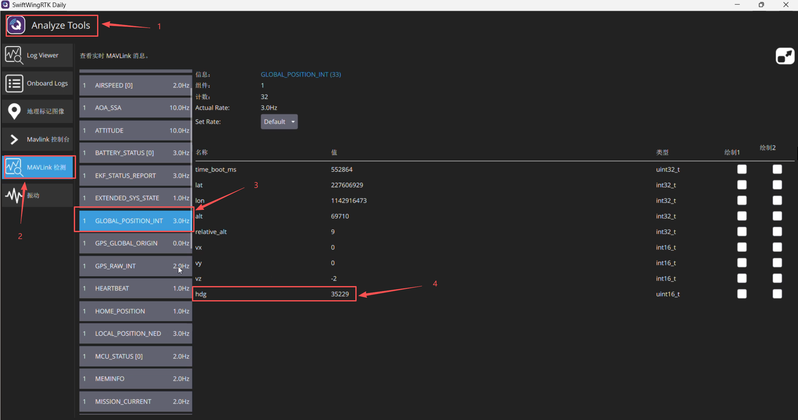
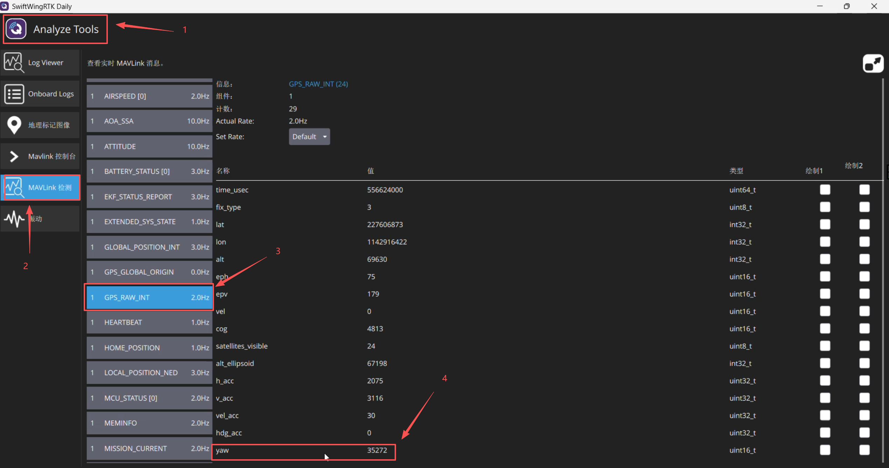

# ArduPilot/APM 飞控参数

本板单台 UM982 经 CAN 发送已校正的机头航向（Heading 20002），按普通 DroneCAN GPS 类型 9 接收；不是双接收机 moving-base pair，不套 GPS 类型 22/23 或串口 UM982 类型 25。[S5][S6]

以下用 4.6 起新参数名；现场 4.8.0 开发版的接收记录不代表所有版本完成飞行融合验收。连接飞控后，在 QGC **飞行器设置 → 参数** 或 Mission Planner **配置/调参 → 全部参数表** 修改。先备份，保存后按提示重启、读回；不要在 RTK 设备列表修改飞控参数。

## 一、参数配置

| 飞控参数 | 设置/核对值 | 作用 |
| --- | --- | --- |
| CAN_P1_DRIVER | 1 | 将 CAN1 分配给 CAN 驱动 1 |
| CAN_D1_PROTOCOL | 1：DroneCAN | 启用 DroneCAN 协议 |
| CAN_P1_BITRATE | 1000000 | CAN1 速率 1 Mbps |
| GPS1_TYPE | 9：DroneCAN | 本板的普通 CAN GNSS 接收路线 |
| AHRS_EKF_TYPE | 3 | 使用 EKF3；核对当前估计器 |
| EK3_ENABLE | 1 | 启用 EKF3 |
| EK3_SRC1_YAW | 3：GPS with Compass Fallback | GPS 航向及健康罗盘后备；需实际校准罗盘 |
| GPS_AUTO_CONFIG | 保留本项目实测值 1 | ESP32 自行配置 UM982，不套 AP_Periph 自动配置流程 |
| GPS1_POS_X | ANT1 相对重心 X，米 | 前方为正 |
| GPS1_POS_Y | ANT1 相对重心 Y，米 | 右方为正 |
| GPS1_POS_Z | ANT1 相对重心 Z，米 | 下方为正 |

若明确选择纯 GPS 航向，EK3_SRC1_YAW=2 是 GPS；初装本板建议先保留健康已校准罗盘并评估枚举 3 的后备策略。后备切换由飞控条件决定，不意味着每次方向跳变都能自动、无扰动纠正。确认当前使用 EKF3 和哪一组源；若实际切到 SRC2/SRC3，则 SRC1 的修改不会自动作用于另一组。[S7]

## 二、版本名、配置边界与重启

- 4.5.7 及更早旧名为 `GPS_TYPE`、`GPS_POS1_X/Y/Z`；4.6 起为 `GPS1_TYPE`、`GPS1_POS_X/Y/Z`。按实际参数选择，旧名也有数字 1。[S6]
- 若存在 EK2_ENABLE，按该版官方 GPS yaw 流程设 0，使用 EKF3；不存在不强套。[S5]
- CAN2 接线查 CAN_P2_DRIVER/CAN_P2_BITRATE；CAN_D1_PROTOCOL 的 D1 是逻辑驱动，不随物理端口机械改 D2。
- 正常安装 RTK 偏角 0，不用 GPS1_MB_TYPE/OFS 或另一层偏角再次旋转机头角。
- GPS_AUTO_CONFIG 保留 1，不套 AP_Periph 的 2。[S6]
- 多 GPS 先核对本 RTK 的实例、主用 GPS 和活动 EKF 源，不覆盖其他 GPS，也不写死偶然分配的 CAN 节点。
- 差分经 QGC 注入时，核对 `GPS_INJECT_TO` 包含本板所在的 GPS 实例，再看移动端 RTCM 计数和龄期；此参数控制飞控内部接收对象，不是基站站号。

## 三、保存与验证顺序

1. 保存飞控参数，按 QGC 提示重启飞控；建议本次配置完成后飞控和移动端一起正常重新上电。
2. 在 QGC 确认移动端的卫星数与定位数据持续更新，操作见[差分接入与数据检查](差分与Wi-Fi后台.md#qgc-gps)。
3. 在 MAVLink 检测中查看 `GPS_RAW_INT.yaw`和`GLOBAL_POSITION_INT.hdg`是否一致。一致则说明飞控使用了RTK航向。

4. 无桨地面整体缓慢转动机体与双天线，再回正，核对方向一致，没有 180° 反向或 90° 错装。

注意

本板没有外置磁罗盘，可保留并校准实际使用的内置磁罗盘。

## 参考资料

- [S5：ArduPilot GPS for Yaw 说明](https://ardupilot.org/copter/docs/common-gps-for-yaw.html)
- [S6：Copter 4.6.3 DroneCAN GPS 接收与配置源码](https://github.com/ArduPilot/ardupilot/blob/Copter-4.6.3/libraries/AP_GPS/AP_GPS_DroneCAN.cpp)
- [S7：ArduPilot EKF 源选择说明](https://ardupilot.org/copter/docs/common-ekf-sources.html)
