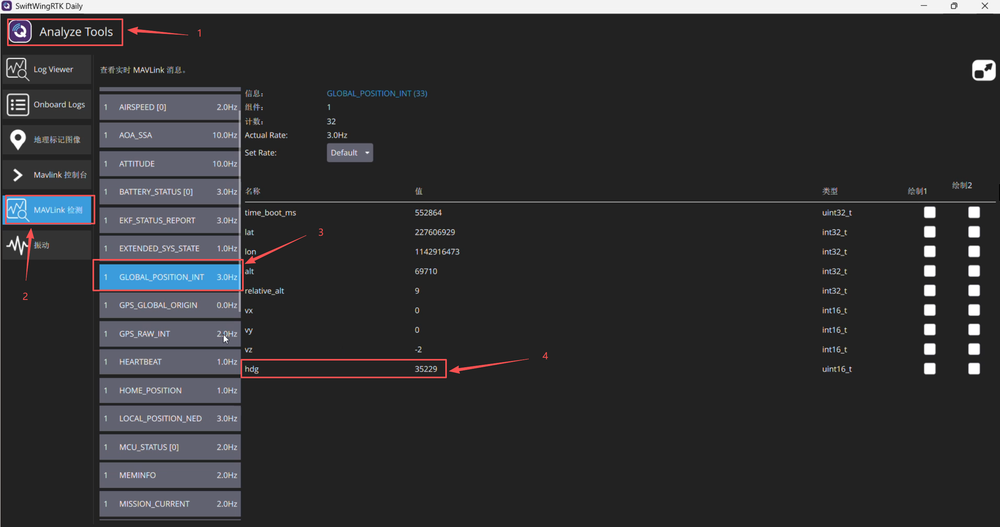
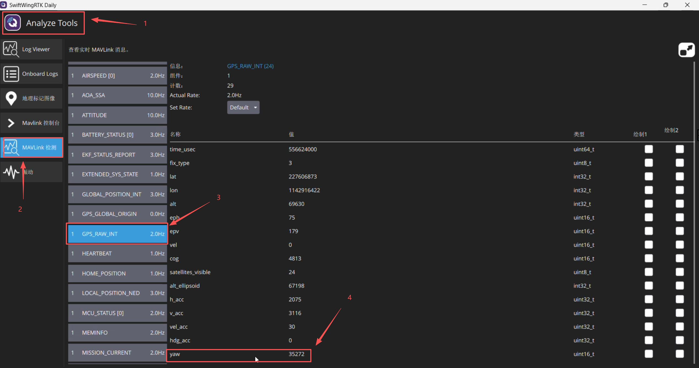

# PX4 飞控参数

本项目经典 PX4 模式对应仍接收旧 Fix2 ECEF 航向扩展的 v1.17.0 路径。较新 PX4 main 已移除此接收方式，不能把「版本更高」理解为必然兼容。AUTO 识别到 PX4 家族也不等于精确版本已验证。[S1][S2]

先导出飞控参数备份。飞控通过 USB 或遥测连接 QGC 后，进入 **飞行器设置 / Vehicle Setup → 参数 / Parameters**，搜索下面的完整参数名，核对当前值后修改并保存；这里不是 SwiftWing RTK 设备参数列表。按重启提示完成后重新读回。以下按 CAN1、单个目标 GNSS 实例说明；CAN2 或多 GPS 系统需核对实际接线和 GPS 实例，勿把板型默认值直接覆盖到另一架飞机。

## 一、参数配置

| 飞控参数 | 设置/核对值 | 作用 |
| --- | --- | --- |
| UAVCAN_ENABLE | 仅传感器用 2；原有 3 则保留 3 | 启用 DroneCAN 自动配置；保留原有 CAN 电调功能 |
| UAVCAN_BITRATE | 1000000 | 与移动端 CAN 一致 |
| UAVCAN_SUB_GPS | 1 | 接收 CAN GNSS |
| EKF2_GPS_CTRL | 原值 7 时改 15 | 在位置/高度/速度基础上增加 bit3 GPS yaw |
| UAVCAN_PUB_RTCM | 1 | 将地面站注入差分发布到 CAN |
| UAVCAN_PUB_ARM | 1 | 发布解锁状态，供移动端灯态等功能使用 |
| EKF2_GPS_YAW_OFF | 核对为 0 | 板端已输出机头角，避免重复安装偏角补偿 |
| EKF2_GPS_POS_X | ANT1 相对重心 X，米 | 前方为正 |
| EKF2_GPS_POS_Y | ANT1 相对重心 Y，米 | 右方为正 |
| EKF2_GPS_POS_Z | ANT1 相对重心 Z，米 | 下方为正 |

## 二、保存与验证顺序

1. 保存飞控参数，按 QGC 提示重启飞控；建议本次配置完成后飞控和移动端一起正常重新上电。
2. 在 QGC 确认移动端的卫星数与定位数据持续更新，操作见[差分接入与数据检查](差分与Wi-Fi后台.md#qgc-gps)。
3. 在 MAVLink 检测中查看 `GPS_RAW_INT.yaw`和`GLOBAL_POSITION_INT.hdg`是否一致。一致则说明飞控使用了RTK航向。

4. 无桨地面整体缓慢转动机体与双天线，再回正，核对方向一致，没有 180° 反向或 90° 错装。

注意

本板没有外置磁罗盘，可保留并校准实际使用的内置磁罗盘。

## 参考资料

- [S1：PX4 v1.17.0 DroneCAN GNSS 接收源码](https://github.com/PX4/PX4-Autopilot/blob/v1.17.0/src/drivers/uavcan/sensors/gnss.cpp)
- [S2：PX4 v1.17 DroneCAN 配置说明](https://docs.px4.io/v1.17/en/dronecan/index)
- [S3：PX4 v1.17.0 GNSS/EKF 参数定义](https://github.com/PX4/PX4-Autopilot/blob/v1.17.0/src/modules/ekf2/params_gnss.yaml)
- [S4：PX4 v1.17 参数参考](https://docs.px4.io/v1.17/en/advanced_config/parameter_reference)
