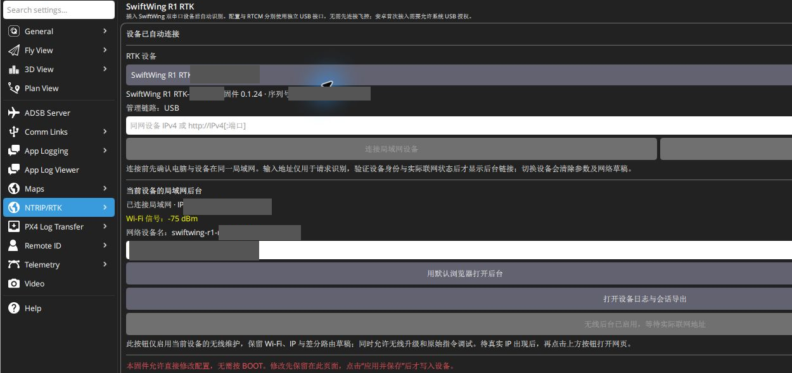
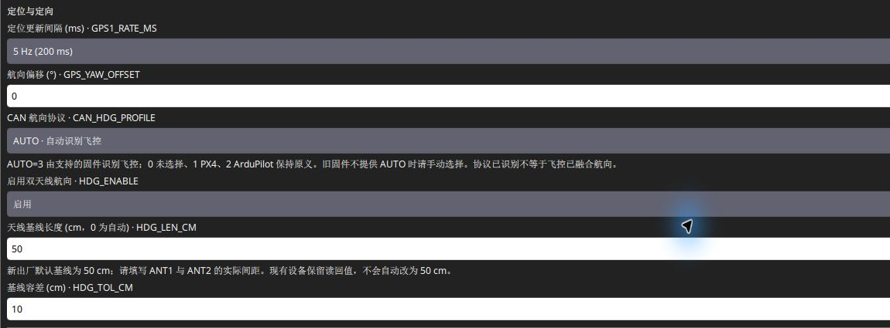
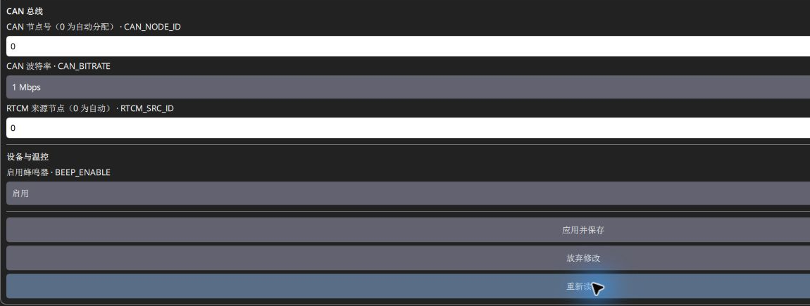

# QGC 配置移动端

## 一、安装、自动识别和选对设备

先按[软件下载与 USB 连接](../RTK通用/软件下载与USB连接.md)从预留的百度网盘入口取得完整安装包并安装，本文界面以 Windows 0.1.0 build8 为例。安装后打开 **SwiftWing QGC**。

1. 关闭占用 RTK 配置串口的其他串口软件或 USB 代理。
2. 将移动端原生 USB 接电脑，保持 BOOT 松开；当前固件改参不需要长按 BOOT，也不需要进入下载模式。
3. 打开 **应用设置 → NTRIP/RTK → SwiftWing R1 / R1-G RTK** 区域。
4. 在设备列表选择 **SwiftWing R1 RTK**，核对角色、完整序列号和固件版本。名称后的末 6 位编码用于区分多台设备，不是飞控 CAN 节点号。
5. 设备使用配置与 RTCM 两个 USB 接口，QGC 自动分辨，不按 COM 号大小猜测。单独连接移动端时，不保证出现基站三脚架图标；始终可走上述设置入口。基站图标弹窗中的快捷按钮名为「SwiftWing RTK配置」。

读图重点：当前产品为 **SwiftWing R1 RTK**，状态为 **设备已自动连接**，**管理链路：USB**。图中移动端已保存外部网络并显示后台地址，灰块遮盖身份和现场地址；这与 USB 管理是两个连接。仅插 USB 不代表无线必然开启，也不代表 CAN 已接入。

## 二、移动端必查参数

| 参数 | 本教程设置/核对值 | 含义与单位 |
| --- | --- | --- |
| RTK_ROLE | 0 | 移动端，不能误设为基站 |
| CAN_HDG_PROFILE | 3：AUTO | 自动识别；1 经典 PX4、2 ArduPilot，0 未选择 |
| HDG_ENABLE | 1 | 启用双天线航向 |
| HDG_LEN_CM | 实际 L，例如 60 | 厘米；新出厂 50，升级保留旧值 |
| HDG_TOL_CM | 10，先保留 | 厘米；长度超出范围时航向会无效 |
| GPS_YAW_OFFSET | 0 | ANT1 在前、ANT2 在后，单位度 |
| CAN_NODE_ID | 0 | 自动分配，不填现场偶然获得的 119 等节点 |
| CAN_BITRATE | 1000000 | 1 Mbps，与飞控同总线一致 |
| RTCM_SRC_ID | 0 | 自动接收当前有效 CAN 差分源 |
| GPS1_RATE_MS | 核对现有值 | 200/100/50 ms，即 5/10/20 Hz 发布周期 |
| BEEP_ENABLE | 1 | 允许蜂鸣器响应支持的飞控命令 |

GPS1_RATE_MS 出厂默认是 200 ms。本次实机截图读回也是 200 ms（5 Hz）；其他设备按实际保存值核对。可先用默认值完成配置，不能将提高频率当作提高精度。Flash 外场日志仍约 1 Hz。

本图为已有参数的只读截图：5 Hz、偏角 0°、AUTO、双天线航向启用、基线 50 cm、容差 10 cm。**50 cm 只是图中设备当前保存值，不代替实测安装间距**；下面以实际安装 60 cm 说明怎样填写。AUTO 选项已选中也不等于已识别飞控或已融合航向。

完整默认值、允许范围和基站共用字段见[全部 23 项设备参数参考](../RTK通用/设备参数参考.md)。

### 实例：把基线改成实际 60 cm

1. 确认选中移动端及其序列号，使用方式是移动端。
2. 展开航向相关参数，将 `HDG_LEN_CM` 改为 **60**，不是 0.60；保持 `HDG_TOL_CM=10`。两值单位都是厘米。
3. 确认 `HDG_ENABLE=1`；正常前后安装时 `GPS_YAW_OFFSET=0`，`CAN_HDG_PROFILE=3`。
4. 点 **应用并保存**并核对读回；在室外查看实际基线、有效固定航向及有效 CAN 模式。

已知长度时，解算长度超出配置范围会标记 `baseline_mismatch`。还需满足固定解、新鲜度等条件，不是落在长度范围内就一定有效。长度 0 是自动 / 无物理长度约束模式，首次安装优先填写实测值。

## 三、保存并读回

只修改必要字段，点击 **应用并保存**，等待 **参数已实时生效、保存并读回确认**。确认读回的基线、角色和协议与输入一致；超时先重新读取，不连续点击保存或恢复出厂。网络设置使用单独的「保存局域网设置」。

图中 `CAN_NODE_ID=0` 是自动分配的**配置值**，实际分配到的运行节点号在状态区查看；`CAN_BITRATE=1 Mbps`，`RTCM_SRC_ID=0` 自动选择来源。保存完成后点击 **重新读取**，再次核对基线、偏角、协议、CAN 速率和差分来源。截图展示按钮位置，本轮采集没有为拍照改写参数或触发保存。

设备 AUTO 按本次启动绑定飞控。更换 PX4/APM 后，给移动端正常断电重启一次；不用重烧、不按 BOOT。若未知飞控名称或版本无法适配，可按兼容范围手动选 1 或 2 并重新核对实际接收。

## 四、安装角与重心杆臂分别配置

设备的 `GPS_YAW_OFFSET` 修正双天线安装角，默认 ANT1 在前、ANT2 在后为 0；横向安装实例见[硬件安装](硬件安装.md)。飞控收到的是板端已修正的机头方向，不能再重复加同一个安装角。

重心到 ANT1 的前 / 右 / 下距离则在飞控参数中填写，单位米，不能写到 `HDG_LEN_CM`。按[PX4](PX4飞控参数.md)或[ArduPilot](ArduPilot飞控参数.md)教程配置后，整体转动机体与双天线验证方向。

## 五、移动端局域网是可选管理功能

只需 CAN 定位与航向时，可以不配置移动端 Wi-Fi。需要网页管理时，按以下顺序准备：

1. 需要 LAN 访问才填写外部 **2.4 GHz** Wi-Fi，点 **保存局域网设置**；只通过设备热点访问可不填。
2. 已确认飞控正常 CAN 交互时，设备通常会关闭整个 Wi-Fi，**已保存 SSID 也不能保证后台在线**。想持续访问，点 **启用无线后台**，它会把“无线高级维护”保存为开启；短时访问可长按 BOOT 约 2 秒，开启约 30 分钟临时窗口。
3. 等实际 LAN IP 后从同一局域网打开；只有热点时连接移动端热点，手动访问 192.168.4.1，QGC 打开按钮可能仍为灰色。
4. 维护后关闭“无线高级维护”并保存，恢复自动策略；BOOT 窗口到期或重启后结束。

尚未确认飞控时会启用恢复无线；已连上外部网络并取得 IP 时热点可能关闭，改用 LAN 地址即可。完整条件见[移动端热点规则](差分与Wi-Fi后台.md#wireless-rules)。这里不是差分 UDP 输入，日常差分仍经飞控 CAN 注入。

## 六、USB 配置完成后，什么时候可以拔线

1. 基线按实物填写，角色为移动端；设备参数已保存并重新读取确认。
2. 飞控所需 CAN、GPS 航向和 ANT1 杆臂参数按对应飞控章节设置，保存及重启要求已经处理。这里与 RTK 自身参数分开确认。
3. 移动端 CAN 与飞控保持连接，CAN 5 V / 对应独立电源能在拔 USB 后继续给主板供电。只连 CANH / CANL 而没有供电，不能靠拔线验证正常工作。
4. 若下一步还要打开移动端网页，按上一节准备热点或 LAN；需要正常 CAN 工作时持续查看，就保存开启无线高级维护，短时查看用 BOOT 临时窗口。只保存 Wi-Fi 与 IP 不足以让后台保持在线。
5. 此时可以拔掉**移动端主板 USB**，保留 CAN。QGC 的 USB 设备列表中该移动端消失是预期现象；飞控连接、CAN 节点、RTCM 接收与航向状态应从飞控或可用网页另行核查。

拔掉移动端 USB 不会把差分路径改为移动端 Wi-Fi。下一阶段链路仍是 **基站 UDP → QGC → 飞控 MAVLink → CAN → 移动端**；此阶段的实际接收检查见[差分与 Wi-Fi 后台](差分与Wi-Fi后台.md)。
