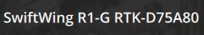
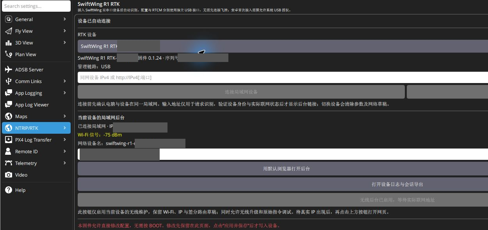
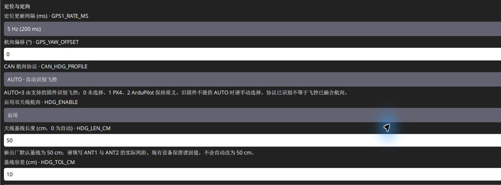
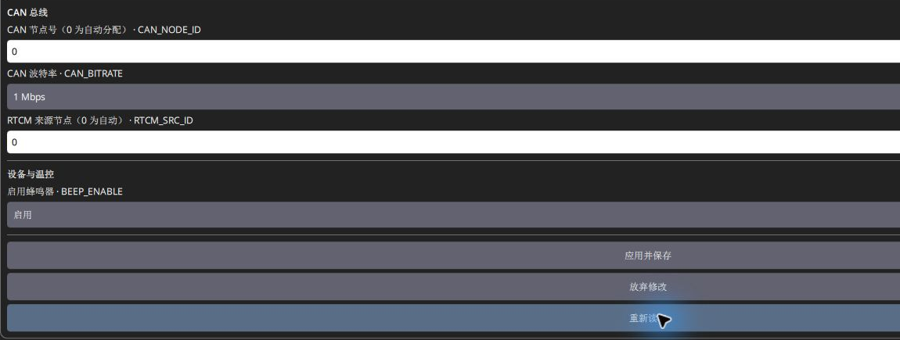
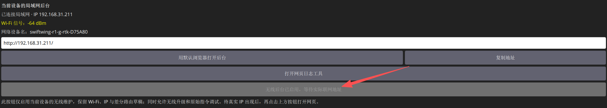
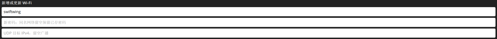

# QGC 地面站参数修改

注意

本页面修改移动端自身参数。两天线基线和安装偏角按实物填写；飞控 GPS、航向融合与重心杆臂在对应飞控参数页另行设置。

## 下载并安装

先按[软件下载与 USB 连接](../RTK通用/软件下载与USB连接.md)从百度网盘入口取得完整安装包并安装，本文界面以 Windows 0.1.0 build8 为例。安装后打开 **SwiftWing QGC**。

## USB 连接和选择移动端

1. 关闭占用 RTK 配置串口的其他串口软件或 USB 代理。
2. 将移动端原生 USB 接电脑。
3. 打开 **应用设置 → NTRIP/RTK → SwiftWing R1 / R1-G RTK** 区域。
4. 在设备列表选择 **SwiftWing R1 RTK**，核对角色、完整序列号和固件版本。名称后的末 6 位编码用于区分多台设备，不是飞控 CAN 节点号。

5. 设备使用配置与 RTCM 两个 USB 接口，QGC 自动分辨，不按 COM 号大小猜测。单独连接移动端时，不保证出现基站三脚架图标；始终可走上述设置入口。基站图标弹窗中的快捷按钮名为「SwiftWing RTK配置」。

## 移动端配置说明

注意

除了天线安装方向和基线长度，其他参数默认不变即可。

| 参数 | 本教程设置/核对值 | 含义与单位 |
| --- | --- | --- |
| RTK_ROLE | 0 | 移动端，不能误设为基站 |
| CAN_HDG_PROFILE | 3：AUTO | 自动识别；1 经典 PX4、2 ArduPilot，0 未选择 |
| HDG_ENABLE | 1 | 启用双天线航向 |
| HDG_LEN_CM | 实际 L，例如 60 | 厘米；新出厂 50，升级保留旧值 |
| HDG_TOL_CM | 10，先保留 | 厘米；长度超出范围时航向会无效 |
| GPS_YAW_OFFSET | 按安装填写；前后正常安装为 0 | 整数 0～360°，不填负值；ANT1 在右填 90、在后填 180、在左填 270 |
| CAN_NODE_ID | 0 | 自动分配，不填现场偶然获得的 119 等节点 |
| CAN_BITRATE | 1000000 | 1 Mbps，与飞控同总线一致 |
| RTCM_SRC_ID | 0 | 自动接收当前有效 CAN 差分源 |
| GPS1_RATE_MS | 核对现有值 | 200/100/50 ms，即 5/10/20 Hz 发布周期 |
| BEEP_ENABLE | 1 | 允许蜂鸣器响应支持的飞控命令 |

GPS1_RATE_MS 出厂默认是 200 ms。本次实机截图读回也是 200 ms（5 Hz）；其他设备按实际保存值核对。可先用默认值完成配置，不能将提高频率当作提高精度。Flash 外场日志仍约 1 Hz。

完整默认值、允许范围和基站共用字段见[全部 23 项设备参数参考](../RTK通用/设备参数参考.md)。

### 实例：把基线改成实际 60 cm

1. 确认选中移动端及其序列号，使用方式是移动端。
2. 展开航向相关参数，将 `HDG_LEN_CM` 改为 **60**，不是 0.60；保持 `HDG_TOL_CM=10`。两值单位都是厘米。
3. 确认 `HDG_ENABLE=1`；正常前后安装时 `GPS_YAW_OFFSET=0`，`CAN_HDG_PROFILE=3`。
4. 点 **应用并保存**并核对读回；在室外查看实际基线、有效固定航向及有效 CAN 模式。

已知长度时，解算长度超出配置范围会标记 `baseline_mismatch`。还需满足固定解、新鲜度等条件，不是落在长度范围内就一定有效。长度 0 是自动 / 无物理长度约束模式，首次安装优先填写实测值。

## 参数保存

只修改必要字段，点击 **应用并保存**，等待 **参数已实时生效、保存并读回确认**。确认读回的基线、角色和协议与输入一致；超时先重新读取，不连续点击保存或恢复出厂。网络设置使用单独的「保存局域网设置」。

图中 <code>CAN_NODE_ID=0</code> 是自动分配的<strong>配置值</strong>，实际分配到的运行节点号在状态区查看；<code>CAN_BITRATE=1 Mbps</code>，<code>RTCM_SRC_ID=0</code> 自动选择来源。保存完成后点击 <strong>重新读取</strong>，再次核对基线、偏角、协议、CAN 速率和差分来源。截图展示按钮位置，本轮采集没有为拍照改写参数或触发保存。

设备 AUTO 按本次启动绑定飞控。更换 PX4/APM 后，给移动端正常断电重启一次；不用重烧、不按 BOOT。若未知飞控名称或版本无法适配，可按兼容范围手动选 1 或 2 并重新核对实际接收。

## 配置局域网（按需）

1. 使用USB连接移动端，点击 **启用无线后台**；

2. 在网络区填写外部 **2.4 GHz** Wi-Fi，点击 **保存局域网设置**，并切换到所选 Wi-Fi 网络。

只需 CAN 定位与航向时，可以不配置移动端 Wi-Fi。保存网络不等于后台一直在线；临时窗口、持续维护及自动热点条件见<a href="../设备后台参数修改/#wireless-rules">设备网页后台</a>。

## USB 配置完成后拔线

拔掉移动端 USB 不会把差分路径改为移动端 Wi-Fi。下一阶段链路仍是 **基站 UDP → QGC → 飞控 MAVLink → CAN → 移动端**；此阶段的实际接收检查见[差分接入与数据检查](差分与Wi-Fi后台.md)。
