<div class="rtk-guide" aria-hidden="true"></div>

# 差分与 Wi-Fi 后台

本章按“接入基站差分 → 在 QGC 看卫星和定位 → 打开移动端后台”的顺序操作。移动端配置完成后可拔掉 USB，保留飞控 CAN 连接和供电。

<a id="correction-sources"></a>

## 先选差分来源

| 你使用的组合 | 先完成什么 | 从哪里开始 |
| --- | --- | --- |
| SwiftWing 基站 + 本移动端 | 基站建站、局域网及 UDP 目标已保存 | 第一节配套基站路线 |
| 其他厂家本地基站 + 本移动端 | 按厂家说明建站，确认输出的是兼容 RTCM3 | [第六节：第三方基站](#third-party-base) |
| CORS / NTRIP 服务 + 本移动端 | 服务账号、挂载点、网络及所需 GGA 位置准备好 | [第六节：NTRIP](#ntrip-input) |

三种来源到达 QGC 后，后半段均为 **QGC → 飞控 MAVLink → CAN → SwiftWing 移动端**。本移动端仍用 CAN 接收 RTCM，不因基站厂家变化而改为 USB / Wi-Fi 差分输入。

<a id="swiftwing-base"></a>

## 一、SwiftWing 配套基站路线

```text
日常首选：基站 Wi-Fi/UDP → SwiftWing QGC → 飞控 MAVLink → CAN → 移动端 UM982
备用方式：基站原生 USB 或原始 TCP → SwiftWing QGC → 飞控 MAVLink → CAN → 移动端 UM982
```

1. 按[基站 Wi-Fi 输出差分](../SwiftWing%20R1-G%20RTK基站/Wifi输出差分.md)让基站和 QGC 主机接入同一局域网，UDP 目标填 QGC 主机的 IPv4，端口 13320。
2. QGC 进入 **应用设置 → NTRIP/RTK → UDP RTCM Input**，开启 **Enable UDP RTCM input**，端口填 **13320**。这里是 RTCM 入口，普通 MAVLink UDP 连接和 UDP Forwarding 不能代替它。

[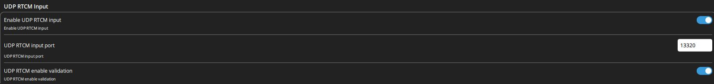](../RTK通用/image/实机操作/qgc-udp-input.png)

3. 飞控通过 USB 或遥测连接 QGC，在差分转发区域勾选 **将 QGC 收到的差分注入已连接飞控**。PX4 同时按[飞控参数教程](PX4飞控参数.md)设置 `UAVCAN_PUB_RTCM=1`。

[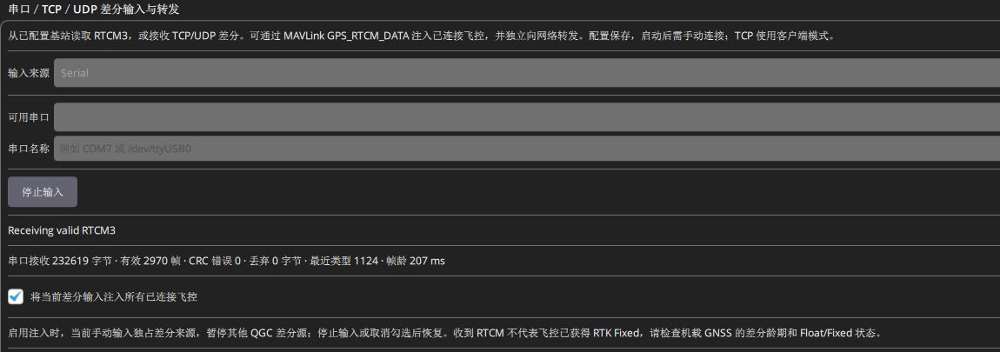](../RTK通用/image/实机操作/qgc-rtcm-relay.png)

图中 **Receiving valid RTCM3**说明 QGC 已收到有效差分。继续检查移动端的定位解与后台 RTCM 输入，确认后续链路。

### 通过顶部基站图标快速查看

点击飞行页面顶部的**三脚架形基站图标**，先看 **差分接收**是否持续更新，再看 **飞控GPS卫星 / 解状态**，即可同时查看地面站差分与飞控回传的移动端结果。

[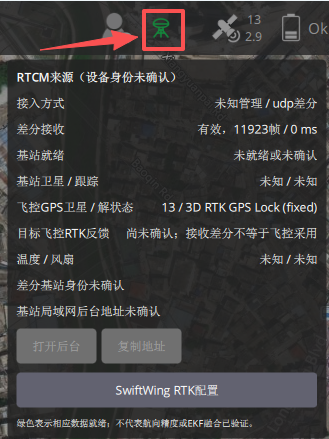](../RTK通用/image/实机操作/qgc-rtk-indicator-unknown.png)

图中飞控报告 **13 颗卫星、RTK Fixed**；上方 **基站卫星 / 跟踪**属于地面基站，不是移动端。显示“设备身份未确认”时，即使收到有效 UDP，基站资料和后台地址仍可能未知；绿色只表示相应差分数据就绪。

弹窗的 **打开后台 / 复制地址**针对基站；移动端后台按本章第四节打开。**SwiftWing RTK配置**进入 NTRIP/RTK 配置页。图标颜色和全部字段的含义见[基站图标说明](../SwiftWing%20R1-G%20RTK基站/QGC地面站参数修改.md#rtk-indicator)。

<a id="qgc-gps"></a>

## 二、在 QGC 查看移动端卫星和定位

1. 返回飞行页面，点击顶部 **GPS / 卫星图标**，查看飞控回传的卫星数量和定位状态。移动端无需接 USB。
2. 查看原始数值时，点击左上角主菜单 **Analyze → MAVLink 检测**。

[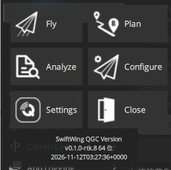](../RTK通用/image/实机操作/qgc-analyze-entry.png)

3. 选择目标飞控的 **GPS_RAW_INT (24)**，查看下列两项，并确认消息计数持续增长。

| 字段 | 查看内容 |
| --- | --- |
| `satellites_visible` | 飞控报告的卫星数量；255 为未知 |
| `fix_type` | 3=3D 单点，4=DGPS，5=RTK Float，6=RTK Fixed |

[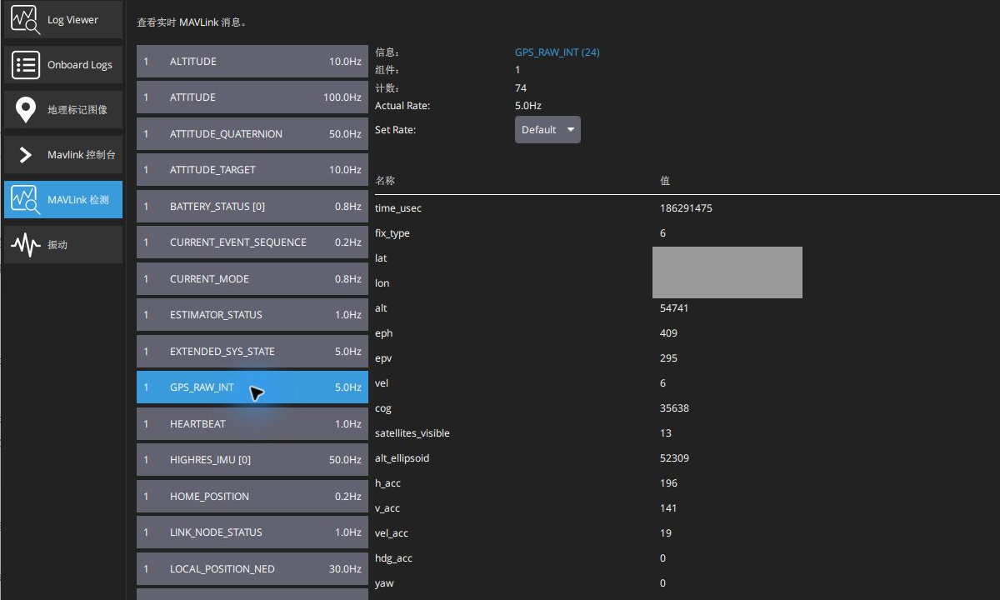](../RTK通用/image/实机操作/qgc-inspector-gps.png)

本图示例为 **13 颗卫星、fix_type=6（RTK Fixed）**，消息约 5 Hz 更新。图中 `yaw=0`没有有效航向；有效航向与飞控方向对照的实机图见[RTK 航向确认](起飞前检查.md#rtk-heading)。多 GPS 系统应确认当前查看的是本移动端对应的 GPS；第二路还可检查 `GPS2_RAW`。

## 三、判断移动端是否收到基站差分

按下面顺序查看即可：

1. **QGC 收到**：顶部 RTK 图标或 NTRIP/RTK 页显示有效帧增加、数据持续更新。
2. **移动端收到**：按[后台入口](#web-backend)开启所需无线，进入网页 **移动端 → RTCM 差分输入**，查看“数据正常”、来源节点和“最近送入接收机”时间；时间应持续刷新。
3. **接收机解算**：同时看 QGC 的 `fix_type`。5 为浮点、6 为固定；需要固定解时等待 RTK Fixed 稳定显示。

移动端后台的“来源”通常是转发差分的飞控 CAN 节点，不是地面基站站号。排查时只保留预期的基站输入。移动端 Wi-Fi 用于后台管理，差分仍经飞控 CAN 送入 UM982。

<a id="web-backend"></a>

## 四、打开移动端网页后台

<a id="wireless-rules"></a>

### 1. 先判断：移动端现在会不会开热点

以下为 **0.1.23 / 0.1.24** 的运行规则。先判断无线是否开启，再判断是否需要广播热点；**保存过 Wi-Fi 名称不等于无线始终开启**。

| 当前情况 | 自动行为 | 怎样打开网页 |
| --- | --- | --- |
| 单独给移动端上电，尚未确认飞控 CAN 通信 | 启用恢复无线；没有可用外部网络或尚未取得 IP 时，自动开设备热点 | 连接移动端热点，访问 192.168.4.1 |
| 恢复无线已开启，且已连接保存的外部网络并取得 IP | 通常只保留外部网络连接，设备热点自动关闭 | 同一局域网访问移动端实际 LAN IP |
| 已确认飞控，最近约 3 秒内有有效飞控 CAN 交互 | 通常关闭整个 Wi-Fi 省电，热点和 LAN 网页都不可用；已保存 SSID 也一样 | 需要网页时，按下方 USB 或 BOOT 方法开启 |
| 曾确认飞控，但约 3 秒以上没有有效飞控交互 | 未处于已知解锁状态时，重新启用恢复无线；热点是否出现仍取决于外部网络是否取得 IP | 按热点 / LAN 的实际状态访问，不靠拔 CAN 来开启后台 |
| 已收到飞控解锁状态且仍保持该状态 | 即使飞控通信中断，也不自动开启恢复无线 | 地面未解锁时完成配置和维护 |
| 正常运行时长按 BOOT 约 2 秒 | 开启约 30 分钟临时无线窗口，保留设备热点，也可连接已保存的外部网络 | 热点或实际 LAN IP；重启会结束临时窗口 |
| QGC 点击“启用无线后台”，或保存“无线高级维护”为开启 | 保存为持续维护模式；无线和热点保持开启，也允许无线升级 / 原始指令 | 维护后明确关闭并保存“无线高级维护”，恢复自动策略 |

这里的“确认飞控”是设备识别并收到有效的飞控交互，**不等于仅插了 CAN 线、总线上有帧、已经搜到卫星或收到了 RTCM**。临时窗口结束后恢复自动策略；不能把 BOOT 临时窗口和保存的无线高级维护当成同一个开关。

### 2. 什么时候先用 USB：首次配置或 CAN 工作时要看后台

首次装机、网络凭据未知、找不到热点且 LAN 地址也不可达时，推荐先用 **移动端自己的主板 USB**；飞控 USB 遥测不能代替它。网页后台已内置在 RTK 固件中，无需另装一套后台。

1. 用数据线把移动端主板 USB 接电脑，在 QGC **应用设置 → NTRIP/RTK**选中移动端并核对身份。
2. 先按[QGC 配置移动端](QGC配置移动端.md)保存角色、基线、偏角和 CAN 参数。
3. 需要通过路由器访问时，在网络区填写外部 **2.4 GHz** Wi-Fi 名称与密码，点 **保存局域网设置**。只用设备热点时可不填外部网络。
4. 若移动端已与飞控正常 CAN 交互，且希望持续查看网页，点击 **启用无线后台**。该按钮会保存“无线高级维护”为开启，并非只打开一个浏览器窗口，也不会代替第 3 步保存 Wi-Fi 草稿。
5. 等实际 LAN IP 出现，再点 **用默认浏览器打开后台**。没有 LAN IP、只有设备热点时，电脑 / 手机连接热点并手动访问 192.168.4.1；打开按钮仍可能是灰色。

[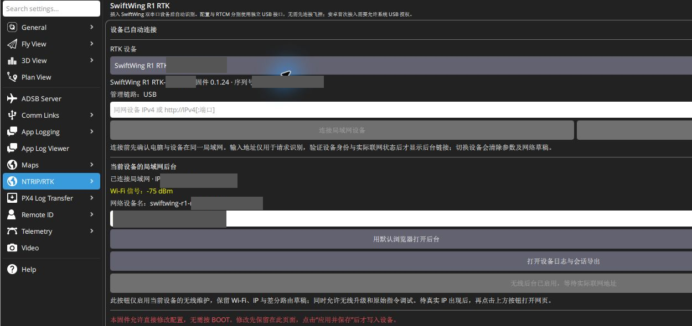](../RTK通用/image/实机操作/qgc-rover-usb.png)

上图是 USB 配置阶段的入口。CAN 及供电确认正常后可拔移动端 USB；已开启的持续维护模式仍保留。完成查看后，在网页 **局域网**关闭“无线高级维护”并点 **保存并连接**，移动端可能立即按 CAN 省电策略断开网页。

### 3. 不方便接 USB：使用 BOOT 临时窗口

地面维护时，保持应用正常运行，长按主板 **BOOT 约 2 秒**。连接 `SwiftWing R1 RTK-XXXXXX`热点，默认密码 **12345678**，浏览器访问 [http://192.168.4.1/](http://192.168.4.1/)。窗口约 30 分钟，重启失效；普通打开后台不用同时按 EN/RESET。

若已能直连设备热点或实际 LAN IP，也可直接在网页配置，不必再接 USB。普通看状态、改参数、下载日志和只读诊断，不要求启用“无线高级维护”；但无线必须处于开启状态。无线升级及发送原始 UM982 指令另需开启高级维护权限。

### 4. 进入网页后看什么

打开后先核对顶部产品名、设备身份和“设备在线”，再点击左侧 **移动端**。

| 卡片 | 主要看什么 |
| --- | --- |
| 卫星质量 | 跟踪数量、使用数量、信号与更新时间；“使用”是参与定位的数量 |
| CAN 总线 / CAN 定位 | 节点在线、有近期收帧、Fix2 入队量持续增加 |
| RTCM 差分输入 | 数据正常、来源节点、最近送入接收机时间 |
| 飞控识别 | 当前飞控与 AUTO 的有效协议 |
| CAN 航向 | 双天线输出状态，再按[RTK 航向确认](起飞前检查.md#rtk-heading)对照飞控方向 |

需要差分帧明细时展开 **设备设置 → 原始诊断数据**，查看 `rtcm_frames`是否增加、`rtcm_age_ms`是否刷新。网页“数据正常”的 5 秒门限用于提示新鲜度，不是定位精度指标。

<a id="web-network"></a>

## 五、保存移动端网络与参数

**网络设置：** 进入 **局域网 → 读取网络设置**，输入外部 2.4 GHz Wi-Fi 名称和密码，点击 **保存并连接**；等显示已连接和实际 IP 后再使用新地址。QGC 对应按钮叫 **保存局域网设置**。

只保存外部网络不会取消移动端的 CAN 省电策略。要在正常 CAN 工作期间持续访问，按上节开启维护；临时查看则使用 BOOT 窗口。`192.168.4.1`只用于设备自身热点，不是设备加入路由器后的 LAN 地址。

- 同一 SSID 的密码留空会保留；新网络需输入密码，或明确选择开放网络。
- 最多保存 5 组网络，可切换或自动选网；清空当前 SSID 只断开，删除历史网络使用“删除此网络”。
- 初次优先 DHCP；改静态地址后重新连接新的实际 IP。

**设备参数：** 在网页 **移动端 → 定位与双天线 / DroneCAN 与差分输入**修改，点击底部 **应用并保存**，等“参数已生效并保存”，再点 **重新读取**核对。基线、偏角和协议填写方式与 [QGC 配置移动端](QGC配置移动端.md)相同。

[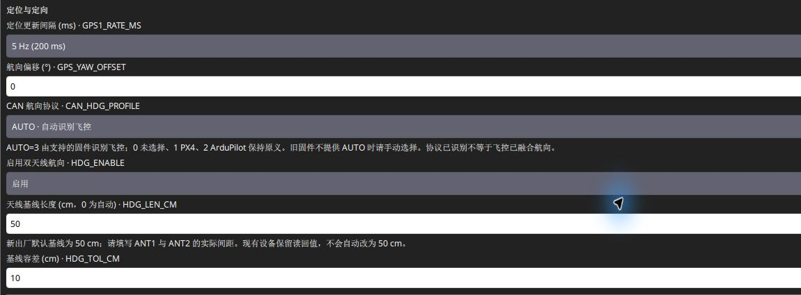](../RTK通用/image/实机操作/qgc-rover-heading-baseline.png)

[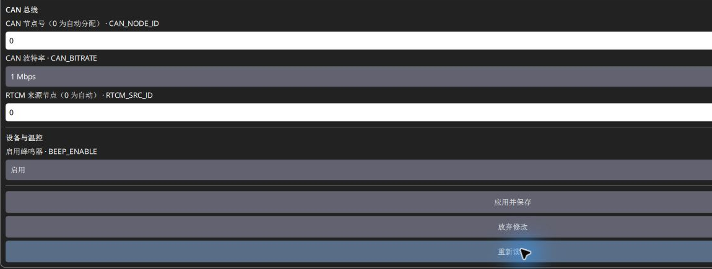](../RTK通用/image/实机操作/qgc-rover-can-save.png)

这两张图展示 QGC 中对应字段，网页使用相同设备参数。图中保存的 50 cm 基线应按自己的实测长度修改。超时先重新读取实际值，再决定是否重试。

<a id="third-party-base"></a>

## 六、使用其他厂家基站或网络差分

### 1. 接入前先确认条件

1. **基站已正确建站**：用该厂家软件完成自主测量或已知坐标设置，天线保持固定；确认站点坐标参考及高程定义。使用网络服务时核对服务覆盖区域和所提供的坐标参考。
2. **输出兼容 RTCM3**：应有参考站坐标（如 1005 / 1006）和接收机支持的卫星观测报文，且保持更新。仅有 NMEA 位置、UBX 状态或厂家私有差分，不等于已有可用 RTCM3。
3. **移动端与飞控先配置好**：本移动端仍按[QGC 配置](QGC配置移动端.md)保存基线、偏角、角色和 CAN，飞控按本手册的 [PX4](PX4飞控参数.md) / [ArduPilot](ArduPilot飞控参数.md)章节开启定位和差分转发。
4. **只选一个来源**：停止上一轮手动串口 / TCP 输入，断开不使用的 NTRIP，避免与现有 SwiftWing 自动输入混用；更换来源后重新看实际输入、站号和数据年龄。

### 2. 本地第三方基站：按输出接口接到 QGC

在 **应用设置 → NTRIP/RTK → Serial and Network RTCM Relay（串口 / TCP / UDP 差分输入与转发）**，按下表填写。第三方设备不必出现在上方 SwiftWing 设备列表中。

[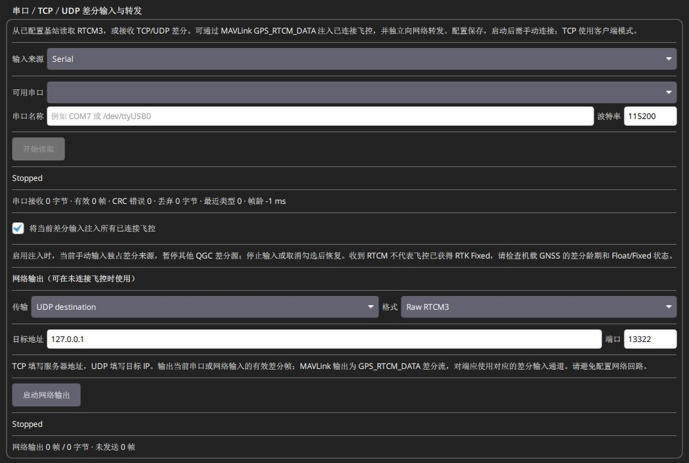](../RTK通用/image/实机操作/qgc-generic-rtcm-input.png)

| 第三方基站怎样输出 | 前置条件 | QGC 设置 |
| --- | --- | --- |
| USB 虚拟串口 / USB 转串口 | 厂家已开启该端口的原始 RTCM3 输出；知道实际 COM 与波特率，串口未被厂家工具占用 | 输入来源 **Serial**，选择对应串口，波特率按厂家配置，点 **开始读取**；不照抄示例 115200 |
| 原始 TCP 服务端 | 基站监听原始 RTCM 端口，QGC 主机可访问该地址 | 来源 **TCP client**，填第三方基站实际服务器 IP / 端口，输入格式 **Raw RTCM3**，点 **开始读取** |
| 原始 UDP 推送 | 基站将数据发往 QGC 电脑实际 IPv4 和约定端口；双方网络互通 | 来源 **UDP listener**，本地监听 IP 填电脑该网卡 IPv4（不是基站 IP），端口与发送端一致，输入格式 **Raw RTCM3**，点 **开始读取** |

[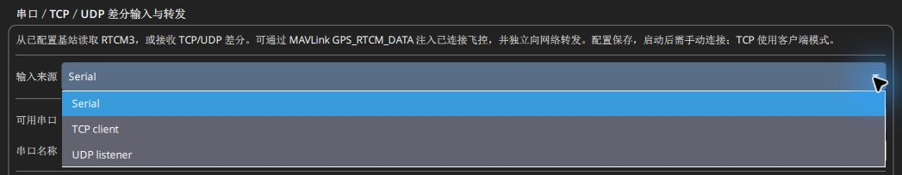](../RTK通用/image/实机操作/qgc-rtcm-input-types.png)

串口模式没有“输入格式”下拉框；切换 TCP / UDP 后才显示。下方“网络输出”的格式属于另一路转发设置，不是当前串口的输入格式。图片为本机 B8 的未连接界面，显示 0 帧 / Stopped，用于辨认位置，不是第三方设备联调结果。

第三方若只能主动建立 TCP 客户端连接，不能直接与 QGC 的 **TCP client** 对接；需改用它支持的 UDP / 串口出口或另设合适中转。UDP 端口由两端约定，不要求所有厂家都用 13320；不要让这里与 **UDP RTCM Input** 同时争用同一监听端口。

启动读取后，确认**有效帧数增加、帧龄刷新**，再勾选 **将当前差分输入注入所有已连接飞控**；联调先只连目标飞控。普通 MAVLink 通信连接、设备串口打开或接收字节增加，均不能替代有效 RTCM 检查。此面板不替第三方基站下发建站命令。

<a id="ntrip-input"></a>

### 3. CORS / NTRIP：由 QGC 接收网络服务

这一路不需要现场 SwiftWing 基站；服务提供兼容 RTCM3 后，仍经 QGC 与飞控送到本移动端。

1. 让运行 QGC 的电脑接入能访问服务的网络，在 **NTRIP/RTK → Server Settings**填写服务给出的 **Host address、Server port、Username、Password**，TLS 按服务要求设置。端口以服务资料为准，不直接套用本地原始 TCP 的配置。

   [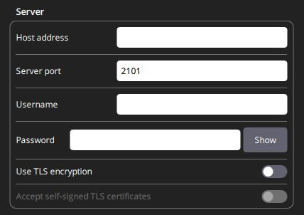](../RTK通用/image/实机操作/qgc-ntrip-server.png)

2. 在 **Mountpoint Browser → Mount Point**填写授权挂载点，或在服务支持时用 **Browse**读取后选择。挂载点应符合现场覆盖、坐标参考和接收机所需报文。

   [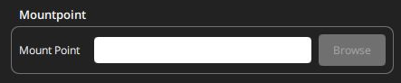](../RTK通用/image/实机操作/qgc-ntrip-mountpoint.png)

3. VRS 等服务若要求 GGA，进入 **GGA Position Reporting**，选择有实际有效位置的来源，按服务要求设置上报周期。无有效位置时不能靠连接成功推断服务已生成差分。

   [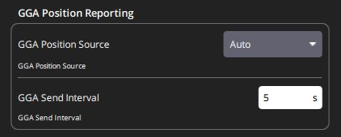](../RTK通用/image/实机操作/qgc-ntrip-gga.png)

4. 确认旧手动输入已停止，在 **Connection**点 **Connect**；保持目标飞控与 QGC 的 MAVLink 连接。NTRIP 接收后由 QGC 的 RTCM 通道转发；不要为了连接 NTRIP 再启动一个空的手动串口输入。
5. 检查服务连接、有效 RTCM 计数 / 数据年龄，再按本页第二、三节确认飞控卫星、移动端 RTCM 接收和位置解。无法获取数据时先看账号、挂载点、GGA 和网络，不先改移动端基线。

以上 NTRIP 截图为配置入口，账号及挂载点留空，没有连接第三方服务。

### 4. 跨厂家使用时，看哪些结果

- QGC 已收到有效 RTCM，但第三方基站身份、卫星数、板温或后台地址可能未知；这与数据已接收是两回事。SwiftWing 的“打开后台”不能打开第三方厂家后台。
- 本移动端网页的差分来源通常仍显示**飞控 CAN 节点**，不显示远处基站的厂家或 `BASE_ID`；不要把基站站号填进 `RTCM_SRC_ID`。
- 先看 **有效输入 → 移动端接收 → Float / Fixed**。长期不固定时，核对报文、共同星座 / 频点、时延、基站坐标、距离和卫星环境，不能只用“同为 RTCM3”判断全部兼容。
- 换成第三方基站或 CORS 后，本移动端的双天线基线、安装偏角与航向确认步骤保持；单天线地面基站不负责生成机头朝向。

链路原理可对照 [PX4 的 RTCM 注入说明](https://docs.px4.io/main/en/advanced/rtk_gps)和 [ArduPilot 的本地基站 / NTRIP 差分说明](https://ardupilot.org/copter/docs/common-rtk-correction.html)。本节按协议与本项目 QGC 接口说明接法，尚未对具体第三方型号逐一验证。

日志下载、只读定位报文和常见问题见本产品的[日志与常见问题](日志与常见问题.md)。
