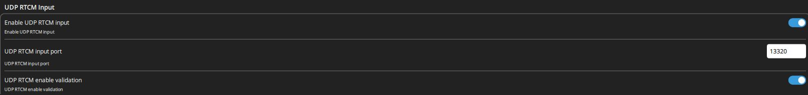
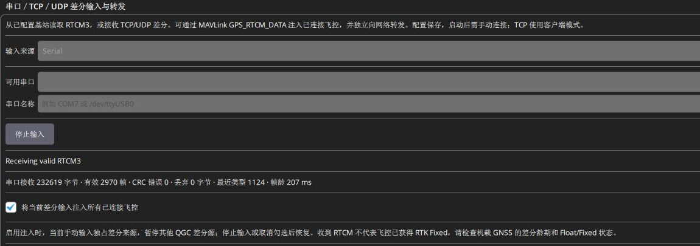
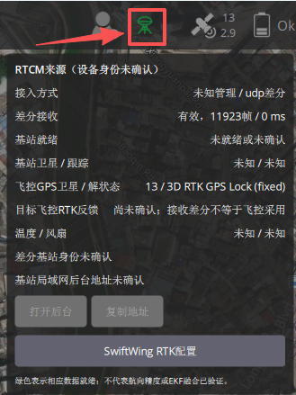
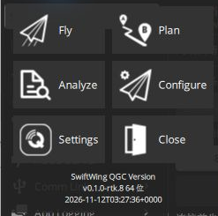
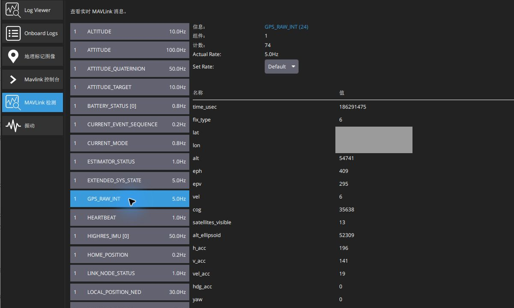
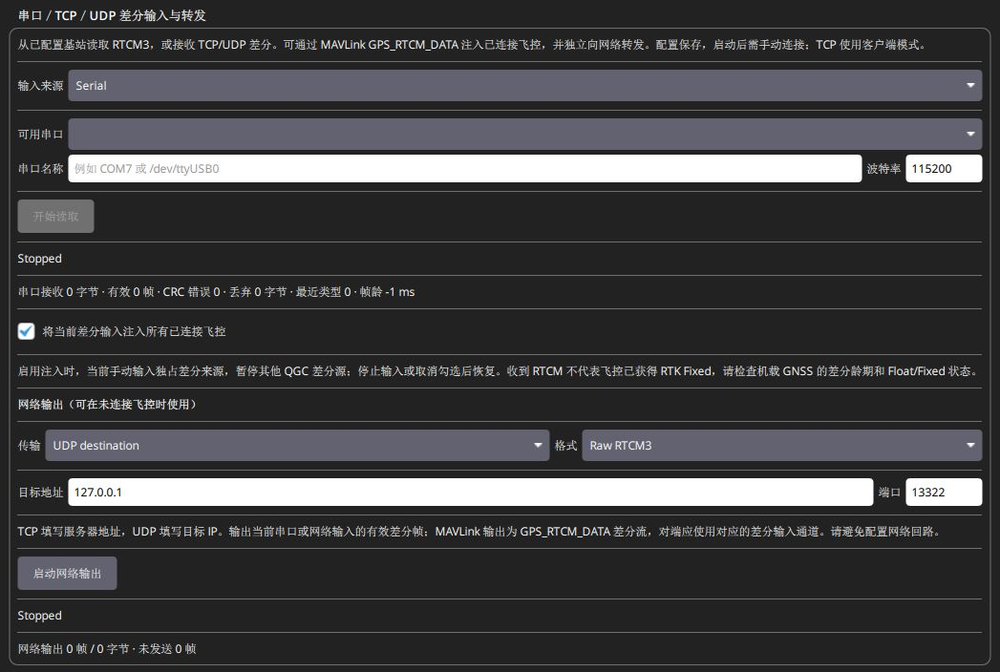
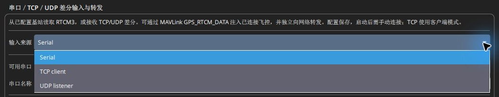

<div class="rtk-guide" aria-hidden="true"></div>

# 基站RTK的使用

本章按“接入差分 → 查看卫星与定位 → 确认移动端接收”的顺序操作。移动端通过飞控 CAN 接收 RTCM，网页管理另见[设备网页后台](设备后台参数修改.md)。

<a id="correction-sources"></a>

## 差分来源说明

| 你使用的组合 | 先完成什么 | 从哪里开始 |
| --- | --- | --- |
| SwiftWing 基站 + 本移动端 | 基站建站、局域网及 UDP 目标已保存 | 第一节配套基站路线 |
| 其他厂家本地基站 + 本移动端 | 按厂家说明建站，确认输出的是兼容 RTCM3 | [其他厂家基站](#third-party-base) |
| CORS / NTRIP 服务 + 本移动端 | 服务账号、挂载点、网络及所需 GGA 位置准备好 | [网络 RTK 教程](网络RTK的使用.md) |

三种来源到达 QGC 后，后半段均为 **QGC → 飞控 MAVLink → CAN → SwiftWing 移动端**。本移动端仍用 CAN 接收 RTCM，不因基站厂家变化而改为 USB / Wi-Fi 差分输入。

<a id="swiftwing-base"></a>

## 一、SwiftWing 配套基站路线

```text
日常首选：基站 Wi-Fi/UDP → SwiftWing QGC → 飞控 MAVLink → CAN → 移动端 UM982
备用方式：基站原生 USB 或原始 TCP → SwiftWing QGC → 飞控 MAVLink → CAN → 移动端 UM982
```

1. 按[基站 Wi-Fi 输出差分](../SwiftWing%20R1-G%20RTK基站/Wifi输出差分.md)让基站和 QGC 主机接入同一局域网，UDP 目标填 QGC 主机的 IPv4，端口 13320。
2. 打开SwiftWing QGC，查看 **应用设置 → NTRIP/RTK → UDP RTCM Input**，默认开启 **Enable UDP RTCM input**，端口填 **13320**。

[](../RTK通用/image/实机操作/qgc-udp-input.png)

3. 飞控通过 USB 或遥测连接 QGC，在差分转发区域勾选 **将 QGC 收到的差分注入已连接飞控**。PX4 同时按[飞控参数教程](PX4飞控参数.md)设置 `UAVCAN_PUB_RTCM=1`。

[](../RTK通用/image/实机操作/qgc-rtcm-relay.png)

图中 **Receiving valid RTCM3**说明 QGC 已收到有效差分。继续检查移动端的定位解与后台 RTCM 输入，确认后续链路。

### 通过顶部基站图标快速查看

点击飞行页面顶部的**三脚架形基站图标**，先看 **差分接收**是否持续更新，再看 **飞控GPS卫星 / 解状态**，即可同时查看地面站差分与飞控回传的移动端结果。

[](../RTK通用/image/实机操作/qgc-rtk-indicator-unknown.png)


<a id="qgc-gps"></a>

### 二、在 QGC 查看移动端卫星和定位

1. 返回飞行页面，点击顶部 **GPS / 卫星图标**，查看飞控回传的卫星数量和定位状态。移动端无需接 USB。
2. 查看原始数值时，点击左上角主菜单 **Analyze → MAVLink 检测**。

[](../RTK通用/image/实机操作/qgc-analyze-entry.png)

3. 选择目标飞控的 **GPS_RAW_INT (24)**，查看下列两项，并确认消息计数持续增长。

| 字段 | 查看内容 |
| --- | --- |
| `satellites_visible` | 飞控报告的卫星数量；255 为未知 |
| `fix_type` | 3=3D 单点，4=DGPS，5=RTK Float，6=RTK Fixed |

[](../RTK通用/image/实机操作/qgc-inspector-gps.png)

本图示例为 **13 颗卫星、fix_type=6（RTK Fixed）**，消息约 5 Hz 更新。图中 `yaw=0`没有有效航向；有效航向与飞控方向对照的实机图见[PX4 航向确认](PX4飞控参数.md#rtk-heading) / [ArduPilot 航向确认](ArduPilot飞控参数.md#rtk-heading)。多 GPS 系统应确认当前查看的是本移动端对应的 GPS；第二路还可检查 `GPS2_RAW`。

### 三、判断移动端是否收到基站差分

按下面顺序查看即可：

1. **QGC 收到**：顶部 RTK 图标或 NTRIP/RTK 页显示有效帧增加、数据持续更新。
2. **移动端收到**：按[后台入口](设备后台参数修改.md#web-backend)开启所需无线，进入网页 **移动端 → RTCM 差分输入**，查看“数据正常”、来源节点和“最近送入接收机”时间；时间应持续刷新。
3. **接收机解算**：同时看 QGC 的 `fix_type`。5 为浮点、6 为固定；需要固定解时等待 RTK Fixed 稳定显示。

移动端后台的“来源”通常是转发差分的飞控 CAN 节点，不是地面基站站号。排查时只保留预期的基站输入。移动端 Wi-Fi 用于后台管理，差分仍经飞控 CAN 送入 UM982。

<a id="web-backend"></a>
<a id="wireless-rules"></a>
<a id="web-network"></a>


<a id="third-party-base"></a>

## 二、搭配其他厂家基站

### 1. 接入前先确认条件

1. **基站已正确建站**：用该厂家软件完成自主测量或已知坐标设置，天线保持固定；确认站点坐标参考及高程定义。使用网络服务时核对服务覆盖区域和所提供的坐标参考。
2. **输出兼容 RTCM3**：应有参考站坐标（如 1005 / 1006）和接收机支持的卫星观测报文，且保持更新。仅有 NMEA 位置、UBX 状态或厂家私有差分，不等于已有可用 RTCM3。
3. **移动端与飞控先配置好**：本移动端仍按[QGC 配置](QGC配置移动端.md)保存基线、偏角、角色和 CAN，飞控按本手册的 [PX4](PX4飞控参数.md) / [ArduPilot](ArduPilot飞控参数.md)章节开启定位和差分转发。
4. **只选一个来源**：停止上一轮手动串口 / TCP 输入，断开不使用的 NTRIP，避免与现有 SwiftWing 自动输入混用；更换来源后重新看实际输入、站号和数据年龄。

### 2. RTCM 输入与转发

1. SwiftWing QGC支持串口获取基站的RTCM数据
2. 在 **应用设置 → NTRIP/RTK → Serial and Network RTCM Relay（串口 / TCP / UDP 差分输入与转发）**，按下表配置。第三方设备不出现在上方 SwiftWing 设备列表中。

[](../RTK通用/image/实机操作/qgc-generic-rtcm-input.png)

| 第三方基站怎样输出 | 前置条件 | QGC 设置 |
| --- | --- | --- |
| USB 虚拟串口 / USB 转串口 | 厂家已开启该端口的原始 RTCM3 输出；知道实际 COM 与波特率，串口未被厂家工具占用 | 输入来源 **Serial**，选择对应串口，波特率按厂家配置，点 **开始读取**；不照抄示例 115200 |
| 原始 TCP 服务端 | 基站监听原始 RTCM 端口，QGC 主机可访问该地址 | 来源 **TCP client**，填第三方基站实际服务器 IP / 端口，输入格式 **Raw RTCM3**，点 **开始读取** |
| 原始 UDP 推送 | 基站将数据发往 QGC 电脑实际 IPv4 和约定端口；双方网络互通 | 来源 **UDP listener**，本地监听 IP 填电脑该网卡 IPv4（不是基站 IP），端口与发送端一致，输入格式 **Raw RTCM3**，点 **开始读取** |

[](../RTK通用/image/实机操作/qgc-rtcm-input-types.png)

<div class="rtk-fineprint"><p>串口模式没有“输入格式”下拉框；切换 TCP / UDP 后才显示。下方“网络输出”的格式属于另一路转发设置，不是当前串口的输入格式。图片为本机 B8 的未连接界面，显示 0 帧 / Stopped，用于辨认位置，不是第三方设备联调结果。</p></div>

第三方若只能主动建立 TCP 客户端连接，不能直接与 QGC 的 **TCP client** 对接；需改用它支持的 UDP / 串口出口或另设合适中转。UDP 端口由两端约定，不要求所有厂家都用 13320；不要让这里与 **UDP RTCM Input** 同时争用同一监听端口。

启动读取后，确认**有效帧数增加、帧龄刷新**，再勾选 **将当前差分输入注入所有已连接飞控**；联调先只连目标飞控。普通 MAVLink 通信连接、设备串口打开或接收字节增加，均不能替代有效 RTCM 检查。此面板不替第三方基站下发建站命令。

<a id="ntrip-input"></a>

## 三、使用 CORS / NTRIP 网络差分

网络差分不需要现场地面基站。服务账号、挂载点、GGA 及连接操作统一见[网络 RTK 的使用](网络RTK的使用.md)，接入后继续按本页检查卫星、RTCM 接收和位置解。

