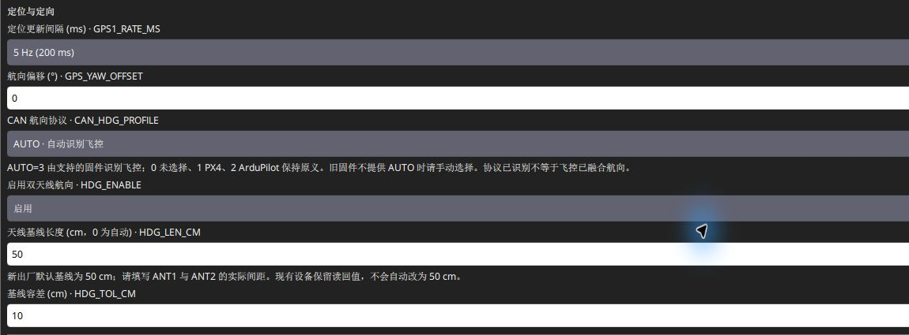
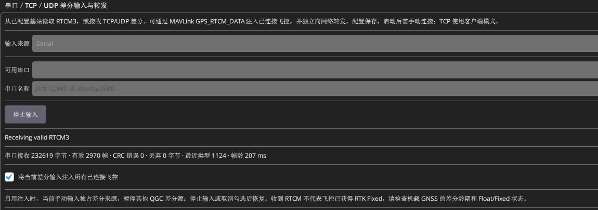

# SwiftWing R1 RTK 移动端快速上手

更新日期：2026-11-13。首次配置建议按下列顺序进行，地面配置时保持未解锁、无桨。

**首次使用顺序：接天线与 CAN → 移动端 USB 配基线 → 配飞控 → 选择差分来源接入 QGC → 检查卫星 / 差分 / 航向。** 产品支持的功能及所需条件见[功能清单](产品介绍.md#features)。

**先认清搭配：**使用 SwiftWing 基站，按本页 UDP 路线；使用其他厂家基站或 CORS，第一至四步照常配置本移动端，第五步改走[第三方差分接入](差分与Wi-Fi后台.md#third-party-base)。无需为接入第三方基站把移动端改成基站角色，也无需配置移动端 Wi-Fi 来接收 UDP。

### 开始前先选场景

| 你要做什么 | 是否先接移动端 USB | 下一步 |
| --- | --- | --- |
| 首次安装、换天线、配置未知 | 推荐先接；不依赖 Wi-Fi，就能核对基线和 CAN | 从第一至四步完成配置 |
| 已配好的移动端，只需日常定位与航向 | 不需要；保留 CAN 和供电即可 | 从第五步接入差分 |
| 要看网页，热点或实际 LAN IP 已可访问 | 不必接，可直接打开网页 | [网页操作](差分与Wi-Fi后台.md#web-backend) |

移动端尚未确认飞控通信时，会启用恢复无线；没有可用外部网络 / LAN IP 才自动开热点。已确认飞控正常 CAN 交互时，通常关闭无线，**保存过 Wi-Fi 也不例外**。这不影响正常 CAN 定位。

## 一、下载并安装 SwiftWing QGC

**百度网盘下载链接：待补充；提取码：待补充。** 下载 Windows x64 完整安装包，压缩包先完整解压，运行安装器，再打开 **SwiftWing QGC**。本文使用 0.1.0 build8；普通 QGC 无本项目配置页。详细步骤见[软件下载与 USB 连接](../RTK通用/软件下载与USB连接.md)。

## 二、接好天线与 CAN

1. 两根同型号有源 GNSS 天线，固定等高，ANT1 在前、ANT2 在后。
2. 测两天线相位中心间距 L，记录厘米数，例如 60 cm；再测重心到 ANT1 的前 / 右 / 下偏移，记录米数，供飞控配置使用。
3. CAN 接口按针号 **1=5 V、2=CANH、3=CANL、4=GND** 对应飞控连接，核对实物 1 脚，不按观察面猜左右。总线 1 Mbps，主干两端各 120 Ω；先核对板载终端是否已装。
4. 供电脚只接 5 V。详细安装见[硬件安装](硬件安装.md)，电平和线序见[硬件接口与线序](../RTK通用/硬件接口与线序.md)。

## 三、USB 连接并配置移动端

1. 用数据线将移动端**主板原生 USB-C**接电脑，关闭占用其串口的软件。
2. 进入 **应用设置 → NTRIP/RTK → SwiftWing R1 / R1-G RTK**，在设备列表选择设备并核对序列号。
3. 核对 `RTK_ROLE=0`、`CAN_BITRATE=1000000`、`CAN_NODE_ID=0`、`RTCM_SRC_ID=0`。
4. 双天线航向设置 `HDG_ENABLE=1`、`HDG_LEN_CM=L`（例如 60）、`HDG_TOL_CM=10`；ANT1 在前、ANT2 在后时 `GPS_YAW_OFFSET=0`。`CAN_HDG_PROFILE=3` 使用 AUTO，之后核对有效模式为目标飞控格式。
5. 如需修改参数，记得点击 **应用并保存**，等待“参数已实时生效、保存并读回确认”，重新核对基线与角色。只需单天线定位时可关闭 `HDG_ENABLE`。

完整参数表与保存细节见 [使用 QGC 配置移动端](QGC配置移动端.md)。

 **如果之后还要查看网页，可在这次 USB 配置时顺便准备：** 具体可见[网页后台](差分与Wi-Fi后台.md#web-backend)。

图中是设备已保存的 50 cm 基线，仅用于辨认输入位置；若你的实测长度为 60 cm，就填写 60。AUTO、启用航向和长度容差也在同一区域，改完后保存并重新读取确认。

## 四、配置飞控（二选一）

- **PX4 1.17 适配路线**：启用 CAN GNSS，`UAVCAN_PUB_RTCM=1`；在原 `EKF2_GPS_CTRL` 上启用 bit3 双天线航向，原值 7 对应改 15；填写 ANT1 相对重心杆臂。完整表与版本限制见[PX4 飞控参数](PX4飞控参数.md)。
- **ArduPilot/APM**：启用 DroneCAN，目标 `GPS1_TYPE=9`，EKF3 航向源按需求用 GPS 或 GPS 加健康罗盘后备；填写 ANT1 杆臂。完整表与旧版参数名见[ArduPilot/APM 飞控参数](ArduPilot飞控参数.md)。

在**飞控参数页**保存并按提示重启飞控，移动端一起正常重新上电。两天线基线、板端安装偏角与飞控重心杆臂是不同配置，不能重复补偿。

## 五、接入基站差分

1. **选择一个差分来源：** SwiftWing 基站按[基站快速上手](../SwiftWing%20R1-G%20RTK基站/快速上手.md)建站，日常优先无线 UDP，主板 USB 可备用；其他厂家基站先用其厂家工具完成建站，再按[通用输入](差分与Wi-Fi后台.md#third-party-base)接入；网络服务按[NTRIP 步骤](差分与Wi-Fi后台.md#ntrip-input)连接。
2. 通过飞控 USB / 遥测连接目标飞控，勾选 **将 QGC 收到的差分注入已连接飞控**。
3. 按 **所选差分来源 → QGC → 飞控 MAVLink → CAN → 移动端 UM982** 顺序，确认 QGC 有效帧增长、移动端 RTCM 龄更新及位置解状态。移动端 Wi-Fi 后台不直接接收基站 UDP / TCP 差分。

图中 **Receiving valid RTCM3** 和注入飞控勾选说明 QGC 这一段的状态，移动端是否固定及飞控是否采用航向还需继续确认。

查看卫星数和定位可直接用飞控遥测，不要求移动端网页在线。要检查网页中的 RTCM 输入时，按前述条件开启无线；连接设备热点用 192.168.4.1，同一路由器下用实际 LAN IP。详见[差分与 Wi-Fi 后台](差分与Wi-Fi后台.md)。

## 六、地面确认与起飞前检查

在本产品的[差分与 Wi-Fi 后台](差分与Wi-Fi后台.md#qgc-gps)查看 QGC 卫星数量、定位状态和移动端差分；网页入口与数据卡片也在同一章。然后按[RTK 航向确认与起飞前检查](起飞前检查.md)核对安装和方向，遇问题查[日志与常见问题](日志与常见问题.md)。

USB 配置完成后可保留移动端 CAN 和有效供电，再拔掉移动端 USB；先按[拔线前检查](QGC配置移动端.md#usb)核对。拔线后正常链路不依赖移动端 USB，也不改成直接接收 Wi-Fi 差分。
