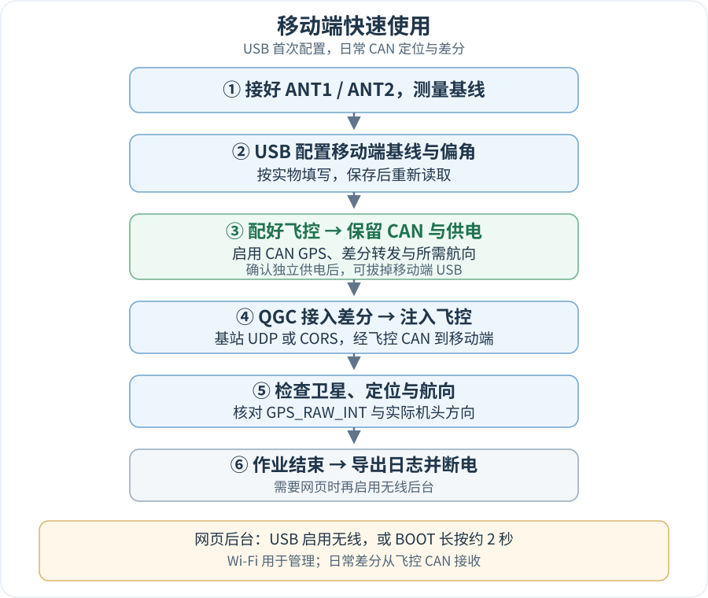
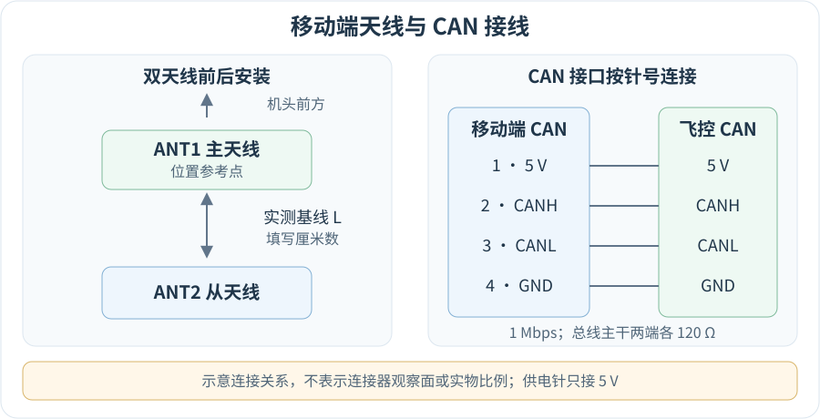
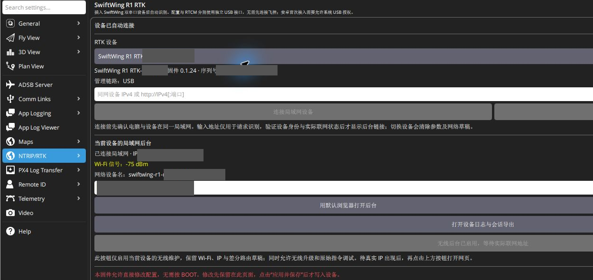
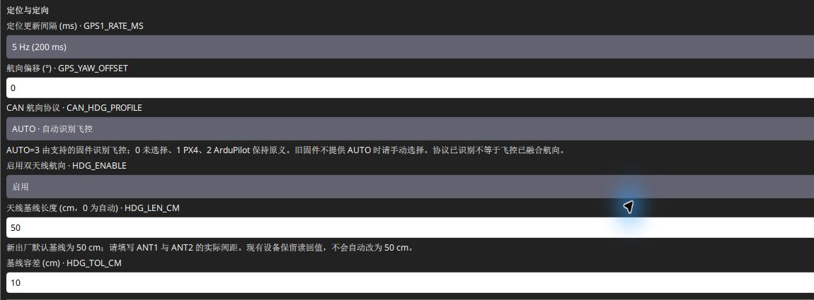
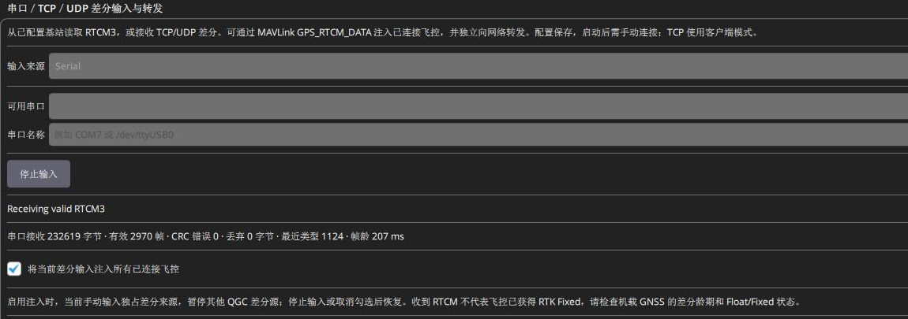
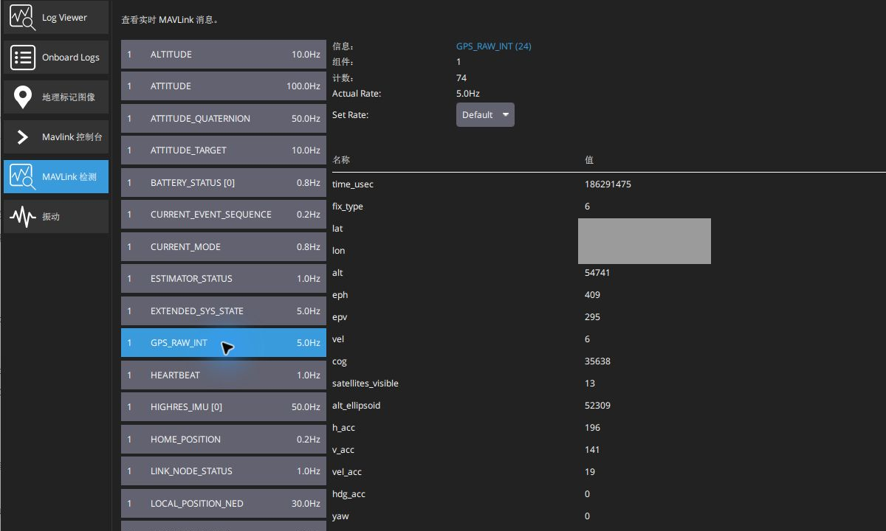

# SwiftWing R1 RTK 移动端快速上手

* 参考本页完成天线安装、USB 配置、飞控连接和差分接入。
* 需要调整其他功能和参数时，再参考后续详细教程。

## 快速使用流程

移动端调试口用于首次配置，日常通过 CAN 与飞控连接即可。

**完整顺序：安装软件 → 接天线与 CAN → USB 配置移动端 → 配置飞控 → 接入差分 → 检查卫星与航向 → 按需查看后台 → 结束使用。**

## 一、下载并安装 SwiftWing QGC

百度网盘下载链接：<a href="https://pan.baidu.com/s/1CAqwyC05L5_-I7qV0qO-yg?pwd=m5x6">SwiftWing-QGC-Setup-0.1.0-b8-Windows-x64.exe</a>，提取码：<code>m5x6</code>。

下载 Windows x64 完整安装包；若为压缩包，先完整解压，再运行安装器并打开 **SwiftWing QGC**。本文使用 0.1.0 build8，详细安装与 USB 自动识别见[软件下载与 USB 连接](../RTK通用/软件下载与USB连接.md)。

## 二、移动端上电前准备

先接好天线，再给移动端供电。首次安装与转向检查在未解锁、无桨的地面状态完成。

1. 两根同型号3.3v有源 GNSS 天线固定、朝天并尽量等高，**ANT1 在前、ANT2 在后**。（如果朝向变化，需调整参数。）
2. 测量两天线实际安装的相位中心间距 **L**，记录厘米数；再测重心到 ANT1 的前 / 右 / 下偏移，记录米数。
3. CAN 使用标准can线序，按针号对应飞控：**1=5 V、2=CANH、3=CANL、4=GND**。本RTK移动端内建终端 120 Ω。

安装方向、线序与实例见<a href="../硬件安装/">硬件安装与天线基线</a>。

## 三、用 USB 调试口配置移动端

1. 用 USB 数据线连接**移动端调试口**和电脑。
2. 打开 **SwiftWing QGC的应用设置 → NTRIP/RTK → SwiftWing R1 / R1-G RTK**，选择 **SwiftWing R1 RTK**并核对硬件短码、序列号和版本。

3. 使用方式默认为移动端，核对 `RTK_ROLE=0`。双天线设置 `HDG_ENABLE=1`、`HDG_LEN_CM=L`、`HDG_TOL_CM=10`；正常前后安装时 `GPS_YAW_OFFSET=0`，`CAN_HDG_PROFILE=3`使用 AUTO。
4. 点击 **应用并保存**，等待保存与读回确认，再核对基线、偏角和角色。

图中 50 cm 是拍摄时的保存值；实际间距为 60 cm 就填写 60。只需单天线定位时可关闭 HDG_ENABLE。

ANT1 不在前方时，按<a href="../硬件安装/#yaw-offset">安装偏角取值表</a>设置 GPS_YAW_OFFSET：前 / 右 / 后 / 左分别填 0 / 90 / 180 / 270。允许整数 0～360°，不填负值。

CAN 参数、保存方法和拔线条件见<a href="../QGC配置移动端/">QGC 地面站参数修改</a>。移动端基线必须按实物填写，不能照抄截图。

## 四、配置飞控

1. 飞控通过 USB / 遥测连接 QGC，根据固件选择[PX4 参数教程](PX4飞控参数.md)或[ArduPilot（APM）参数教程](ArduPilot飞控参数.md)。
2. 启用 CAN GPS、所需 GPS 航向及差分转发，填写 ANT1 相对重心的杆臂。经典 PX4 路线还需 `UAVCAN_PUB_RTCM=1`。
3. 保存飞控参数，按提示重启飞控与移动端，让 AUTO 重新识别。确认移动端由 CAN 正常供电后，可拔掉移动端调试 USB。

注意

飞控参数与移动端设备参数分开保存。本板没有外置磁罗盘；安装偏角只补偿一次，按对应飞控版本配置。

## 五、接入基站差分

1. 配套基站按[基站快速上手](../SwiftWing%20R1-G%20RTK基站/快速上手.md)完成配置，日常优先通过无线 UDP 将 RTCM 送到 QGC。
2. 确认 **将 QGC 收到的差分注入已连接飞控**已勾选，联调先只连接本轮目标飞控。
3. 按 **基站 → QGC → 飞控 MAVLink → CAN → 移动端**确认有效 RTCM 持续更新。

使用其他厂家基站时，改按<a href="../差分与Wi-Fi后台/#third-party-base">通用差分输入</a>接入；使用 CORS 时，按<a href="../网络RTK的使用/">网络 RTK 教程</a>连接。后半段仍经飞控 CAN 到移动端，无需把移动端 Wi-Fi 配成差分入口。

## 六、检查卫星、定位与航向

1. 在 QGC 主界面点击 **GPS / 卫星图标**查看飞控报告的卫星数和定位状态。
2. 查看原始数据时，进入 **Analyze → MAVLink 检测 → GPS_RAW_INT**：`satellites_visible`为卫星数，`fix_type=5`为浮点解，`6`为固定解。

3. 双天线航向按[PX4 航向确认](PX4飞控参数.md#rtk-heading) / [ArduPilot 航向确认](ArduPilot飞控参数.md#rtk-heading)查看 `GPS_RAW_INT.yaw`，对照机头方向，再比较 `GLOBAL_POSITION_INT.hdg`。

完整数据检查见<a href="../差分与Wi-Fi后台/#qgc-gps">差分接入与数据检查</a>。基站绿图标、移动端位置固定和飞控采用航向分别确认。

## 七、后台数据查看

日常使用无需进入网页后台；需要查看详细 RTCM 接收状态、修改参数或下载日志时，再打开后台。

1. USB 配置时选中移动端，按需保存外部 Wi-Fi，点击 **启用无线后台**，等待可用地址后打开。
2. 不方便接 USB 时，可在正常运行中长按 **BOOT 约 2 秒**，通过设备热点进入后台。

移动端正常 CAN 交互时通常关闭无线。热点 / LAN 地址、临时窗口和持续维护的区别见<a href="../设备后台参数修改/">设备网页后台</a>。

## 八、结束使用

1. 结束使用前，按需[导出日志](日志与常见问题.md)。
2. 关闭飞控及移动端供电；若移动端 USB 仍接电脑，也需断开，主板才会完全停止。
3. 保持天线与支架固定；下次更换天线安装后重新测量基线并核对参数。
