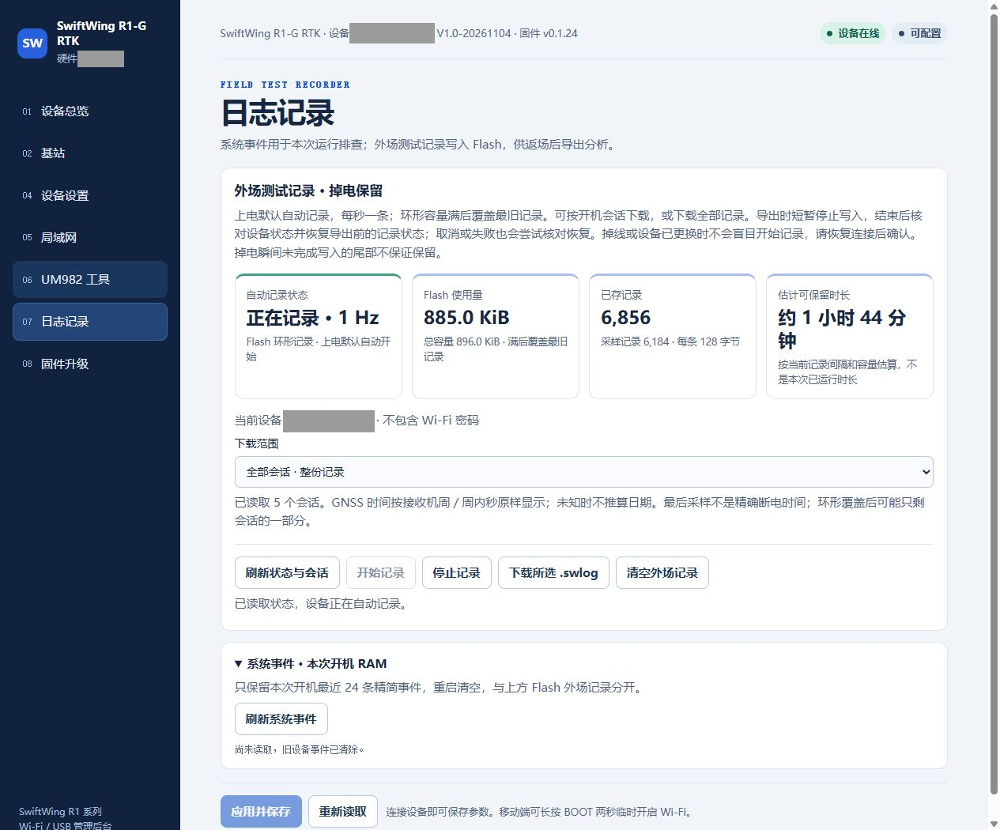
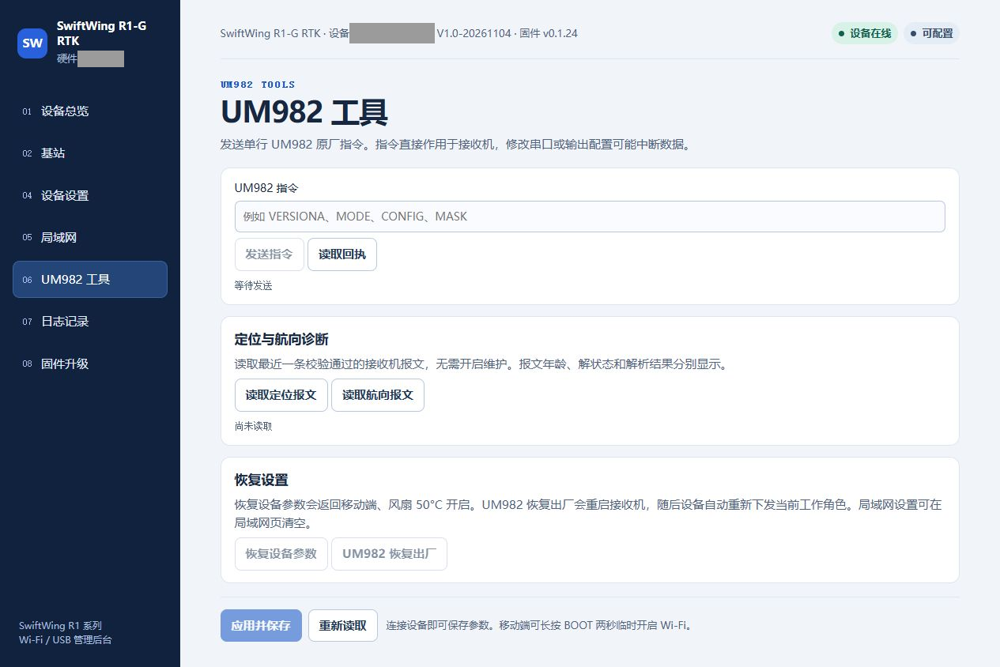
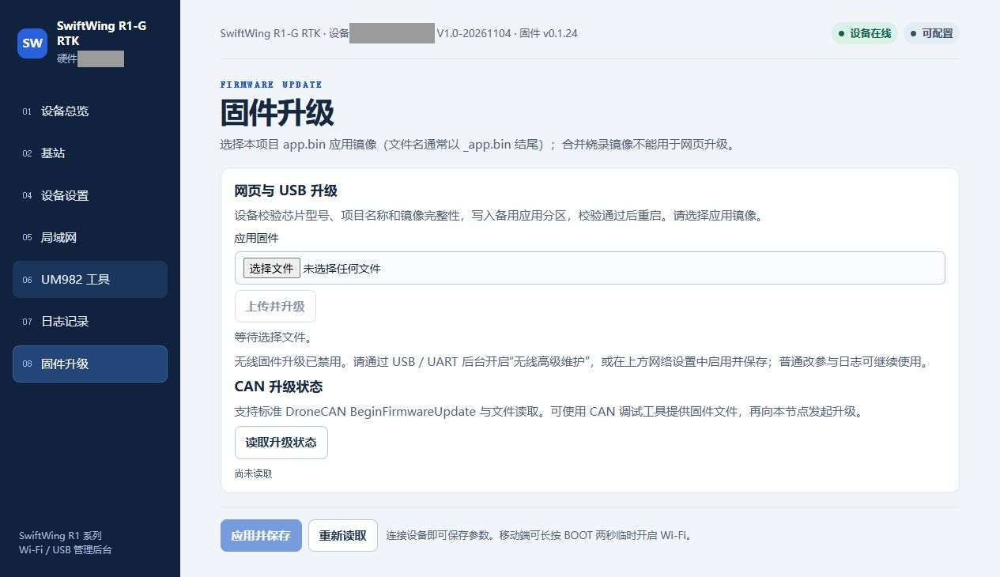

# 日志与常见问题

## 一、记录、导出、清空

每次启动默认自动以约 1 Hz 记录到设备 Flash，不需要连接电脑。打开本移动端[网页后台](差分与Wi-Fi后台.md#web-backend)，按以下顺序下载：

1. 点击 **日志记录 → 刷新状态与会话**，核对目标设备和记录状态。
2. **下载范围**选本次开机会话，或 **全部会话 · 整份记录**。
3. 点击 **下载所选 .swlog**，等待完成并保存文件。
4. 下载后再次刷新，确认需要继续使用时已显示“正在记录”且样本数增长；必要时点 **开始记录**。

上图为基站实机的相同日志功能示例，移动端按钮操作相同；实际下载时核对的是自己的移动端。此次截图只查看记录状态，没有执行下载或清空。

导出会临时停止写入并尝试恢复原状态，断连或失败后要重新确认。Flash 环形容量名义约 104 分钟，写满覆盖最早记录；GNSS 时间未知时不猜测会话日期。`.swlog`是设备记录，飞控日志另行保存。

**清空外场记录**前先导出备份，等擦除完成再点 **开始记录**。下方 **系统事件 → 刷新系统事件**只查看本次开机最近 24 条精简记录，重启清空，与 Flash 会话分开。

### 读取接收机定位报文

需要排查时进入 **UM982 工具 → 定位与航向诊断**，点击 **读取定位报文**。先看是否收到、报文年龄和解状态；此处读取已有数据，不用发接收机重配置命令。

上图为基站的相同工具入口，移动端按同名按钮操作。CRC 正确不等于解有效，还要看数据是否新鲜；有效航向的 QGC 实机截图见[RTK 航向确认](起飞前检查.md#rtk-heading)。

## 二、排查顺序

| 现象 | 先检查什么 |
| --- | --- |
| QGC 没有三脚架图标 | 单移动端可无基站图标；走应用设置→NTRIP/RTK，确认设备列表与 USB 身份 |
| 有卫星但没有定位 | 看接收机原始解与有效性、遮挡/供电/天线；卫星数量不是定位保证 |
| 有位置/RTK 却没有 yaw | 查 HDG_ENABLE、实际基线和容差、有效航向、AUTO 结果及飞控 yaw 启用/融合 |
| 朝向反 180° | 查 ANT1/ANT2 前后、偏角与是否双端补偿；不要先关罗盘 |
| 移动端收不到 RTCM | 查 QGC 实际接收、目标飞控、PX4 转发开关、CAN 来源锁定与帧龄 |
| 第三方基站不在 SwiftWing 设备列表 | 该列表用于本项目设备管理；第三方按[通用输入或 NTRIP](差分与Wi-Fi后台.md#third-party-base)接入，看有效 RTCM 而不是要求识别出 SwiftWing 身份 |
| 换基站后有字节但无有效 RTCM | 核对是否原始 RTCM3、实际串口 / 波特率 / TCP角色 / UDP端口；停止旧手动输入或 NTRIP，确认未混入不同来源 |
| CORS 已连接却无差分 / 不固定 | 核对服务账号、挂载点、所需 GGA、服务覆盖 / 坐标参考，以及移动端支持的报文；按[网络差分步骤](差分与Wi-Fi后台.md#ntrip-input)逐段查看 |
| APM 只到浮点 | 先看 UM982 本身解状态与 RTCM/卫星质量，不能只改飞控显示参数 |
| Wi-Fi 后台打不开 / 找不到热点 | 正常 CAN 交互时会关闭无线；有 LAN IP 时又可能只关闭热点。按[热点规则](差分与Wi-Fi后台.md#wireless-rules)区分，USB 启用持续维护或 BOOT 开临时窗口；保存过 SSID 不等于一直在线 |
| 参数改了没生效 | 核对所选设备、保存结果和实际读回；超时先读状态，不连续提交 |
| CAN 累计错误很大 | 分启动和稳定期看增量、bus-off 和收发；不把累计事件当丢帧百分比 |

本次样机有效航向基线约 0.59 m，与 55±10 cm 旧保存范围相容；新装机仍按实物设值。当前固件会拒绝超出长度范围、非固定或过期航向，不能为让页面显示数值而放宽所有有效性门限。

## 三、兼容范围和参考资料

### 固件升级与恢复

1. 先导出需要的日志，并记录移动端角色、基线、偏角、CAN 协议和网络。
2. 打开网页 **固件升级**，选择适配本硬件的 `_app.bin`应用镜像，点击 **上传并升级**；无线方式需先在局域网页开启并保存 **无线高级维护**。
3. 等设备重启后重新连接，核对新版本及上述参数，完成后关闭无线高级维护。

此图是基站的同一升级界面示例，截图时维护关闭，未实际升级。移动端应选择自己的设备再操作；完整合并烧录镜像不能当作应用镜像上传。

**恢复设备参数**会恢复 ESP32 通用参数；**UM982 恢复出厂**会恢复接收机并重新下发当前角色。两者含义不同，恢复后均需重新核对安装参数。普通打开后台、保存参数和网页升级不用进入 BOOT 下载模式。

### 兼容范围

- 经典 PX4 v1.17.0/对应接收实现是本项目明确适配路线；不是所有更新 main 或厂商分支的通用保证。APM profile2 接收路线已核对 Copter 4.6.3 等官方源码；4.8.0 现场开发版本的接收/地面记录不等于所有稳定版或飞行融合已验收。
- 本板没有外置磁罗盘；不照抄 CUAV RTK 2HP 外置磁源参数。GPS 杆臂、估计器选择等使用飞控标准参数；本设备 23 项配置不是完整飞控参数的替代。
- 本教程不要求恢复出厂、重刷飞控或改动既有磁罗盘策略。涉及其他版本时，先备份并按官方版本资料核对。

### 1. 官方参考

- [S1：PX4 v1.17.0 DroneCAN GNSS 接收源码](https://github.com/PX4/PX4-Autopilot/blob/v1.17.0/src/drivers/uavcan/sensors/gnss.cpp)
- [S2：PX4 v1.17 DroneCAN 配置说明](https://docs.px4.io/v1.17/en/dronecan/index)
- [S3：PX4 v1.17.0 GNSS/EKF 参数定义](https://github.com/PX4/PX4-Autopilot/blob/v1.17.0/src/modules/ekf2/params_gnss.yaml)
- [S4：PX4 v1.17 参数参考](https://docs.px4.io/v1.17/en/advanced_config/parameter_reference)
- [S5：ArduPilot GPS for Yaw 说明](https://ardupilot.org/copter/docs/common-gps-for-yaw.html)
- [S6：Copter 4.6.3 DroneCAN GPS 接收与配置源码](https://github.com/ArduPilot/ardupilot/blob/Copter-4.6.3/libraries/AP_GPS/AP_GPS_DroneCAN.cpp)
- [S7：ArduPilot EKF 源选择说明](https://ardupilot.org/copter/docs/common-ekf-sources.html)

本项目依据：当前固件 config.h、gnss.c、can_node.c；QGC B8 实际页面及发行校验；2026-11-12 APM/PX4 返场日志分析。第三方产品教程用于参考使用方式，不替代本板硬件与协议定义。
