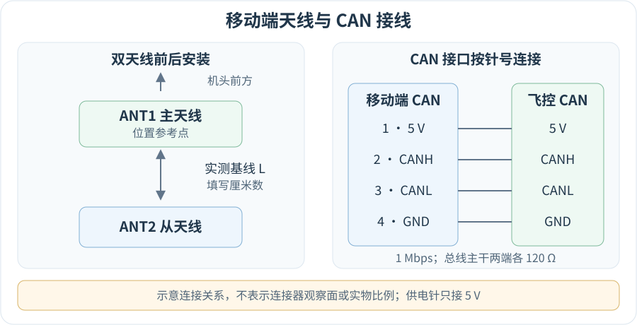
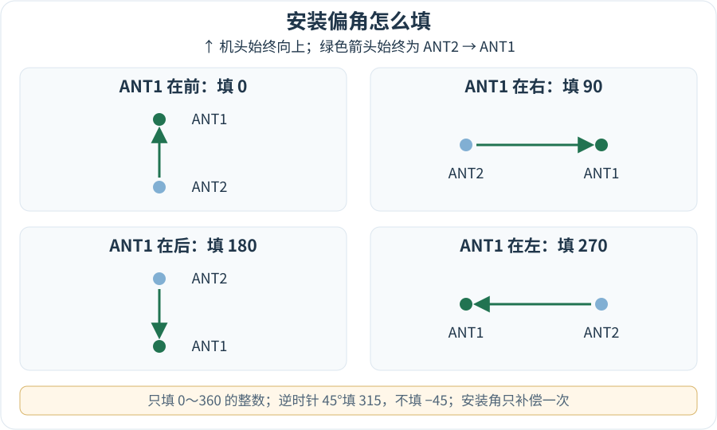

# 天线安装与天线基线

SwiftWing R1 RTK 使用 ANT1 解算位置，ANT1 / ANT2 双天线解算方向；日常通过 CAN 向飞控输出定位与航向，并接收飞控转发的 RTCM。

## 一、天线与摆放

1. 两根同型号、支持 UM982 所需频段的有源 GNSS 天线分别接 **ANT1 / ANT2**，先接天线才能上电。
2. 正常安装为 **ANT1 在前、ANT2 在后**；固定在刚性结构上，朝天并尽量等高。
3. 远离碳板遮挡、大电流线、发射天线和电机，测量两天线相位中心间距 **L**，记录厘米数。

注意

天线基线不能在使用中伸缩或交换前后位置。只需单天线定位时可仅接 ANT1，并关闭 HDG_ENABLE；双天线航向需要两根天线及正确基线。

## 二、基线、安装偏角与重心杆臂

| 配置内容 | 在哪里设置 | 单位 / 约定 |
| --- | --- | --- |
| 两天线间距 | RTK 的 HDG_LEN_CM | 厘米；按实物填写 |
| 双天线安装偏角 | RTK 的 GPS_YAW_OFFSET | 整数 0～360°，不填负值；正常前后安装为 0 |
| ANT1 相对重心位置 | 飞控 GPS 杆臂参数 | 米；前 / 右 / 下为正 |
| 飞控是否采用 GPS 航向 | 飞控估计器参数 | 按 PX4 / ArduPilot 版本配置 |

注意

双天线型号必须相同，否则偏航无法正常工作。

例如 ANT1 在重心前 30 cm、左 5 cm、上 10 cm，ANT2 在 ANT1 后 60 cm：

1. RTK 中填写 **HDG_LEN_CM=60、GPS_YAW_OFFSET=0**。
2. 飞控杆臂填写 **X=+0.30 m、Y=−0.05 m、Z=−0.10 m**，参数名见 [PX4](PX4飞控参数.md) / [ArduPilot](ArduPilot飞控参数.md)。
3. 保存后在地面整体转动机体与两天线，按[PX4 航向确认](PX4飞控参数.md#rtk-heading) / [ArduPilot 航向确认](ArduPilot飞控参数.md#rtk-heading)检查。

基线 60 cm 填 60，不填 0.60，也不填进飞控的 X 杆臂。UM982 解算方向后，板端会按安装偏角输出机头角；飞控不要重复补偿同一个安装角。

初装可采用约 50～60 cm 的固定基线，实际填写值仍以测量为准。本板没有外置磁罗盘，飞控罗盘按整机要求完成安装、校准和后备配置。

## 三、ANT1 朝向说明

**取值范围为 0～360 的整数，单位为度，默认 0。不接受负值和小数；360 与 0 等效，正前方安装建议填 0。**

从上方看机体，以**机头方向为 0°**，沿顺时针方向转到 **ANT2 指向 ANT1**的方向，转过的角度就是要填写的值。这里看的是两根天线形成的方向，不是飞机当时相对正北的航向。

| 天线实际安装 | ANT2 → ANT1 相对机头的方向 | GPS_YAW_OFFSET |
| --- | --- | --- |
| ANT1 在前、ANT2 在后 | 向前 | `0` |
| ANT1 在右、ANT2 在左 | 向右，顺时针 90° | `90` |
| ANT1 在后、ANT2 在前 | 向后，顺时针 180° | `180` |
| ANT1 在左、ANT2 在右 | 向左，顺时针 270° | `270`，不填 −90 |
| ANT2 → ANT1 指向右前方 45° | 顺时针 45° | `45` |
| ANT2 → ANT1 指向左前方 45° | 逆时针 45°，换算为顺时针 315° | `315`，不填 −45 |

顺时针安装角直接填写；如果测得的是逆时针 A°，就填写 360−A。例如逆时针 30°填写 330，逆时针 90°填写 270。

### 修改与检查

1. 在 QGC 的 **SwiftWing RTK 设备参数**或移动端网页中，按实际安装填写 **GPS_YAW_OFFSET**；两天线间距仍单独填写 **HDG_LEN_CM**。
2. 点击 **应用并保存**，再 **重新读取**确认；此处修改的是移动端，不是飞控的同名 / 类似参数。
3. 等双天线输出有效航向后，按[PX4 航向确认](PX4飞控参数.md#rtk-heading) / [ArduPilot 航向确认](ArduPilot飞控参数.md#rtk-heading)对照实际机头，并在无桨地面整体转动机体与两天线检查。

注意

本参数已在移动端将双天线方向换算为机头方向，飞控不要再补偿同一个安装角。改变天线位置或交换 ANT1 / ANT2 接线后，应重新核对偏角与基线；ANT1 仍是定位参考点，重心杆臂也需按 ANT1 的实际位置填写。

