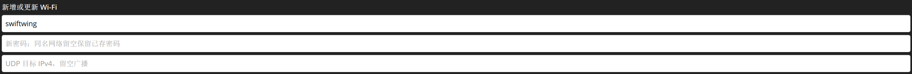
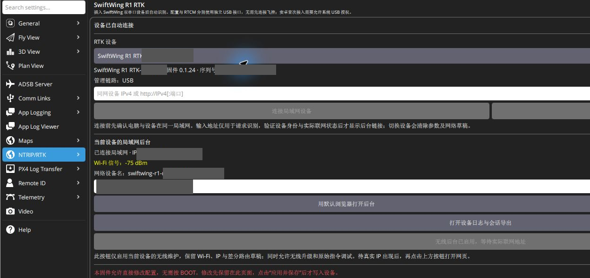
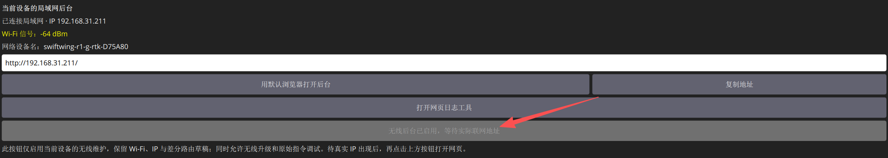
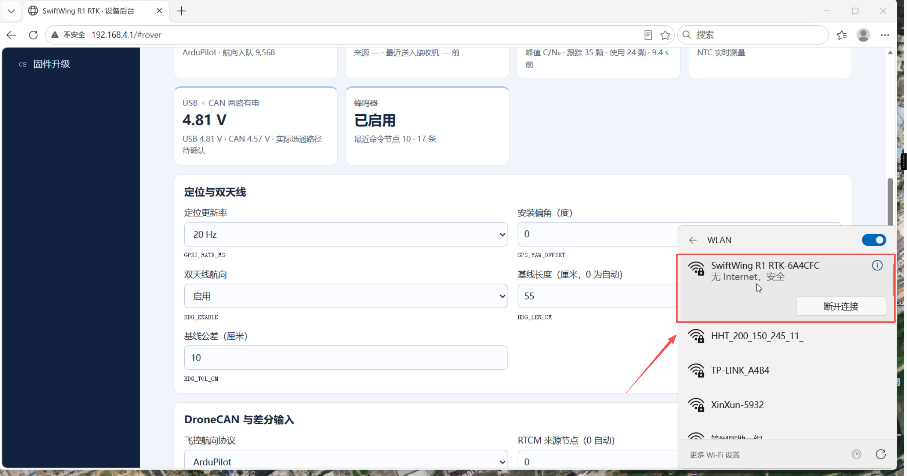
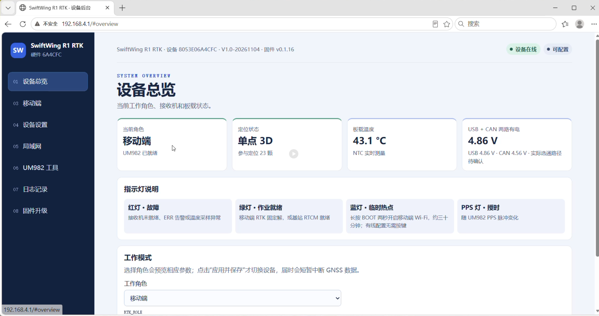
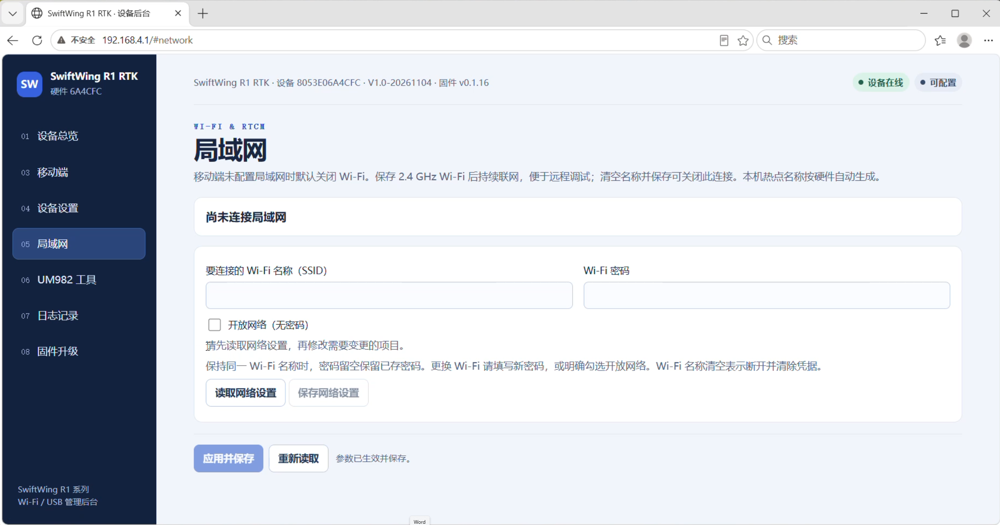
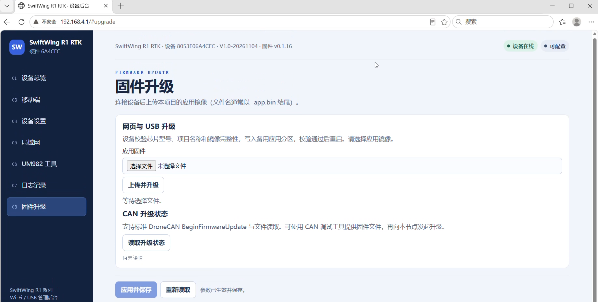
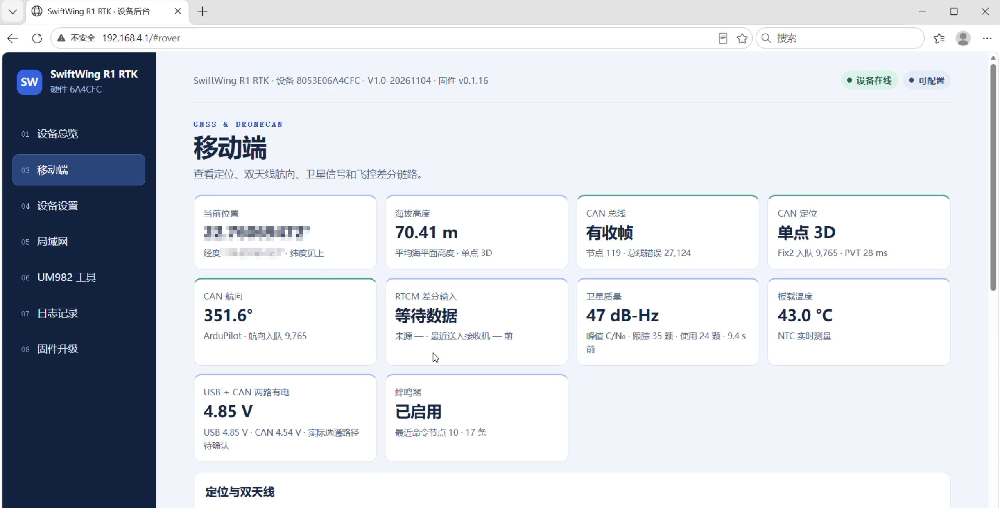
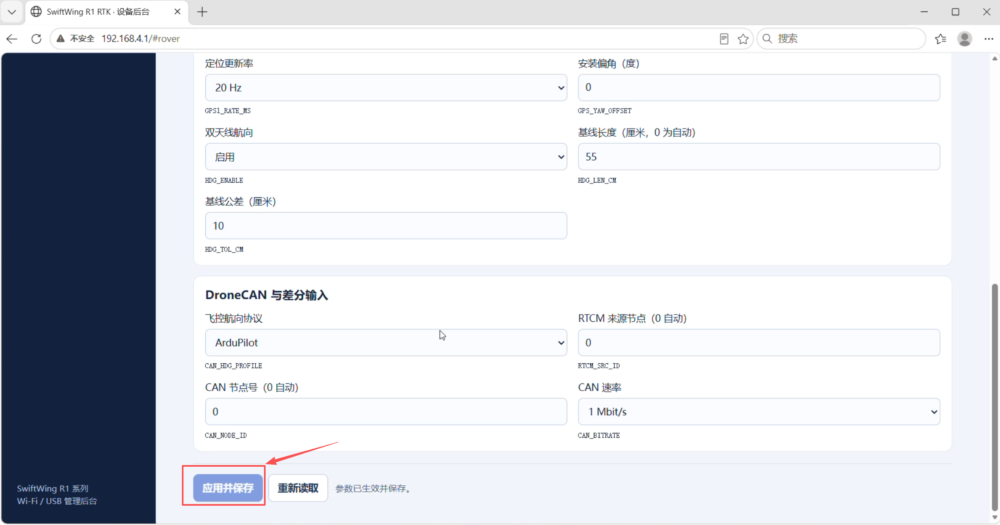

# 设备后台参数修改

注意

需要在地面调试阶段修改参数，不要再使用过程中修改。

本文按“打开网页 → 查看移动端状态 → 修改并保存参数”的顺序操作。网页后台已内置在移动端固件中，可通过设备热点或外部局域网管理。

## 从 QGC 打开网页后台

1. 用**移动端自己的 USB 调试口**连接电脑，在 QGC **应用设置 → NTRIP/RTK**选择移动端并核对身份。

2. 需要通过路由器访问时，填写外部 2.4 GHz Wi-Fi 名称与密码，点击 **保存局域网设置**。

3. 点击 **启用无线后台**，等待实际 LAN IP 出现，再点击 **用默认浏览器打开后台**。

正常 CAN 交互时移动端通常关闭无线。QGC“启用无线后台”会保存开启“无线高级维护”，完成查看后需关闭并保存，恢复自动策略。

飞控 USB 遥测不能代替移动端自身的 USB 管理。只有设备热点、尚无 LAN IP 时，QGC 打开按钮可能仍为灰色；按下节连接热点后手动访问。

## 未配置局域网时，通过设备热点打开

### 1. 移动端上电并开启临时窗口

在QGC中点击**启用无线后台**，等待移动端热点出现。

### 2. 连接移动端热点

在电脑 / 手机 Wi-Fi 列表连接 **SwiftWing R1 RTK-XXXXXX**，默认密码 **12345678**。末六位短码用于区分设备，先核对是本移动端。

### 3. 访问后台地址

浏览器打开 [http://192.168.4.1/](http://192.168.4.1/)，核对顶部产品名、设备身份和“设备在线”。

热点无互联网不影响本机后台。若已有实际 LAN IP，也可以在同一局域网直接打开；不要沿用其他设备的旧地址。

### 4. 连接外部局域网（可选）

1. 进入 **局域网 → 读取网络设置**，填写外部 2.4 GHz Wi-Fi 名称、密码，点击 **保存并连接**。
2. 等显示已连接及实际 IP 后，将电脑 / 手机接入同一外部网络，使用该 LAN 地址打开后台。
3. 完成维护后，按需要关闭“无线高级维护”并保存。

192.168.4.1 只用于设备自身热点。取得外部 LAN IP 后，普通模式可能关闭热点；正常 CAN 交互时还可能关闭整个无线。保存过 Wi-Fi 不等于后台始终在线。

同名网络密码留空会保留；新网络需输入密码或明确选择开放网络。最多保存 5 组，清空当前 SSID 只断开，删除凭据使用“删除此网络”。首次优先 DHCP，静态地址需符合所在网段并避免冲突。

## 一、网页后台菜单

- **设备总览**：设备身份、固件版本、工作角色与状态。
- **移动端**：定位、双天线、CAN 协议和 RTCM 差分输入。
- **设备设置**：供电读数、板温、提示音和原始诊断数据。
- **局域网**：外部 Wi-Fi、已存网络及无线高级维护。
- **UM982 工具**：读取接收机报文、原始指令和恢复入口。
- **日志记录**：系统事件及 Flash 会话日志。
- **固件升级**：应用镜像上传及升级状态。

工作模式下拉框是待保存配置，点击“应用并保存”后才会切换实际角色。普通查看状态、改常规参数、下载日志和只读诊断，不额外要求无线高级维护权限；无线升级与原始 UM982 指令需要该权限。

## 二、查看移动端状态

点击左侧 **移动端**，按下表查看数据。

| 卡片 | 主要看什么 |
| --- | --- |
| 卫星质量 | 跟踪数量、使用数量、信号和更新时间；使用数量为参与定位的数量 |
| CAN 总线 / CAN 定位 | 节点在线、有近期收帧，Fix2 入队量持续增加 |
| RTCM 差分输入 | 数据正常、来源节点、最近送入接收机时间持续刷新 |
| 飞控识别 | 已识别的飞控与 AUTO 的有效协议 |
| CAN 航向 | 双天线输出状态；继续按[PX4 航向确认](PX4飞控参数.md#rtk-heading) / [ArduPilot 航向确认](ArduPilot飞控参数.md#rtk-heading)对照飞控方向 |

需要差分帧明细时展开“设备设置 → 原始诊断数据”，查看 rtcm_frames 与 rtcm_age_ms。网页“数据正常”的 5 秒门限用于提示新鲜度，不是定位精度指标。

## 三、修改并保存参数

* 修改了重要参数后电机应用并保存

