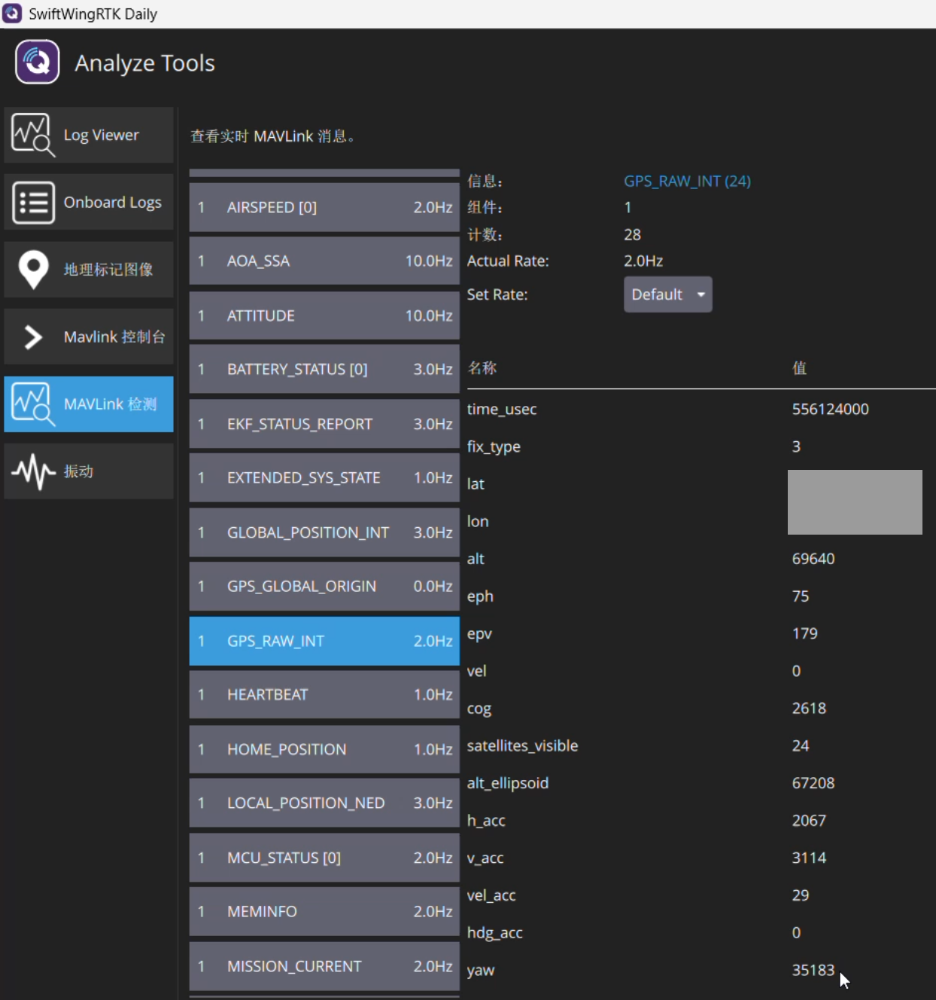
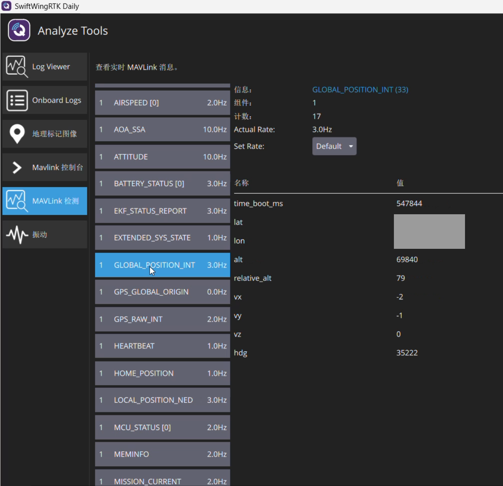

# 起飞前检查

配置完成后，在室外开阔位置按本页检查。卫星、差分和后台的具体操作见本产品的[差分与 Wi-Fi 后台](差分与Wi-Fi后台.md)。

## 一、机械与安装

1. ANT1 在前、ANT2 在后；两根同型号天线固定，无松动、交换接口或线缆拉扯，实际基线与保存值相符。
2. RTK 偏角 0 与正常前后安装一致；飞控杆臂按重心到 ANT1 实测填写，前/右/下为正。不要在两端重复补偿航向或位置。
3. CAN 线序、供电、终端正确。稳定工作时节点在线，没有 bus-off、频繁重连或错误计数持续快速增加。

## 二、位置与差分

4. 选择并核实正确的 RTK、基站和目标飞控。确认基站没有在测量/输出后被移动。
5. 差分链路逐段正常：QGC 有效 RTCM 帧 → 飞控 → 移动端 RTCM 帧增长/龄新鲜 → 接收机位置解。需要厘米级作业时，等待目标 GPS 位置显示 RTK Fixed，并确认差分仍新鲜。
6. 不用卫星数量单独作起飞判据。同时看有效解、DOP/精度估计、差分龄、连续性；NO_FIX、单点、DGPS、浮点和固定解要分清。飞控无解时显示 0 颗也可能涉及该版本消费端的显示规则。

## 三、RTK 航向确认

### 1. 查看 RTK 航向

打开 QGC **Analyze → MAVLink 检测 → GPS_RAW_INT**，查看 `yaw`。原始数值除以 100 得到角度；下图 **35183 = 351.83°**。等待有效读数后，对照实际机头方向，确认安装偏角设置正确。

本图报告 24 颗卫星，位置 `fix_type=3`为 3D 单点；位置解状态与双天线航向分别查看。现场经纬度已遮盖，航向读数保持原样。

### 2. 对比飞控航向

在同一界面选择 **GLOBAL_POSITION_INT**，查看 `hdg`，同样除以 100 得到角度；下图 **35222 = 352.22°**。与上一步 `yaw`比较，两者应接近。

这两张截图中的读数相差约 **0.39°**，可用于说明对比方法。截图取自不同时刻，不能当作同步精度测量。无桨地面缓慢转动机体与双天线，再回正，观察两个角度是否同向变化。

两者接近用于直观核对 RTK 航向与飞控方向一致，单独的数值接近不作为航向来源证明。GPS 的 `cog`是运动方向，不用于本项检查。

`yaw=0`或 `65535`时没有可用航向，`yaw=36000`表示正北；`hdg=65535`表示未知。字段单位见 [MAVLink GPS_RAW_INT](https://mavlink.io/en/messages/common.html#GPS_RAW_INT)及 [GLOBAL_POSITION_INT](https://mavlink.io/en/messages/common.html#GLOBAL_POSITION_INT)。

## 四、完成飞控常规检查

确认保留并完成所用罗盘校准、飞控预检。首次安装或更改基线后，记录本次天线安装、基线和飞控版本；发现持续跳变、180° 反向或失锁时，先核对天线前后与安装偏角。
